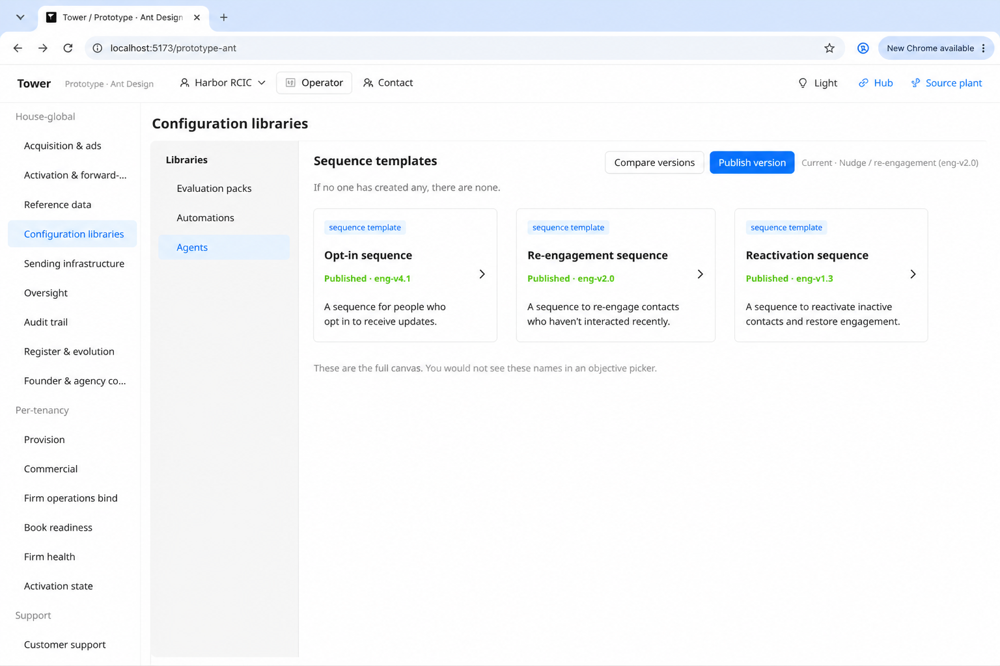
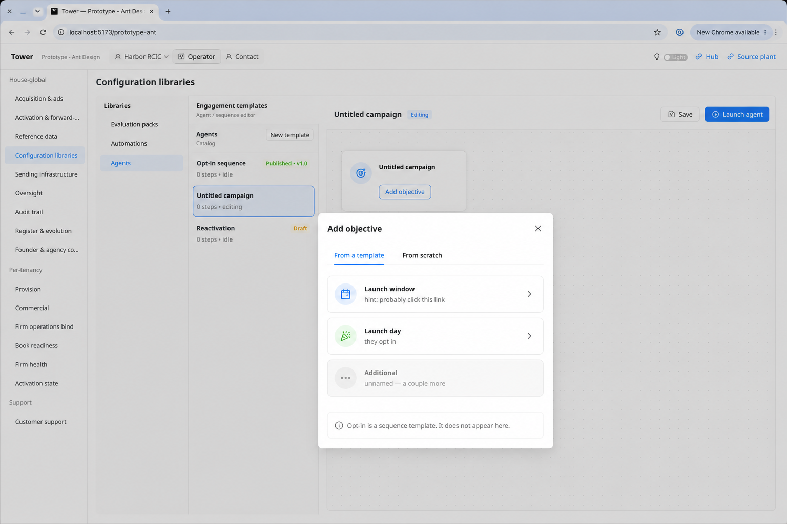
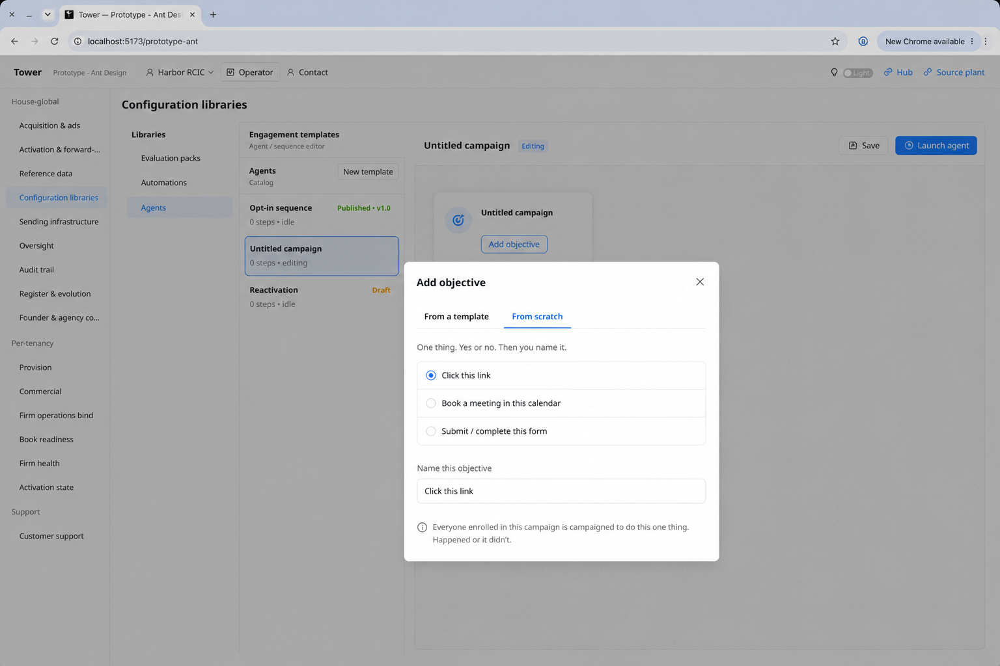
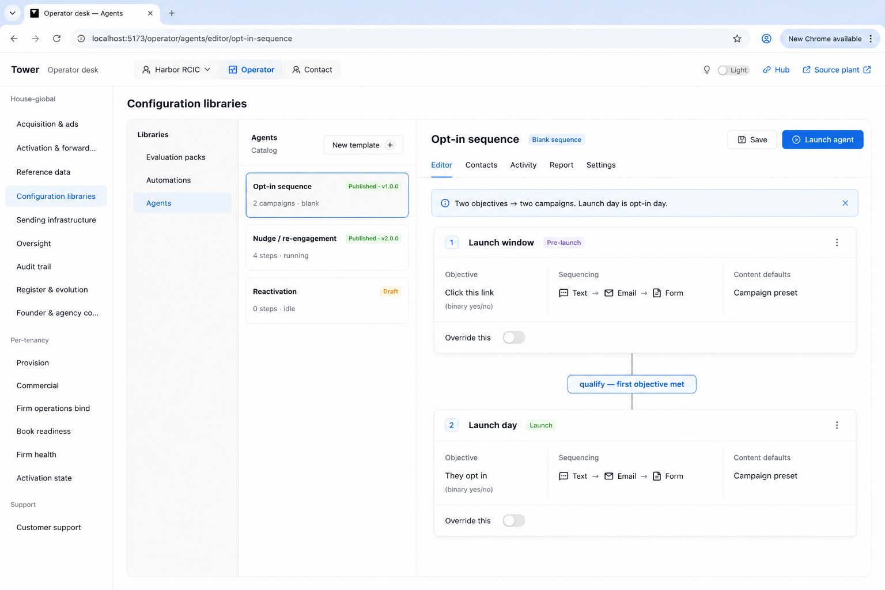
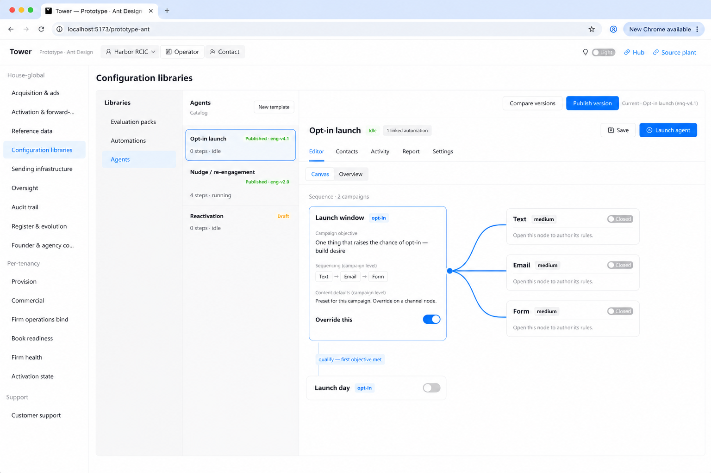
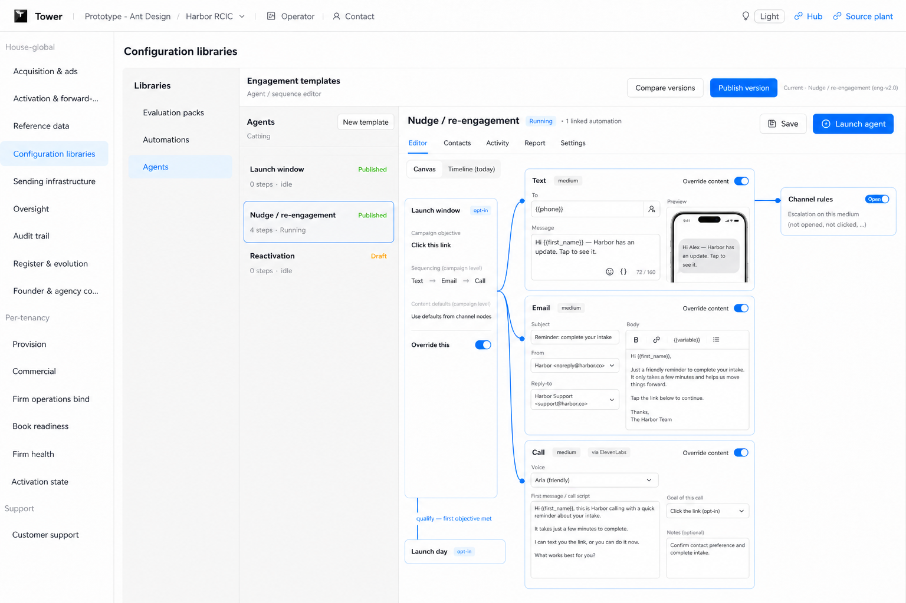
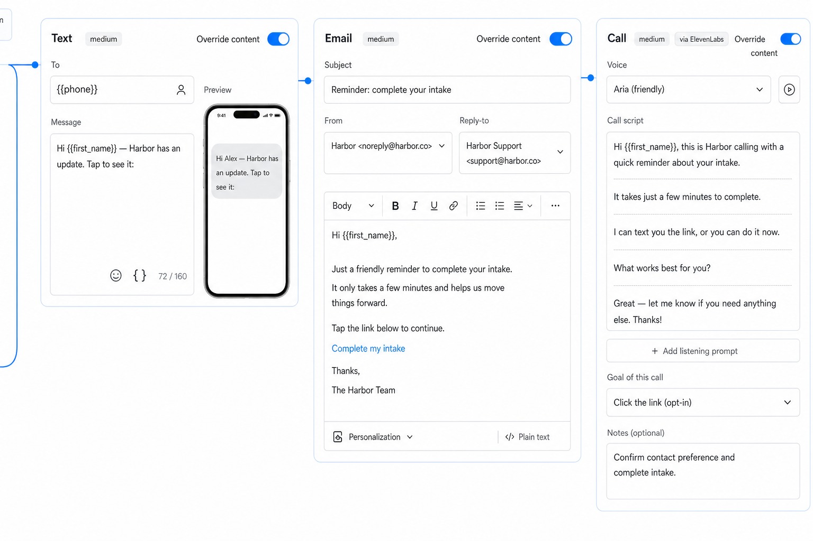
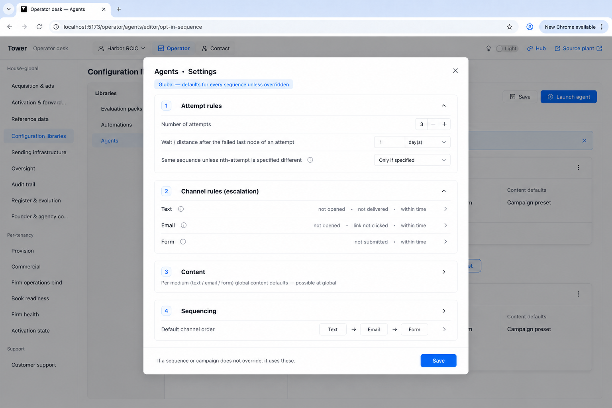
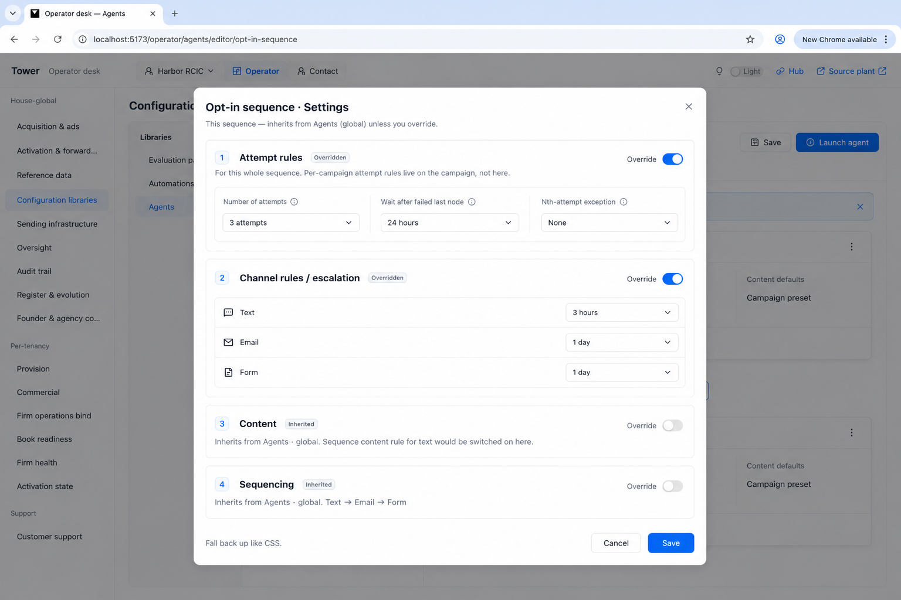
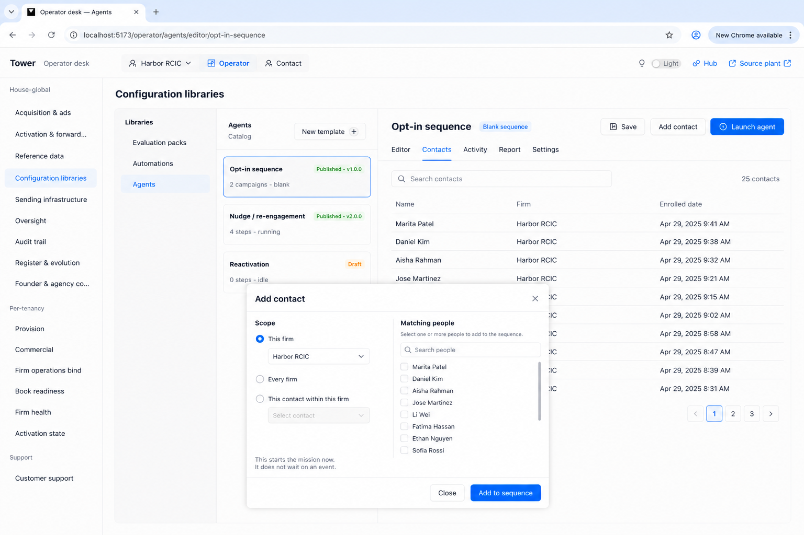

# Agents — UI blueprint (canon images)

**Seat:** Product Manager.  
**What this is:** the **UI blueprint** for Agents, before Systems Analyst extract. Not a systems blueprint. Do not invent tables from this file.  
**Flag:** [`PHASE-TWO-LOG.md`](./PHASE-TWO-LOG.md) **15:43 UTC** — do not overwrite.  
**Law and excerpts:** [`AGENTS-FACE.md`](./AGENTS-FACE.md). This file is the **image lineup + spec**. Rationale lives in the log stamps named on each plate. **Captions vs spec:** [`IMAGE-CAPTION-AUDIT.md`](./IMAGE-CAPTION-AUDIT.md) — teaching copy on the plates is not a node.  
**Plate chrome:** [`PLATE-CHROME-RULE.md`](./PLATE-CHROME-RULE.md) — screenshot the live `/prototype-ant` desk first; do not invent a different left nav.  
**Implementer copy-filter:** [`IMPLEMENTER-FACE-PASS.md`](./IMPLEMENTER-FACE-PASS.md) — each new plate has one purpose; ignore the rest of the PNG. Plates are one grain on one example; **extrapolate** (variation and channel-rules parameters on every channel). Images keep the desk congruent. The written spec is the product.  
**Founder (2026-08-15 19:47):** Settings images are canonical. This pass = lineup of canon vs revision, map each plate to the rationale that birthed it, then spec the plates. Click paths / what is on the glass. If anything is under-specified, that is the point of this pass.

Chrome for every plate unless noted: Operator desk → Configuration libraries → Agents.

---

## Canon lineup (read in this order)

These ten files are **canon**. Later plates revise earlier ones only where the table says so. Do not treat discarded files as face.

| # | File | What it is | Born from (log) | Revises |
|---|------|------------|-----------------|---------|
| **C1** | [`C1-sequence-templates.png`](./agents-blueprint/C1-sequence-templates.png) | Sequence templates. Empty world possible. Opt-in / re-engagement / reactivation are **sequence** templates, not objectives. | 18:40 two template layers · 18:50 beat 1 · 18:55 mock = image | — |
| **C2** | [`C2-add-objective-template.png`](./agents-blueprint/C2-add-objective-template.png) | First thing on a campaign: **Add objective**. Modal, from a template. Example names: Launch window / launch day / additional. Opt-in is not in this list. | 18:40 Hub Add-configuration analogy · 18:50 beat 2 | — |
| **C2b** | [`C2b-add-objective-scratch.png`](./agents-blueprint/C2b-add-objective-scratch.png) | Same modal, **from scratch**. One yes/no, then name it. | 18:40 binary event · 18:50 beat 2 | companion to C2 |
| **C3** | [`C3-two-campaigns.png`](./agents-blueprint/C3-two-campaigns.png) | Blank sequence with two campaigns (example names). Distance = previous **objective met** (caption, not a qualify node). Override this **off**. | 18:08 two objectives · 18:50 beat 3 | — |
| **C4** | [`C4-override-this.png`](./agents-blueprint/C4-override-this.png) | Override this **on**. Channel nodes hang as wires. Campaign toggles stay. Channels **closed**. | 18:08 Override this · 18:50 beat 4 | — |
| **C5** | [`C5-content-toggle.png`](./agents-blueprint/C5-content-toggle.png) | Channel open. **Override content is a toggle**; node expands into that medium’s content-creation block. Text, email, **call (ElevenLabs)**. Channel rules still a wire off the channel. | 19:10 content inside the node · 19:45 toggle + richness + call | **C5 supersedes** open-channel siblings and the content-as-button frame |
| **C5b** | [`C5b-content-toggle-closeup.png`](./agents-blueprint/C5b-content-toggle-closeup.png) | Same as C5, close-up of the three expanded composers. | 19:45 richness | companion to C5 |
| **C6** | [`C6-agents-settings-global.png`](./agents-blueprint/C6-agents-settings-global.png) | **Agents Settings** = global defaults. Founder: locked, perfect. | 19:30 two Settings surfaces | — |
| **C7** | [`C7-sequence-settings.png`](./agents-blueprint/C7-sequence-settings.png) | **Sequence Settings** = this sequence; inherit unless override. Founder: locked, perfect. | 19:30 | — |
| **C8** | [`C8-sequence-contacts-enroll.png`](./agents-blueprint/C8-sequence-contacts-enroll.png) | This sequence → **Contacts**. Displays enrolled. **Add contact** in the header. Scope: **Every firm** (default) or **Select from** (all selected; deselect to pick one). Starts the mission now. | 00:02 · 01:01 scope | — |
| **C0** | [`C0-agents-global-settings-entry.png`](./agents-blueprint/C0-agents-global-settings-entry.png) | **Copy only:** Agents settings gear next to New template (global). Ignore the rest of the PNG. | 16:10 · 16:34 | — |
| **C9** | [`C9-campaign-local-attempt-add-channel.png`](./agents-blueprint/C9-campaign-local-attempt-add-channel.png) | **Copy only:** Override this on → **Attempt count** + **Distance between attempts** on the campaign. Ignore the rest of the PNG. | 16:10 · 16:34 | — |
| **C11** | [`C11-channel-attempt-variation.png`](./agents-blueprint/C11-channel-attempt-variation.png) | **+ Add variation** at the top of the channel. Each variation then selects how it applies in the attempt cycle. Not three radios. **On every channel** (plate is Text). Channel-rules extra node: keep the seat; fill **actual parameters** — [`IMPLEMENTER-FACE-PASS.md`](./IMPLEMENTER-FACE-PASS.md). | 16:34 · 16:41 | — |
| **C13** | [`C13-sequence-activity.png`](./agents-blueprint/C13-sequence-activity.png) | **Activity** table: Time · Name · Firm · Channel · What happened. Contacts uses the same table chrome (Name · Firm · Enrolled date) — no extra PNG. | 16:10 · 16:34 | — |

### Discarded (do not spec, do not hand to SA as face)

| File (artifacts only) | Why dead |
|-----------------------|----------|
| `agents-mock-5-open-channel.png` | Content, attempt rules, and channel rules all hung off the channel as siblings. Placement was wrong. |
| `agents-mock-5b-content-inside-channel.png` | Content was a **button**; founder: it is a **toggle** that expands the node. Third medium still Form. |
| `agents-mock-6-attempt-cycles.png` | Attempt rules sat in the **middle of the sequence canvas**. Founder: per-campaign on the campaign; per-sequence in Sequence Settings. Discarded on request. |

In-app Editor → Mock / Timeline plant is **not** this blueprint. Mock = generated image.

### Known stale pixels (do not silently “fix” in systems)

- **C4** still shows Form as the third closed medium and Text → Email → Form on the campaign. **C5** is the call revision (Text → Email → Call, ElevenLabs). C4 remains canon for *closed* channel nodes after Override this.
- **C3** still says Form in sequencing. Same: C5 is the later medium set for content.
- **C6** channel-rules rows still mention Form. Call is on the face in C5; machine still has form until SA/Story. Do not mint a call table from C5.
- **C3, C4, and C5** still show connector copy **“qualify — first objective met.”** Caption, not a node. C5b does not have it.
- Generated chrome sometimes mislabels the selected agent (Nudge vs Launch window). Ignore catalog-selection drift. Trust the **canvas / modal contents**.

---

## Click paths (operator)

Not a test script. The path that produces each plate.

| Path | Lands on |
|------|----------|
| Operator → Configuration libraries → Agents | Catalog of **sequence templates** (C1). Empty if none authored. |
| New template *or* open a sequence (e.g. Opt-in) | Blank **sequence** canvas. |
| Add campaign | Untitled campaign node. First control: **Add objective** (same *seat* as Hub Automations “Add configuration”). |
| Add objective | Modal (C2 / C2b). Template **or** from scratch. Not Automations triggers. |
| Template: example names Launch window / Launch day | Campaign named and objectived. Opt-in is **not** a choice here. Names are renamable. |
| From scratch: pick the one yes/no → name it | Campaign objectived from a binary event. |
| String a second campaign when the previous objective is met | Distance on C3. Caption, not a qualify node. Tick allowed. |
| Campaign: Override this **on** | Channel nodes appear as **wires** (C4). Sequencing / objective stay on the campaign. |
| Channel: Open (channel rules) | **Channel rules** (escalation) hang off that channel. |
| Channel: Override content **on** | That channel **expands** into its composer (C5 / C5b). |
| Agents module → Settings | **C6** global. |
| This sequence → Settings | **C7** this sequence. Inherit from C6 unless Override is on. |
| This sequence → **Contacts** | Enrolled list (C8). Empty until someone is on it. |
| This sequence header → **Add contact** | Always in the top row with Save / Launch. Opens the modal. **Every firm** (default, top) or **Select from** (bottom; everyone selected; deselect to pick one). Add to sequence. Starts the mission now. |

Fallback if a control is not overridden: campaign → sequence Settings → Agents Settings (CSS).

---

## Spec per plate

### C1 — Sequence templates

**Rationale:** If no one has created templates, there are none. Opt-in, re-engagement, reactivation are **sequence** templates (the full canvas). You would not see those names in an objective picker.

**On the glass:**
- Heading: Sequence templates. Teaching line on the plate (founder caption, need not ship as copy): “If no one has created any, there are none.”
- Three cards: Opt-in sequence · Re-engagement sequence · Reactivation sequence — **example names**. Tag: sequence template.
- Footer on the plate is founder caption: “These are the full canvas. You would not see these names in an objective picker.” Law is real; the sentence need not live on the glass.

**Controls:** open a sequence (goes to canvas) · New template. Empty-world is the same page with zero cards.

**Not in this plate:** objectives, campaigns, channels, Settings.

---

### C2 — Add objective (from a template)

**Rationale:** First thing on a campaign is the objective. Hub Automations: trigger node → Add configuration. Same *seat*, not the same module.

**On the glass:**
- Behind: untitled campaign with **Add objective**.
- Modal title: Add objective. Tabs: From a template (this plate) | From scratch (C2b).
- Template list (example names, operator can rename): **Launch window** (parenthetical “probably click this link”) · **Launch day** (“they opt in” — a **title at best**, not an objective class) · **Additional** (disabled, unnamed).
- Note on the plate is founder caption: “Opt-in is a sequence template. It does not appear here.”

**Controls:** pick a template · Set objective · cancel.

**Not in this plate:** channel graph, Settings, Automations trigger picker.

---

### C2b — Add objective (from scratch)

**Rationale:** Untemplated objective is binary. Everyone enrolled is campaigned to do **one thing**. Yes or no. Then you name it.

**On the glass:**
- Same modal, tab **From scratch**.
- Teaching line on the plate (founder caption): “One thing. Yes or no. Then you name it.” Law is real; the sentence need not ship as copy.
- Radios: Click this link · Book a meeting in this calendar · Submit / complete this form.
- Name field (example: “Click this link”).
- Note on the plate is founder caption: “Everyone enrolled in this campaign is campaigned to do this one thing. Happened or it didn’t.”

**Controls:** pick the event · name it · Set objective.

**Not in this plate:** webhook / table lookup (named later, not drawn). Word “event” may change.

---

### C3 — Two campaigns, Override this off

**Rationale:** Two objectives → two campaigns **in this example**. Launch window / Launch day are **names**. Distance between them = previous **objective met** (caption, not a qualify node). See [`IMAGE-CAPTION-AUDIT.md`](./IMAGE-CAPTION-AUDIT.md).

**On the glass:**
- Sequence chrome: two campaigns (example names).
- Each campaign: an **objective**, sequencing, Override this **off**.
- Wire between them: founder caption **“qualify — first objective met”** — **not spec**. Do not mint. A tick is allowed chrome.

**Controls:** Override this on a campaign (goes to C4) · Add campaign · Add objective on an unconfigured campaign.

**Not in this plate:** channel nodes (not revealed until Override this) · attempt-cycles strip (discarded).

---

### C4 — Override this on, channels closed

**Rationale:** One first toggle on the campaign: Override this. Reveals channel nodes as **wires**. Campaign-level toggles **stay on the campaign**.

**On the glass:**
- Launch window: Override this **on**. Sequencing and objective still on that card.
- Wires to **Text / Email / Form** *(Form stale vs C5 Call)*, each **closed**. Copy: open this node to author its rules; campaign toggles stay.
- Next campaign (example name Launch day) still closed.
- Connector copy **is on this PNG:** **“qualify — first objective met.”** Founder caption, same as C3. Not spec.

**Controls:** Override this off (returns to C3) · Open a channel (channel rules) · Override content (C5).

**Not in this plate:** composers · attempt rules on the channel · Settings.

---

### C5 / C5b — Override content toggle; text, email, call

**Rationale:** Content is not a wired sibling. Not a small button. **Toggle** inside the channel; on → the node **expands** to that medium’s content-creation block. Founder asked to **see text, email, and call** overridden. Call **via ElevenLabs**. Channel rules (escalation) remain the wired deeper grain. Attempt rules are **not** here.

**On the glass (C5 — full canvas, not the C5b crop):**
- Two campaign cards still present (example names Launch window / Launch day). **Override this** on.
- Connector copy **is on this PNG too:** **“qualify — first objective met.”** Same founder caption as C3/C4. Not a node.
- **Override content** toggle **on** (blue). Node is tall because it now contains the composer.
- **Text:** To `{{phone}}` · SMS body · 160 count · variable / emoji · device preview.
- **Email:** Subject · From · Reply-to · body with formatting · personalization. Grain of the real Timeline email card, on the canvas node.
- **Call:** badge **via ElevenLabs** · voice picker · call script · goal of this call. Richness in the image is **illustrative** of a call-authoring block, not a frozen ElevenLabs field list.
- **Channel rules** card still a wire: escalation on this medium (not opened, not clicked, …). Teaching ellipsis, not a catalog.

**On the glass (C5b — composers only):** no campaign cards, no qualify pill. Harbor / Alex / intake copy is **example content**.

**Controls:** Override content off → composer collapses, node shrinks · Open channel rules · campaign Override this still on.

**Not in this plate:** attempt rules · Form (this plate uses Call) · Settings.

---

### C6 — Agents Settings (global) — locked

**Rationale:** Global rules live in the **Agents module** Settings. If a sequence or campaign does not override, it uses these. Founder: perfect; do not regenerate.

**On the glass:**
- Title: Agents · Settings. Grain: **Global**.
- **1. Attempt rules:** number of attempts · wait / distance after the failed last node · same sequence unless nth-attempt is specified different.
- **2. Channel rules (escalation):** Text (not opened · not delivered · within time) · Email (not opened · link not clicked · within time) · Form (not submitted · within time).
- **3. Content:** per-medium global content defaults — possible at global.
- **4. Sequencing:** default order Text → Email → Form.
- Footer: “If a sequence or campaign does not override, it uses these.” Save.

**Controls:** edit any family · Save. No inherit row (this *is* the top of the cascade).

---

### C7 — Sequence Settings — locked

**Rationale:** Sequence-grain rules live in **this sequence’s** Settings, not in the middle of the canvas. Inherit from Agents unless Override. Per-campaign attempt rules live **on the campaign**, not in this modal. Founder: perfect; do not regenerate.

**On the glass:**
- Title: Opt-in sequence · Settings. Grain: this sequence.
- Each family has **Override**. Off = Inherited from Agents · global.
- Attempt rules Override **on:** number of attempts · wait after failed last node · nth-attempt exception. Caption: “For this whole sequence. Per-campaign attempt rules live on the campaign, not here.”
- Channel rules Override **on:** per medium.
- Content Override **off:** inherits.
- Sequencing Override **off:** inherits Text → Email → Form.
- Footer: “Fall back up like CSS.” Cancel · Save.

**Controls:** flip Override per family · Save.

---

### C8 — Contacts on this sequence; Add contact

**Rationale (00:02):** Drawing the sequence is not putting people on it. The **self path from Agents** is this sequence’s **Contacts** model — it **displays who is enrolled** — plus **Add a contact**. **Not Publish.** Automations enroll is the other door (on an event). Agents enroll **starts the mission now**. Apollo was inspiration, not a clone. Ant already has a Contacts tab with empty copy and no Add button — this plate is the face; do not plant the editor.

**On the glass:**
- Same Operator-desk chrome as C3 / C6 / C7 (00:51 rebuild). Do not invent surrounding.
- Sequence: Opt-in. Header row: Save · **Add contact** · Launch agent. Add contact is **always in that top portion**, not inside the Contacts tab.
- Tabs: Editor · **Contacts** (on) · Activity · Report · Settings.
- Enrolled list in the workspace (names, firm, enrolled date).
- **Add contact** (header) opens a modal.
- Scope radios, two only: **Every firm** (top, selected by default) · **Select from** (bottom). Select from opens the list with **everyone already selected**; deselect to pick a specific contact. That is the old “this contact” option. No third radio.
- Caption: “This starts the mission now. It does not wait on an event.”

**Controls:** Every firm, or Select from then deselect/pick · Add to sequence.

**Not this plate:** Publish-to-enroll. The engagement chart. Automations assign (A14). A third scope radio. A full filter catalog.

---

## What is specified but not on a canon plate

This is the under-documented remainder **before** systems. Not for SA to invent UI.

| Said | Not drawn |
|------|-----------|
| Attempt rules **per campaign** live **on the campaign** | No campaign card in C3–C5 actually shows an Attempt-rules block. C7 only *says* they live on the campaign. |
| Attempt copy = **variation** on the same channel node at attempt N | No “attempt 2 variation” control on C5 composers. |
| Additional opt-in objectives besides launch window / launch day | C2 Additional is disabled / unnamed. |
| Word for the untemplated objective (“event”?) | C2b uses event-shaped radios; name not locked. |
| Mix objective types in one sequence | Not drawn. |
| Campaign-level Settings modal | Not placed. Campaign has Override this + sequencing on the node. |
| Call vs Form on the **machine** | Face C5 shows Call (ElevenLabs). C4/C6/C7 still show Form. SA does not mint call from the picture. |
| Add-contact filters beyond Every firm / Select from | C8 names those two. Do not invent the rest. |

---

## What this is not

- Not overwriting 15:43.
- Not a table inventory. Not Story. Not “where it touches Postgres.”
- Not Automations triggers on this canvas.
- Not restoring the discarded plates.
- Not a second Agents flag.

**SA:** read 15:43, then [`AGENTS-FACE.md`](./AGENTS-FACE.md), then **this file in lineup order**. Dated prompt: [`AGENTS-SA-PACKAGE.md`](./AGENTS-SA-PACKAGE.md). Extract the machine from the law + these plates. Do not design a different Agents module from the old Timeline.
