# Automations — UI blueprint (from-scratch images)

**Seat:** Product Manager.  
**What this is:** the **UI blueprint** for Automations, before Systems Analyst extract. Not a systems blueprint. Do not invent tables from this file.  
**Flag:** Agents [`PHASE-TWO-LOG.md`](./PHASE-TWO-LOG.md) **15:43 UTC** — do not overwrite.  
**Law and excerpts:** [`AUTOMATIONS-FACE.md`](./AUTOMATIONS-FACE.md). This file is the **chosen image lineup + spec**. Rationale lives in the log stamps named on each plate. **Captions vs spec:** [`IMAGE-CAPTION-AUDIT.md`](./IMAGE-CAPTION-AUDIT.md).  
**Plate chrome:** [`PLATE-CHROME-RULE.md`](./PLATE-CHROME-RULE.md) — screenshot the live `/prototype-ant` desk first; do not invent a different left nav.  
**Founder (2026-08-15 22:17):** terrain is enclosed enough. Line up **chosen images in order**. If a plate is a **revision**, keep the **prior** in the lineup and make the revision **canonical**. Spec why each thing does what we wanted. Then the SA package. Hub is the complete plant; Ant Automations is a poorer translation; Rule GUI **does not exist in Ant** — mocks are from scratch.

**Mock = generate the image.** Do not plant `AntAutomationWorkbench`.

Chrome for every **node chrome** plate unless noted: Operator desk → Configuration libraries → Automations. Light mode. Ant.

---

## PM verdict (so we do not stay stuck on “is it all code?”)

The **authored** logic is simple enough for a GUI. A condition is **field · operator · constant**. A rule is **togglable families of those**. That is blocks, not code.

What stays under the hood (operator does not write it): the evaluator that turns those rows into analysis / R-* / billing.

**Two options on the rule:**

| Mode | When |
|------|------|
| **GUI** | Default, where the logic is this simple |
| **Custom** | When the GUI isn’t enough — same idea as JSON |

Hub’s “View code” can remain as under-the-hood. It must not be the only way to author.

**Two grains of “condition” (do not collapse):**

1. **Inside the rule** — outcome rows: field · operator · constant (or named code). That is A2 / A4.
2. **After the previous result, on the DAG** — a **condition / If node** that **calls from the previous result** (rule Output **or** an action’s output) and forks actions. Hub already has this (`branch` / `if`; `lastOutput` → next node). A10 / A13 are **diagrams of the lattice idea**. **A16** is the Ant plate of opening that node. A15 is the chain on the canvas.

**Constants** live in two places Hub already names: as the right-hand of a condition, and as their own **constant node** on the canvas. A4 shows them inside the rule. The canvas constant node is Hub-as-built; not drawn as its own Ant plate.

---

## Chosen lineup (read in this order)

These files are **chosen**. Later plates revise earlier ones only where the table says so. The revision is **canonical** for that idea; the prior stays so you can see why it evolved. Do not treat unlisted files as face.

| # | File | Kind | What it is | Born from (log) | Revises / canon |
|---|------|------|------------|-----------------|-----------------|
| **A1** | [`A1-smallest-workflow.png`](./automations-blueprint/A1-smallest-workflow.png) | chrome | Smallest workflow: **trigger · rule · action**. Fewer pieces. Then build those pieces. | 20:54 | — |
| **A2** | [`A2-rule-gui.png`](./automations-blueprint/A2-rule-gui.png) | chrome | Open the rule. Stacked families. Off = empty. **Wrong:** giant GUI/Custom where tabs belong. | 20:54 | **prior.** Outcomes pane → **A21** |
| **A3** | [`A3-rule-custom.png`](./automations-blueprint/A3-rule-custom.png) | chrome | Whole-rule Custom JSON. Code color. | 20:54 | **prior.** Per-outcome JS is on **A21** |
| **A4** | [`A4-gui-plus-named-code.png`](./automations-blueprint/A4-gui-plus-named-code.png) | chrome | GUI + named code. **Wrong:** side-by-side. Code editor look (line numbers, copy, rename) is kept. | 21:10 | **prior.** Outcomes pane → **A21** |
| **A21** | [`A21-rule-outcomes-pane.png`](./automations-blueprint/A21-rule-outcomes-pane.png) | chrome | **Canonical Outcomes.** Tabs = Input / Outcomes / Output. Outcomes stacked. Per-outcome GUI \| JS. On → interior. Off → empty. | 16:33 | **revises A2 · A3 · A4** |
| **A5** | [`A5-inside-trigger.png`](./automations-blueprint/A5-inside-trigger.png) | chrome | Inside the trigger. Event or schedule. | 21:10 | **prior.** Select event → **A26** |
| **A26** | [`A26-trigger-select-event.png`](./automations-blueprint/A26-trigger-select-event.png) | chrome | **Canonical trigger select.** Event \| Schedule. Searchable **named events**. Grain dropdown. Global = every firm + every permutation; Local = nested existing shape. | 20:05 · lock 20:09 | **revises A5 · A18**. Packet [`TRIGGER-SELECT-PACKET.md`](./TRIGGER-SELECT-PACKET.md) |
| **A6** | [`A6-add-node.png`](./automations-blueprint/A6-add-node.png) | chrome | Add a node. Select Action. | 21:10 | **prior.** Wire + → **A28** |
| **A27** | [`A27-node-options-popover.png`](./automations-blueprint/A27-node-options-popover.png) | chrome | Placed-node **⋯**: Duplicate · Add node · **Switch** · Delete. Click the node is **configure**, not switch. | 20:05 · lock 20:09 | Packet [`NODE-PLACE-PACKET.md`](./NODE-PLACE-PACKET.md) |
| **A28** | [`A28-add-node-on-wire.png`](./automations-blueprint/A28-add-node-on-wire.png) | chrome | Wire **+**. Add node: Get · Rule · Action · Condition (If) · Exit. **No Trigger** on insert-on-wire. | 20:05 · lock 20:09 | **revises A6**. Packet [`NODE-PLACE-PACKET.md`](./NODE-PLACE-PACKET.md) |
| **A7** | [`A7-action-two-kinds.png`](./automations-blueprint/A7-action-two-kinds.png) | chrome | Inside action: **Agents** vs **in the application**. | 21:10 | — |
| **A8** | [`A8-action-agents-objective.png`](./automations-blueprint/A8-action-agents-objective.png) | chrome | Agents as the action: select agent, or create the objective / form. Form here is still a **blank builder**. | 21:10 | **prior.** Form bind → **A12** |
| **A12** | [`A12-form-from-required-data.png`](./automations-blueprint/A12-form-from-required-data.png) | chrome | **Canonical form.** Questions **are** the required-data rows. Bound from listing. | 21:36 then 21:48 | **revises A8** (form only). Select-agent law still A8 |
| **A9** | [`A9-rule-output-gap.png`](./automations-blueprint/A9-rule-output-gap.png) | chrome | Rule Output **today** vs unnamed complete idea. Signals, not a field listing. | 21:10 | **prior.** Listing → **A11** |
| **A11** | [`A11-rule-output-required-data-listing.png`](./automations-blueprint/A11-rule-output-required-data-listing.png) | chrome | Required data as **field rows**. Not a flag. Listing always on, under the class chips. | 21:36 then 21:48 | **prior.** Select / preview → **A20** |
| **A20** | [`A20-rule-output-select-preview.png`](./automations-blueprint/A20-rule-output-select-preview.png) | chrome | **Canonical Output.** Top: every output this run made. Click one. Bottom: that output. Required data is one class, selected. | 16:04 | **revises A11** |
| **A10** | [`A10-output-classes-lattice.png`](./automations-blueprint/A10-output-classes-lattice.png) | **diagram** | Output classes as a **lattice**. Missing class: **required data**. A condition on a class forks actions. | 21:28 | **prior.** Listing class → **A13** |
| **A13** | [`A13-lattice-required-data-listing.png`](./automations-blueprint/A13-lattice-required-data-listing.png) | **diagram** | Lattice with required data as a **listing class**. If listing not empty → create form from those rows. | 21:48 · founder 22:17: this is a **different kind of picture** | **revises A10.** Not a node screenshot. Not the If node |
| **A14** | [`A14-action-assign-or-template.png`](./automations-blueprint/A14-action-assign-or-template.png) | chrome | Action · Agents: **assign to an existing sequence** or **create from a template**. You do **not** create an agent here. | 00:02 | **revises A8** (assign path only). Select-agent = sequence still A8. Form still **A12** |
| **A15** | [`A15-blank-canvas-chain.png`](./automations-blueprint/A15-blank-canvas-chain.png) | chrome | Blank canvas. Chain: **firm provisioned → audit contacts → if X → agents**. Palette includes Condition (If). A1 stays the smallest. | 01:17 · 01:20 | — |
| **A16** | [`A16-if-previous-result.png`](./automations-blueprint/A16-if-previous-result.png) | chrome | **First Ant If plate.** Calls from the previous result (the audit). Not a rule. | 01:20 | fills open item 11 |
| **A17** | [`A17-trigger-firm-provisioned.png`](./automations-blueprint/A17-trigger-firm-provisioned.png) | chrome | Inside trigger. Event = **firm created / provisioned**. | 01:20 | companion to A5 |
| **A18** | [`A18-trigger-global-local.png`](./automations-blueprint/A18-trigger-global-local.png) | chrome | Inside trigger. After the event: **Global** (all of that kind) or **Local** (this specific one). Example: form submitted. | 18:53 | **prior.** Grain as radios. Grain dropdown → **A26** |
| **A19** | [`A19-automations-contacts.png`](./automations-blueprint/A19-automations-contacts.png) | chrome | Automations **Contacts** = the same look as Agents C8. Same Add contact modal. Does not start a mission now. | 18:53 · 01:01 | companion to C8 / C8b |
| **A22** | [`A22-get-canvas.png`](./automations-blueprint/A22-get-canvas.png) | chrome | Canvas. **Get** is a node kind. Chain: **Reference pack updated → Get → Rule**. Palette includes Get. | 17:06 | — |
| **A23** | [`A23-get-input-parameters.png`](./automations-blueprint/A23-get-input-parameters.png) | chrome | Inside **Get**. Left = n8n tree (keep). Parameters: **dropdown** Every firm / Select firm. Select → Firm then Contact **comboboxes** (dropdown + input). Left writes apply in those boxes. | 17:33 | revises 17:26 |
| **A24** | [`A24-contact-import-output.png`](./automations-blueprint/A24-contact-import-output.png) | chrome | Trigger **Output** of **contact import**. A20 shape. This run: `import_batch` + `contact_records`. | 19:34 | — |
| **A25** | [`A25-new-contact-output.png`](./automations-blueprint/A25-new-contact-output.png) | chrome | Trigger **Output** of **new contact**. A20 shape. This run: `contact_records` (that person). | 19:34 | — |

**Why A10 / A13 are in the lineup and still not chrome:** they are the **idea** of output classes as a lattice. They are not Operator screens. The DAG piece that does that fork is the **If / condition node**, now on the glass as **A16**. Keep both diagrams so the evolution (hole → listing) is visible. Do not ascribe A13 as a screen.

### Discarded (none this module)

No Automations plates were discarded. A8 / A9 / A10 stay as **priors**, not as trash.

In-app Ant Automations workbench is **not** this blueprint. Mock = generated image.

### Known stale pixels (do not silently “fix” in systems)

- Generated chrome sometimes mislabels the background workflow (opt-in vs reactivation agent). Trust the **modal contents**.
- A8 still shows a blank “Field label / + Add field” form. **A12** is the form revision.
- A9 still names the Output gap. **A11** is the listing always-on. **A20** is click a class, preview below.
- A10 still shows required data as a dashed hole. **A13** fills the hole **as a diagram**.
- A1 smallest workflow is trigger · rule · action with **no If node** on the canvas. **A15** is the chain (If on the canvas). **A16** opens that If. A1 stays the smallest. A6’s palette includes **Exit**; A15’s includes **Condition (If)** — do not freeze one palette from the other.
- **A14** nav chrome sometimes drifts (Home / Workspaces vs House-global). Trust the **modal contents**. A14 footer on the PNG is Cancel · Save; the “not a third option” sentence is not on that image.

---

## Click paths (operator)

Not a test script. The path that produces each chrome plate. Hub `/hub` Automations is the **source plant** for the same path with working Rule GUI.

| Path | Lands on |
|------|----------|
| Operator → Configuration libraries → Automations | Workflow list. Open **New firm → opt-in launch** (or equivalent). |
| Open the workflow | Canvas: **trigger · rule · action** (A1). Smallest. |
| Same desk, teaching walk | Canvas: provisioned → audit → if X → agents (**A15**). Blank canvas; you can chain. |
| **Click** a placed node | **Configure** that node. Trigger Output after contact import = **A24**. Not the event picker. |
| Add a **Trigger** from the palette, or **⋯ → Switch** | Event picker (**A26**). Packet [`TRIGGER-SELECT-PACKET.md`](./TRIGGER-SELECT-PACKET.md). Named events. Grain dropdown. Local = nested shape. |
| Node **⋯** | Duplicate · Add node · Switch · Delete (**A27**). Packet [`NODE-PLACE-PACKET.md`](./NODE-PLACE-PACKET.md). |
| Open the **Trigger** node (configure) | **Not** the event picker. Output after contact import = **A24**. Event/Schedule + grain look is **A26** only when adding or **Switch**. A5 / A17 / A18 stay prior. |
| Open the **Trigger** after **contact import** | **Output** tab. **A24.** Writes: import_batch · contact_records. |
| Open the **Trigger** after **new contact** | **Output** tab. **A25.** Write: contact_records (that person). |
| Open the **If / Condition** node | Calls from previous result (**A16**). Not a rule. |
| Insert / add a node | Palette (A6 prior). Wire **+** (**A28**). Select **Action**. No Trigger on the wire. |
| Open the **Action** node | Kind: **Agents** vs **in the application** (A7). |
| Action kind = Agents | First: **assign existing** or **from a template** (**A14**). Then select agent (whole sequence) · declare objective · if data request, create the form (A8 prior / **A12** canon). You do **not** author a new agent here. |
| Open the **Get** node | **A23.** Packet [`GET-PACKET.md`](./GET-PACKET.md). Input tree \| Parameters (three-level selector). Output tab exists, not opened. |
| Open the **Rule** node | Click the Rule node. Tabs: Input · Outcomes · Output. **Outcomes:** **A21**. GUI \| Custom on A2 is **not** the tab. |
| Rule tab **Output** | Today’s signals (A9 prior) · listing always-on (**A11** prior) · **A20** canon: click a class, preview below. |
| After the rule, on the DAG | **Condition / If node** that reads that Output and forks. **Hub has this. No Ant plate.** A10 / A13 diagram the idea. |

Fallback: if Ant has no Rule GUI (it does not), the picture is still the face. Hub is what is stood up for Rules.

---

## Spec per plate

### A1 — Smallest workflow

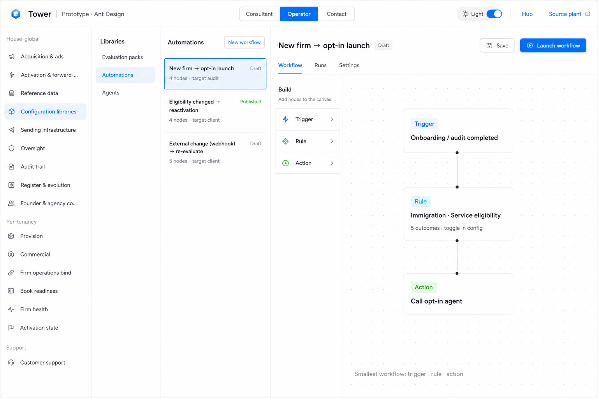

**Rationale (20:54):** A rule lets us create the smallest looking automation: trigger, rule, action. Fewer pieces to think about. Then look **inside** those pieces.

**On the glass:**
- Canvas, three nodes down: **Trigger** (onboarding / audit completed) → **Rule** (Immigration · Service eligibility) → **Action** (call opt-in agent).
- Caption: smallest workflow.

**Why this does what we wanted:** encloses the definite middle. Not an Agents sequence. Not a full DAG yet.

**Not this plate:** GUI vs Custom. Form creation. If node after the rule. Enrollment tab.

---

### A2 — Rule, GUI (prior)

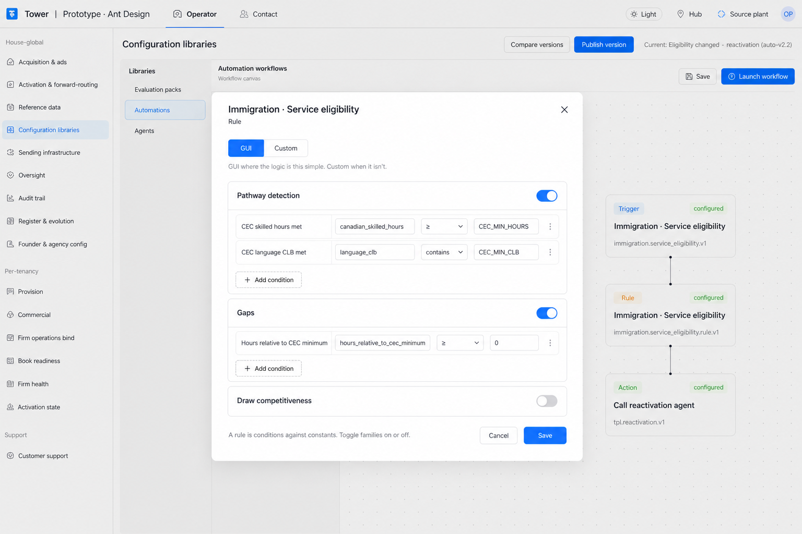

**Rationale (20:44, 20:54):** Look at Rules to see the end goal. Toggles on outcome families. A rule is a **composite of conditions and constants**. Creatable. Industry-modular. Authored logic is simple enough for a GUI.

**On the glass:**
- Modal: Immigration · Service eligibility · Rule.
- Segmented **GUI | Custom**, GUI on.
- Families with switches (Pathway, Gaps, …). A family can be off.
- Condition rows: field · operator · constant. Add condition.

**Why this does what we wanted:** operator authors blocks, not code. Constants are referenced. Inside-the-rule **condition** grain. **Stack + off-empty is kept.** Giant GUI/Custom is not.

**Canonical Outcomes:** **A21**.

**Not this plate:** Custom JSON (A3). Named code beside GUI (A4). The If node **after** the rule.

---

### A3 — Rule, Custom (prior)

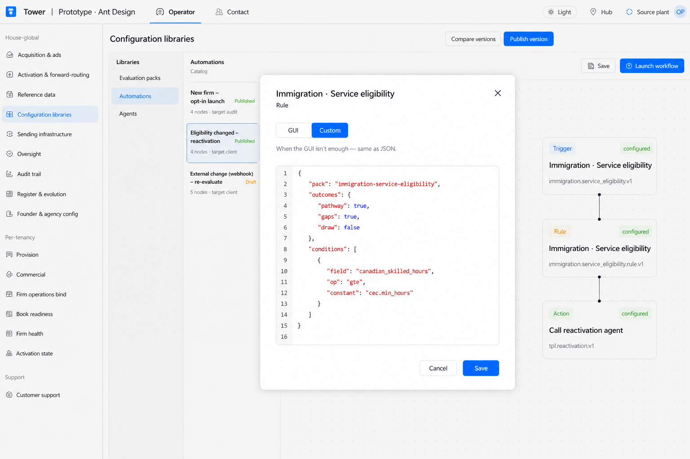

**Rationale (20:54):** Two options. Custom when the GUI isn’t enough — same idea as JSON. Escape hatch, not the default.

**On the glass:** Same modal, **Custom** on. JSON of the same rule. Caption under the switch: **“When the GUI isn’t enough — same as JSON.”** Founder caption — not a node.

**Why this does what we wanted:** not limited to code; not forbidden from code. **Code color / indent is kept** on A21’s per-outcome JS.

**Canonical Outcomes:** **A21**.

**Not this plate:** Named-code **outcome** inside GUI (that is A4).

---

### A4 — GUI plus named code (prior)

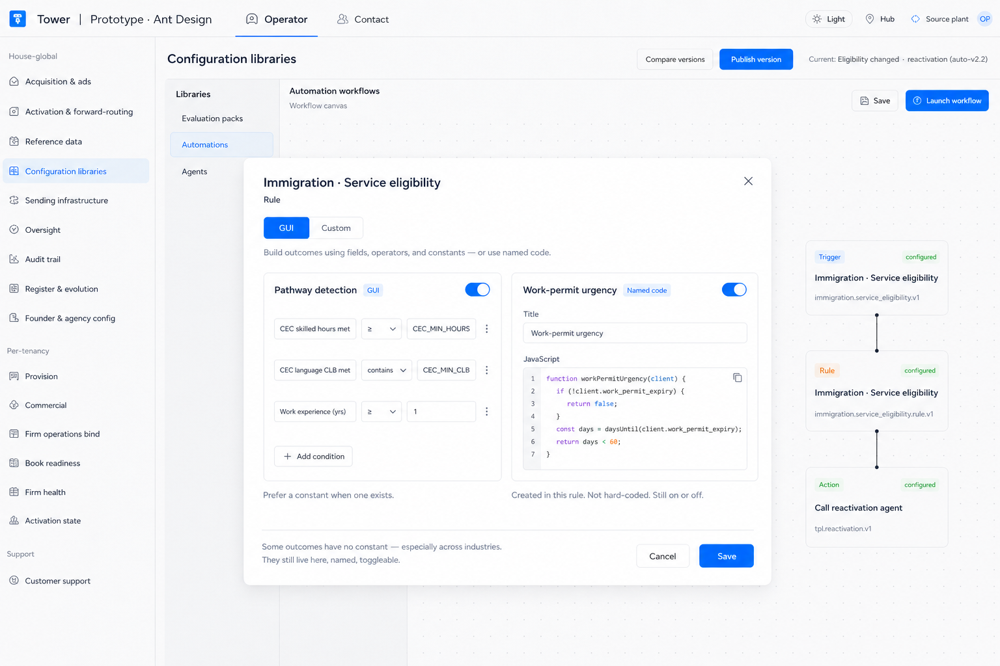

**Rationale (21:10):** Some outcomes have a constant (GUI). Some have no constant — especially across industries — and must be **named code** (JS or Python), **created in this rule**, still **on or off**, you **name it**. Prefer a constant when one exists.

**On the glass:**
- One outcome: field / operator / constant, toggle on, tag GUI.
- One outcome: named JavaScript, toggle on, tag Named code.
- Caption: created in this rule; not hard-coded.

**Why this does what we wanted:** still the rules module. Still a toggle. Not a hard-coded special case. **Code editor look is kept.** Side-by-side is not.

**Canonical Outcomes:** **A21**.

**Not this plate:** Whole-rule Custom (A3). Inventing rule-output catalog.

---

### A21 — Rule Outcomes pane (canonical Outcomes)

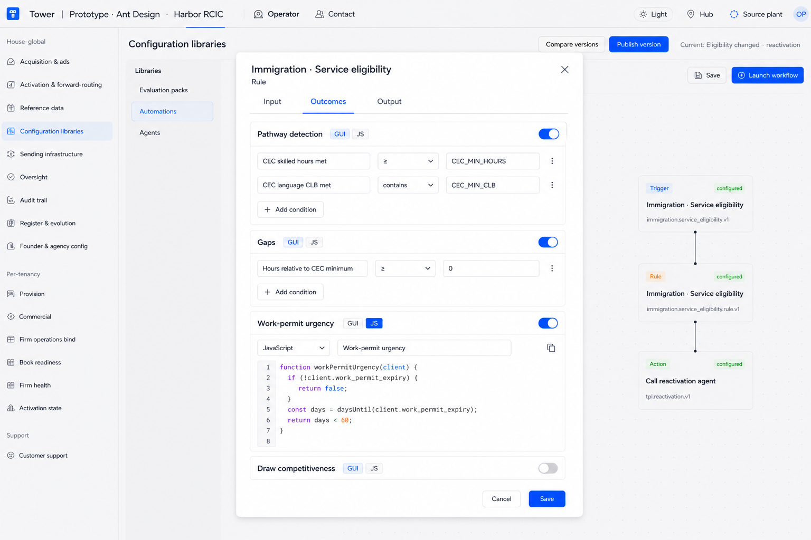

**Rationale (16:33):** Assemble A2/A3/A4. Engineer is literal. One arrangement.

**On the glass:**
- Tabs: **Input · Outcomes · Output**. Outcomes selected. **No** giant GUI/Custom.
- Outcomes **stacked**. Never side-by-side.
- Each outcome: title · tiny **GUI | JS** (same small look as A4’s GUI chip) · on/off.
- On + GUI → conditions + Add condition (A2).
- On + JS → code editor: language picker, rename, line numbers, syntax color, copy (A4).
- Off → header only. Nothing inside (A2 Draw competitiveness).
- Footer: Cancel · Save. **No teaching captions.**

**Do not build from this plate:** any sentence that is not a control. There are none on purpose.

**Not this plate:** Input tab. Output tab (A20). Planting.

**Packet:** [`RULE-OUTCOMES-PACKET.md`](./RULE-OUTCOMES-PACKET.md).

---

### A5 — Inside trigger

**Rationale (20:44, 20:54):** Look at Rules to see the end goal. Toggles on outcome families. A rule is a **composite of conditions and constants**. Creatable. Industry-modular. Authored logic is simple enough for a GUI.

**On the glass:**
- Modal: Immigration · Service eligibility · Rule.
- Segmented **GUI | Custom**, GUI on.
- Families with switches (Pathway, Gaps, …). A family can be off.
- Condition rows: field · operator · constant. Add condition.

**Why this does what we wanted:** operator authors blocks, not code. Constants are referenced. Inside-the-rule **condition** grain.

**Not this plate:** Custom JSON (A3). Named code beside GUI (A4). The If node **after** the rule.

---

### A3 — Rule, Custom

**Rationale (20:54):** Two options. Custom when the GUI isn’t enough — same idea as JSON. Escape hatch, not the default.

**On the glass:** Same modal, **Custom** on. JSON of the same rule. Caption under the switch: **“When the GUI isn’t enough — same as JSON.”** Founder caption — not a node.

**Why this does what we wanted:** not limited to code; not forbidden from code.

**Not this plate:** Named-code **outcome** inside GUI (that is A4).

---

### A4 — GUI plus named code (both on/off)

**Rationale (21:10):** Some outcomes have a constant (GUI). Some have no constant — especially across industries — and must be **named code** (JS or Python), **created in this rule**, still **on or off**, you **name it**. Prefer a constant when one exists.

**On the glass:**
- One outcome: field / operator / constant, toggle on, tag GUI.
- One outcome: named JavaScript, toggle on, tag Named code.
- Caption: created in this rule; not hard-coded.

**Why this does what we wanted:** still the rules module. Still a toggle. Not a hard-coded special case.

**Not this plate:** Whole-rule Custom (A3). Inventing rule-output catalog.

---

### A5 — Inside trigger

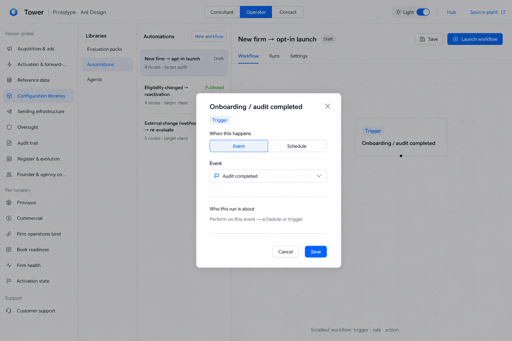

**Rationale (21:10):** Not satisfied with canvas-only. Look **inside trigger**. Perform **on this event** (schedule or trigger).

**On the glass:** Event or schedule. The start of the definite middle.

**Why this does what we wanted:** Automations’ event-of-origin is schedule | trigger — not Agents’ “event” on C2b. Do not collapse those words.

**Not this plate:** Constant-change trigger / webhook as a full catalog. Named remainder. Look of the picker → **A26**.

---

### A6 — Add a node

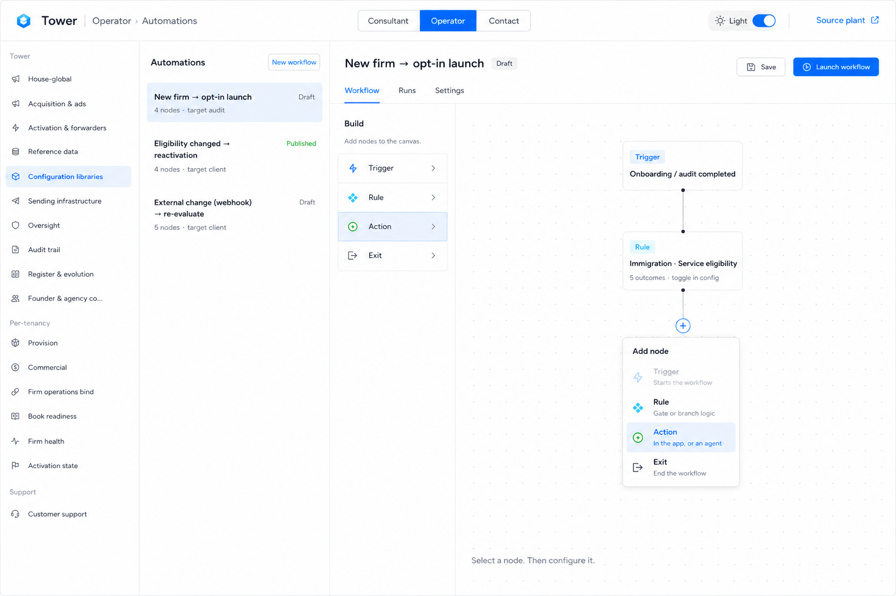

**Rationale (21:10):** See what it looks like to select a node, add a node, then select **Action** as a node.

**On the glass:** Build palette **Trigger · Rule · Action · Exit**. Insert **+** on the wire. Action selected. Insert-menu helper lines (Starts the workflow / Gate or branch logic / In the app, or an agent / End the workflow) are **founder captions**. Footer **“Select a node. Then configure it.”** is a caption.

**Why this does what we wanted:** the DAG is authored. Action is a kind you pick, not a hidden enroll.

**Not this plate:** The If / condition node in that same picker — Hub palette has it; **A15** is the plate that adds Condition (If). Do not freeze A6’s Exit and A15’s If as one palette. Wire **+** look → **A28**. Node **⋯** → **A27**.

---

### A7 — Two kinds of action

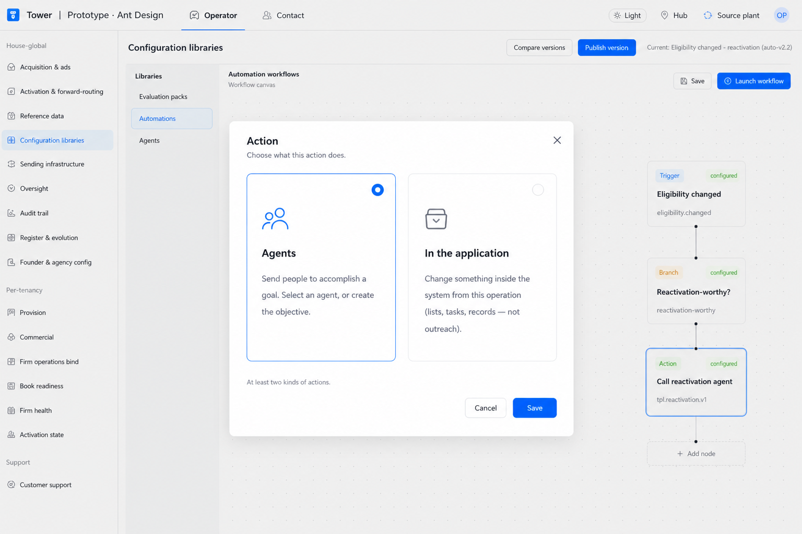

**Rationale (21:10, law 19):** At least two kinds: **in the application** (change something inside the system) and **agents** (send people to a goal). Actions are not only outreach.

**On the glass:** Agents vs in the application. Card body copy + footer **“At least two kinds of actions.”** are **founder captions**. Background canvas showing a **Branch** “Reactivation-worthy?” is **generated drift** — A1’s smallest is still trigger · rule · action.

**Why this does what we wanted:** Automations touches more of the app. Hub already names in-app kinds (`manage_lists`, `assign_task`, `notify_consultant`) and agent enroll (`enroll_sequence` + agent ref). Do not invent a longer catalog in the picture.

**Not this plate:** Form builder. Objective picker.

---

### A8 — Agents as the action (prior)

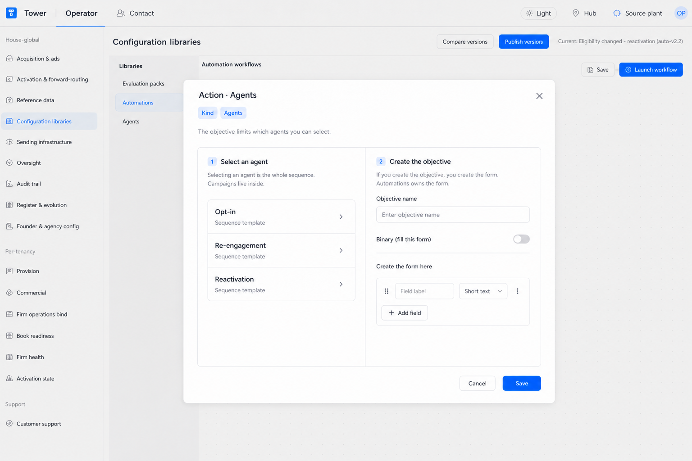

**Rationale (20:24, 21:10):** End node mirrors Agents’ beginning. Select an agent **or** create/select the objective. Select agent = **the whole sequence**. Campaigns live inside. Re-engagement is a **campaign / sequence template**, not an objective. If you create the objective and it is a data request, you create the form **here** (embedded lean). Objective **limits** which agents you can select.

**On the glass:**
- Kind: Agents.
- Select an agent: Opt-in / Re-engagement / Reactivation as **sequence templates**.
- Create the objective. Blank form builder (Field label / + Add field).

**Why this does what we wanted (and why it evolved):** this plate locked **select agent = sequence** and **form lives in Automations**. The form itself was still a blank builder — that is why **A12** exists. Keep A8 so the agent/objective law is visible without pretending the blank builder is canon.

**Canonical for the form:** A12. **Canonical for select-agent / sequence templates:** still this plate. **Canonical for assign-existing vs from-template (no create-agent here):** **A14**.

**Not this plate:** Binding questions to rule Output (A12). In-app action kinds (A7). The 00:02 assign choice (A14).

---

### A12 — Form questions are those rows (canonical form)

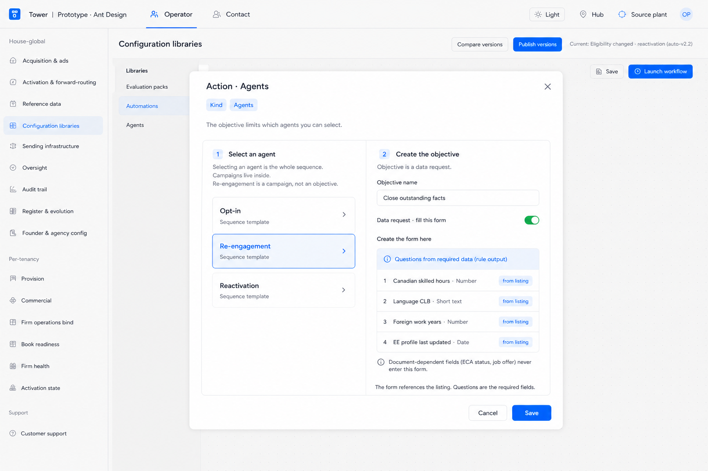

**Rationale (21:28, 21:36, 21:48):** When we need a form, we know everything that must exist in it because of **required data**. Questions **are** the required fields. The form **references the listing**. Not a blank Add-field authoring. Document-dependent never enter a form. Do not lock an objective type to a given signal. Re-engagement stays a campaign.

**On the glass:**
- Same Action · Agents chrome as A8.
- Re-engagement **sequence template** selected.
- Objective is a **data request** (on). Name example: Close outstanding facts.
- Banner: **Questions from required data (rule output)**.
- Rows (catalog only): Canadian skilled hours · Language CLB · Foreign work years · EE profile last updated — each **from listing**.
- Note: document-dependent (ECA status, job offer) never enter this form.

**Why this does what we wanted:** the form is not invented in Agents and not typed from scratch in Automations. It is the listing, as questions.

**Not this plate:** Inventing extra questions. Locking this objective to “re-engagement signal only.”

---

### A9 — Rule output today vs gap (prior)

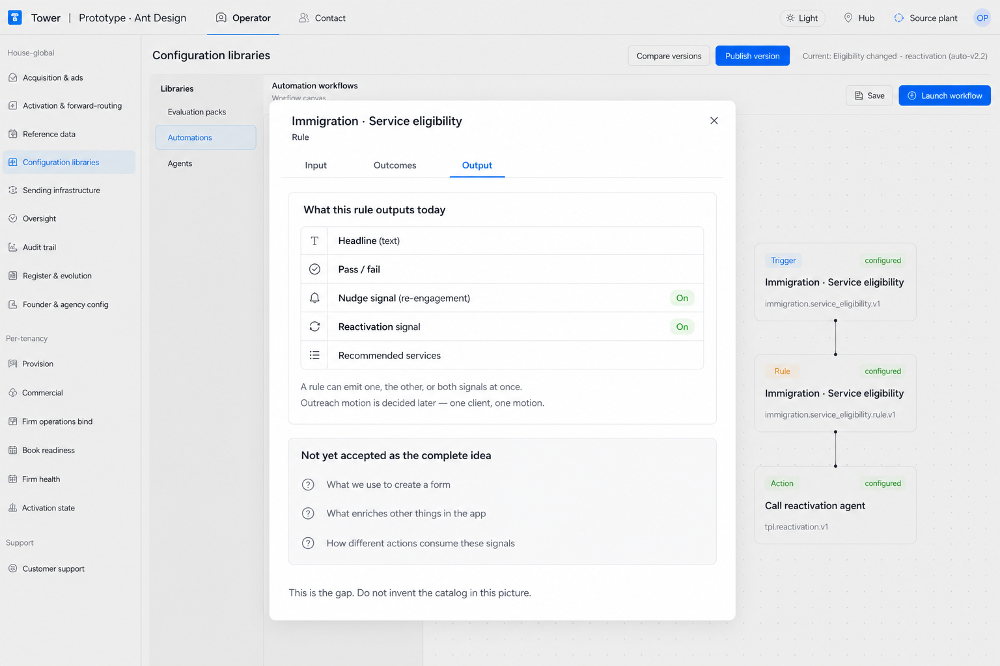

**Rationale (21:10):** We do not yet have a congruent complete idea of **what a rule outputs**. That output is supposedly what we use to create a form, and maybe enrich many other things. Do **not** split the rule to separate re-engagement from reactivation. One, the other, or both — that is why different **actions** exist.

**On the glass:**
- Output tab.
- Today: headline, pass, nudge (re-engagement) signal, reactivation signal, recommended services — one, the other, or both.
- Named gap: what we use to create a form · what enriches · how actions consume.
- Caption: do not invent the catalog in this picture.

**Why this does what we wanted (and why it evolved):** named the hole without filling a fake catalog. **A11** fills **one** missing class as a listing. Keep A9 so SA can see Hub-today vs the listing.

**Canonical for Output:** A20 (A11 stays prior).

---

### A11 — Rule Output: required data as a listing (prior)

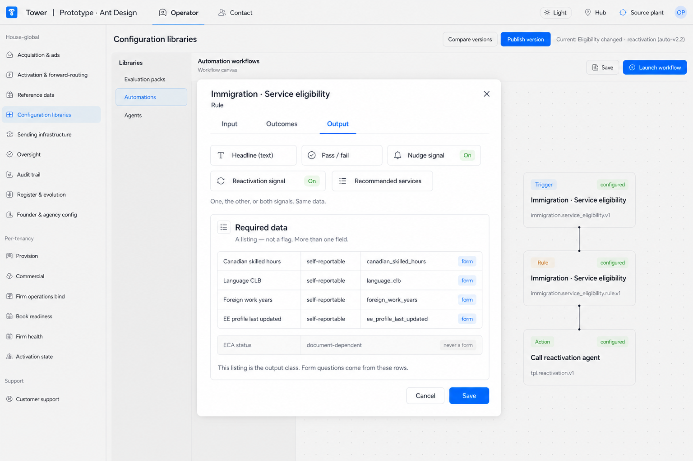

**Rationale (21:28, 21:36, 21:48):** Required data is a **class**. It is a **listing**, not a flag. More than one field. It must **show on rule-node output**. Catalog fields only. Self-reportable → form. Document-dependent → never a form. 21:36: this listing is **not stood up** in code today (`COLLECTIBLE_FIELDS` unused; Hub summary is signals / R-* ids).

**On the glass:**
- Same Output tab. Existing classes still present (headline, pass, nudge, reactivation, services).
- **Required data:** field rows — Canadian skilled hours, Language CLB, Foreign work years, EE profile last updated — self-reportable, tagged **form**.
- ECA status: document-dependent, **never a form**.
- Caption: this listing is the output class; form questions come from these rows.

**Why this does what we wanted:** the next node (If / action / form) can **call from previous results**. A form can bind. A condition can ask “listing not empty.”

**Not this plate:** Binding UI (A12). Inventing fields not in the catalog. Click-one / preview-below — that is **A20**.

---

### A20 — Rule Output: top = all outputs; bottom = preview of the selected (canonical Output)

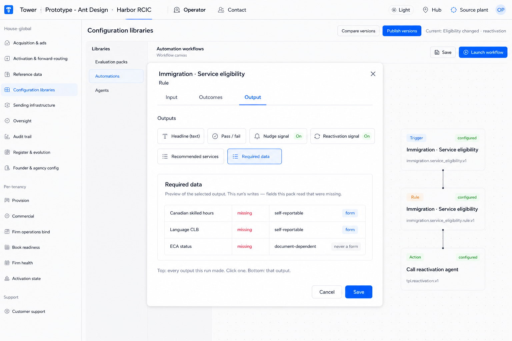

**Rationale (16:04):** Founder on A11: the top chips are a **quick look at all the potential outputs**. Required data is itself an output. Click a class; the **bottom switches** to that output’s results. That is how Output should look on **every** node, not only Rules. A11 had the look and the listing, but it dumped the listing always-on. It did not select.

**On the glass:**
- Output tab. Same desk chrome as A11.
- Top: Headline · Pass/fail · Nudge · Reactivation · Recommended services · **Required data** (selected).
- Bottom: preview of the selected class. Required data selected → **this run’s missing fields** (not the whole catalog painted). Self-reportable → form. Document-dependent → never a form.
- Caption: Top: every output this run made. Click one. Bottom: that output.

**Why this does what we wanted:** Output is the writes. The top is the classes. The bottom is the selected write. Same pane shape for other node kinds later.

**Not this plate:** Input or Outcomes (still not drawn). Inventing extra classes. Planting the editor.

**Packet:** [`RULE-OUTPUT-PACKET.md`](./RULE-OUTPUT-PACKET.md).

---

### A10 — Lattice; required-data missing (prior, diagram)

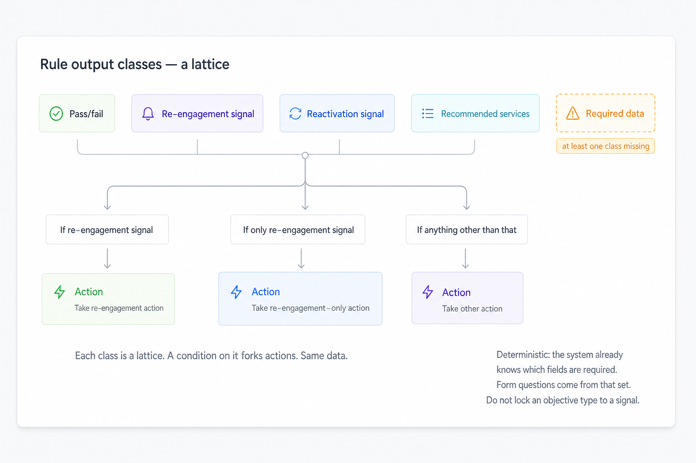

**Rationale (21:28):** Output classes are a **lattice**. Each class is something you can put a simple **condition** on, which **forks actions** on the **same data** (if re-engagement · if **only** re-engagement · if **anything other than that**). At least one class missing: **required data**. Deterministic. Do not lock an objective type to a signal.

**On the glass (diagram, not a node):** class cards; required data dashed / missing; three forks → three actions.

**Why this does what we wanted (and why it evolved):** named the missing class. **A13** fills it as a listing **on the same kind of diagram**. Keep A10 so the hole is visible.

**This is not a screen.** The fork on the DAG is Hub’s If node after the rule.

---

### A13 — Lattice: required data is the listing class (canonical diagram)

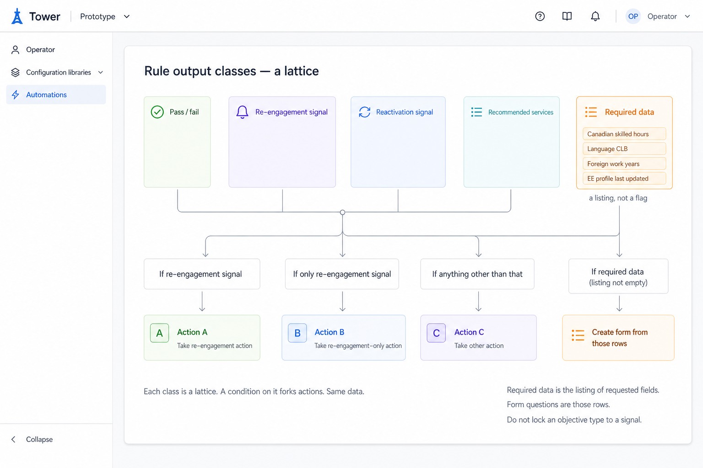

**Rationale (21:48):** Same lattice as A10, with the hole filled as a **listing**. Founder (22:17): this last image is a **different kind of picture** — do not confuse it with node chrome or with the **condition node that sits after the rule output** and says “if this,” calling from previous results.

**On the glass (diagram, not a node):**
- Required data is a **solid** class containing field chips (catalog names).
- Caption: a listing, not a flag.
- Condition **if required data (listing not empty)** → **create form from those rows**.
- The other three forks on the same data still stand.

**Why this does what we wanted:** the class is the listing; a condition on it forks the form. **Ascribe the idea, not a lattice page.**

**Not this plate:** A screenshot of Hub If. A replacement of A10 (A10 stays as the prior). Building a “lattice” screen in Ant.

---

### A14 — Assign existing, or from a template (canonical assign)

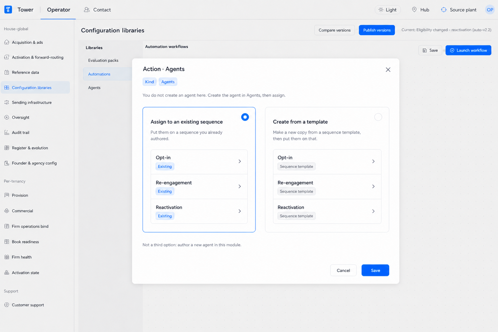

**Rationale (00:02):** Leftover 6. Keep it simple. **Do not create agents inside Automations.** Create the agent in Agents, then assign. Two choices only: **assign to an existing sequence**, or **create from a template**. Can evolve later — not now. A8 stays so select-agent = whole sequence is visible. A12 stays the form.

**On the glass:**
- Same Operator-desk chrome as A8 / A7 / A1 (00:51 rebuild). Do not invent surrounding.
- Kind: Agents.
- Line: “You do not create an agent here. Create the agent in Agents, then assign.”
- Two cards: **Assign to an existing sequence** (put them on one you already authored) · **Create from a template** (new copy from a sequence template, then put them on that).
- Same three names on both sides (Opt-in / Re-engagement / Reactivation) — left tagged Existing, right tagged Sequence template. Each row is a **radio**. One selected. **No chevron / arrow.** There is nothing further after you pick the sequence (select agent = the whole sequence).
- Footer on this PNG: **Cancel · Save** only. The sentence “Not a third option: author a new agent in this module” is **not** on the pixels. Law still; do not require that sentence as UI.

**Why this does what we wanted:** the copy-vs-assign choice is obvious on the glass. It is not a third authoring place.

**Not this plate:** Authoring a sequence (that is Agents / C1). Form bind (A12). Hand enroll (C8).

---

### A15 — Blank canvas; you can chain

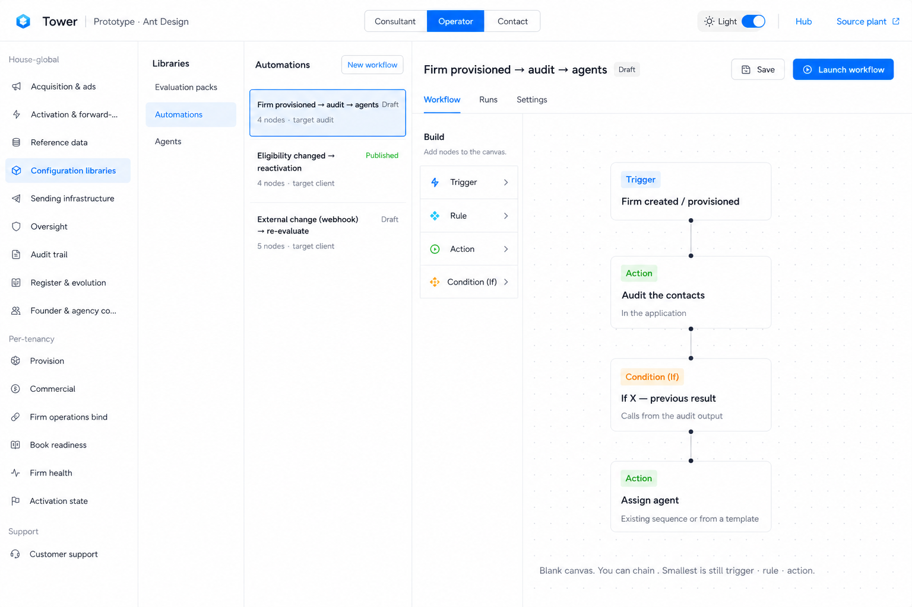

**Rationale (01:17, 01:20):** Automations is a blank canvas the same way an agent is. Smallest is still A1. This plate is the chain: firm created / provisioned → audit the contacts → if X (previous result) → assign agent. Palette includes **Condition (If)**. Provisioning a firm is not only creating the firm.

**On the glass:**
- Same Operator-desk chrome as A1.
- Workflow: Firm provisioned → audit → agents.
- Four nodes down, wired.
- Caption: “Blank canvas. You can chain. Smallest is still trigger · rule · action.”

**Why this does what we wanted:** one canvas, the walk. A1 is not discarded.

**Not this plate:** Opening the If (A16). Opening the trigger (A17). Inside the audit.

---

### A16 — If reads the previous result (first Ant If)

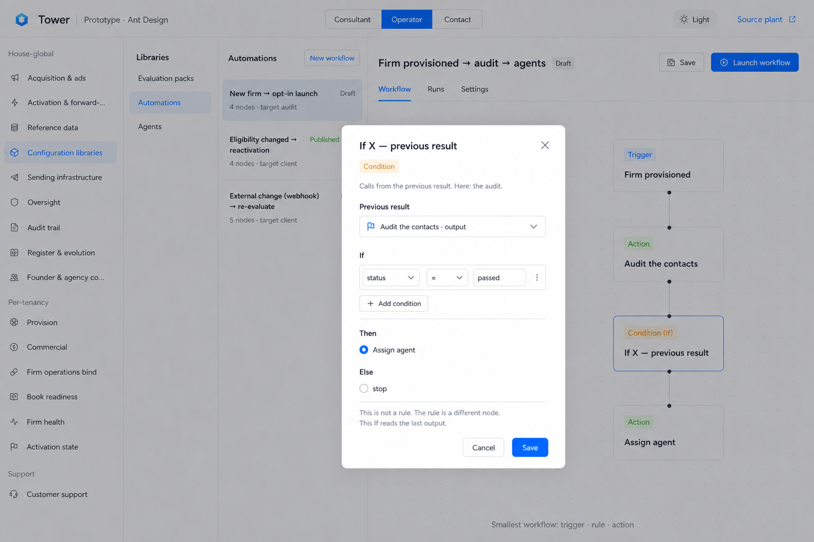

**Rationale (22:17, 01:17, 01:20):** The node after the previous result says “if this,” already calling from last output. That previous result can be an **action** (the audit), not only a rule. This is **not** a rule (A2). A13 is still a lattice diagram, not this screen.

**On the glass:**
- Modal: If X — previous result. Condition tag.
- Previous result: Audit the contacts · output.
- One row: field · operator · constant.
- Then → Assign agent. Else → stop.
- Caption: “This is not a rule. The rule is a different node.”

**Not this plate:** Rule GUI (A2). Lattice (A13). Inventing the condition catalog. **12:31 / 12:34:** A16 already locks the mechanism. The previous result is Audit’s **primitive** (the run, each verdict, sequence-ready) — not a check catalog we specified. A16’s row `status = passed` is the run only. Do not draw a pipe. Do not generate until asked.

---

### A17 — Trigger: firm created / provisioned

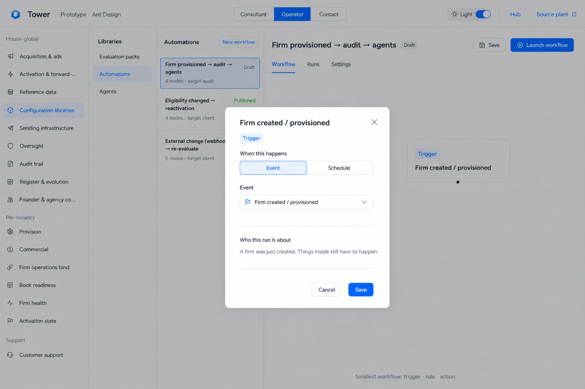

**Rationale (01:17, 01:20):** Named event. Same trigger modal as A5. Event, not schedule. “A firm was just created. Things inside still have to happen.”

**On the glass:**
- When this happens: **Event**.
- Event: Firm created / provisioned.
- Who this run is about: that line.

**Not this plate:** Global vs local picker (**A18**). Audit completed (A5). Filling the event catalog.

---

### A18 — Trigger: Global or Local

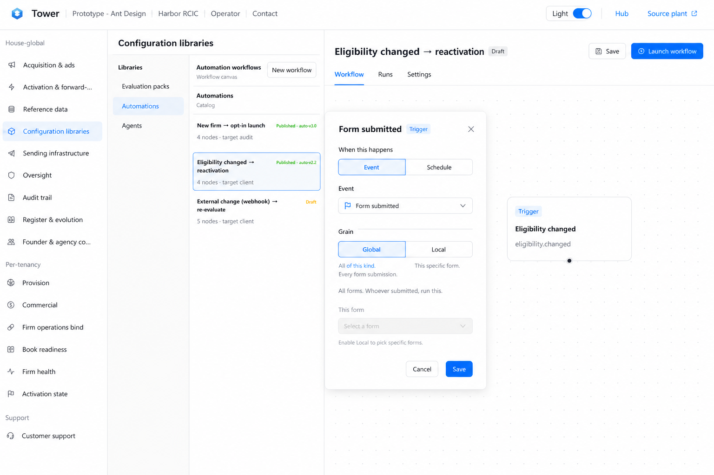

**Rationale (23:16 law 27, drawn 18:53):** When you select an event to trigger, you detail **Global** or **Local**. Not Settings. Who this applies to is **Contacts** (A19), not this modal.

**On the glass:**
- When this happens: **Event**.
- Event: **Form submitted** (the clear example).
- Grain: **Global** | **Local**. Global on: all form submissions.
- **This form** picker **disabled** on Global; enables on Local.

**SA idea (do not invent UI):** some events may not have Local (an **audit** is one-time). Map which events allow which grain. Do not fill the catalog.

**Not this plate:** Contacts picker. A Settings modal. Firm provisioned (A17). Grain as a **dropdown** on the event picker → **A26**. Radios stay prior.

---

### A19 — Automations Contacts (same as Agents)

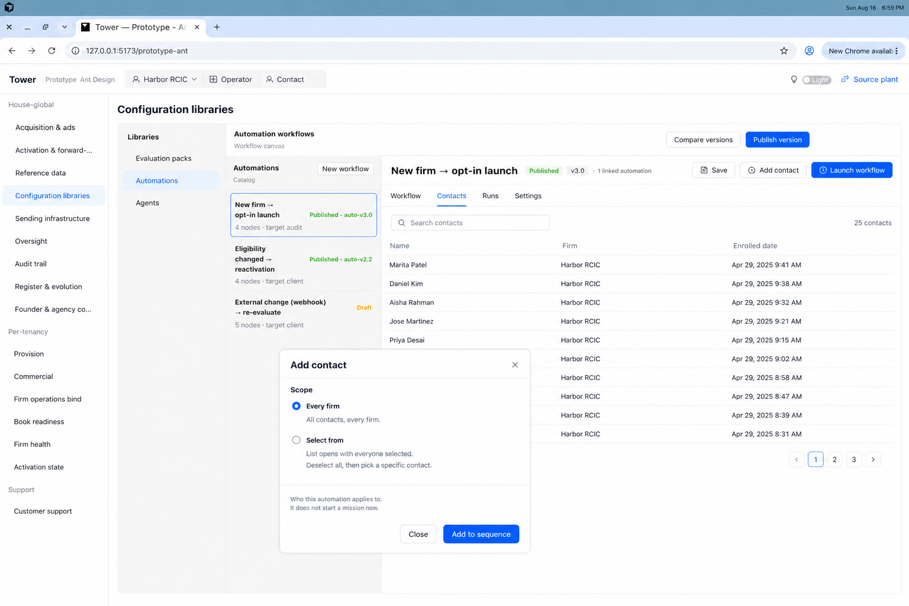

**Rationale (01:01, 18:53):** Add contact and Contacts exist in Automations **the exact same way** they look in Agents. Live Automations has no Contacts tab. Build it.

**On the glass:** Workflow · **Contacts** · Runs · Settings. Table Name · Firm · Enrolled date. **Add contact** in the header. Same Every firm / Select from modal. Footer: who this automation applies to; it does **not** start a mission now.

**Not this plate:** Trigger Global/Local (A18). Agents start-now (C8).

---

## Under-specified (named, not filled)

| Remainder | What we know | What is not drawn |
|-----------|--------------|-------------------|
| **If / condition node after the previous result** | Hub: `branch` / `if`; reads previous `lastOutput`. **A15** chain · **A16** open. Can follow an action, not only a rule. | Drawn. Inside of audit still not drawn. |
| **Constants as a canvas node** | Hub palette: constant node. Also the right-hand of A2/A4 rows. | No Ant plate of the constant node itself. |
| **Full operations catalog** | Data request is one. Engagement spoken as a maybe. | Do not invent. |
| **Full exit points** | Start/select agent is one. | Do not invent. |
| **Form as own graph node vs embedded** | Lean: **embedded** in the start-agent node. Not locked. | A12 draws embedded. |
| **Remaining output classes besides required data** | Lattice classes named on A9–A13: pass, re-engagement signal, reactivation signal, recommended services, required-data listing. | Do not invent the rest. |
| **In-system action kinds** | Hub names `manage_lists`, `assign_task`, `notify_consultant` plus agent enroll. A7 is the split. | Do not invent a longer catalog. |
| **Word “event”** | Agents C2b vs Automations event-of-origin. Form completion **is** an Automations trigger (23:16). | Do not collapse C2b with this. |
| **Event: global vs local** | **Global:** every firm + every permutation of this event. **Local:** nested dropdowns of that event’s existing shape (firm/contact primitive + instance). **A26**. A18 radios prior. Some events may have no instance axis — SA maps. Not A19. | Catalog still not filled. Do not invent events. |
| **Automations Contacts** | Same look as Agents C8 / C8b. **A19**. Who this applies to. Does not start now. | Drawn. |
| **In-app action: ascribe a tag** | Campaign fails → record / tag. Subscription bell is that tag. | Named. Do not invent the rest. |
| **Lineage queryable** | Who created the objective (agent vs hand), path to completion, completion event, time. | Queryable at minimum. Not a new screen. |
| **Assign existing vs from template** | **Settled 00:02.** A14. No create-agent in Automations. | Drawn. |
| **Get node** | New kind. Read records from a **module**. Input is n8n. Parameters: Every firm stays as a dropdown option; Select opens cascading comboboxes. Left writes apply in those boxes. **A22** · **A23**. Output not drawn. | Drawn as plates. Not planted. |

---

### A22 — Get on the canvas

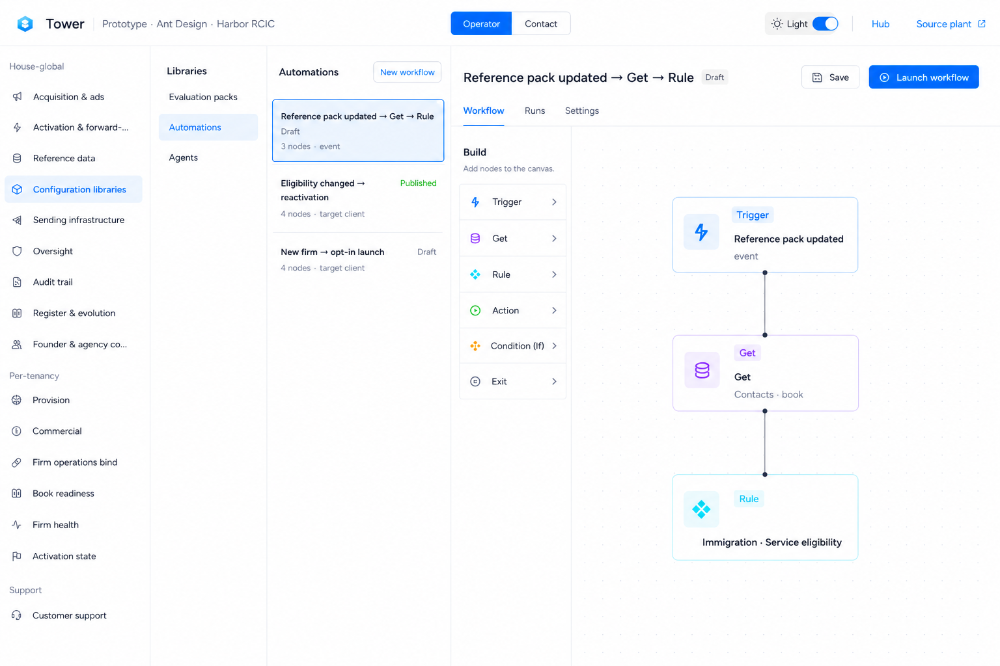

**Rationale (17:06):** Reference pack updated writes no people. **Get** makes the inputs. Then the rule can run. Get is a **kind**, same as Trigger / Rule / Action / If.

**On the glass:** Palette includes **Get**. Chain: Reference pack updated → Get (Contacts · book) → Immigration · Service eligibility. No teaching captions.

**Do not build:** extra catalog workflows if they drifted. Trust the three-node chain and the palette.

**Not this plate:** Inside Get (A23). Output of Get.

---

### A23 — Get: Input left, Parameters middle

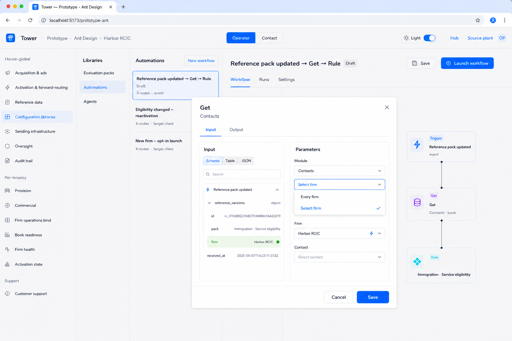

**Rationale (17:33):** Left stays n8n. Parameters go back toward Add contact’s Every firm / Select — but the selector is a **dropdown**, not radios, and it is not only firm. Select firm produces the next dropdown. Those dropdowns are also **input boxes**. That is where a left-side write (this firm, this contact) gets applied. Same choice will exist across modules given the classes that apply. Cascade until you have to pick.

**On the glass:** Module Contacts. First dropdown open: **Every firm** · **Select firm** (selected). Then **Firm** combobox with Harbor RCIC (lightning — left `firm` applied). Then **Contact** combobox empty: Select contact. No radios. No “Of” pill.

**Do not build:** teaching captions. Flat Key/ID Input. Replacing Every firm with a mapped-only slot. Immigration fields on Get.

**Stale pixel:** `received_at` may sit under `reference_versions`. Sibling write, not child.

**Not this plate:** Get Output pane. Rule Outcomes (A21). Every-firm default with no cascade showing.

**Packet:** [`GET-PACKET.md`](./GET-PACKET.md) — engineer + SA. On the PNG / not on the PNG. Three-level shape. Do not freeze the left example tree.

---

### A24 — Contact import · Output (this run’s writes)

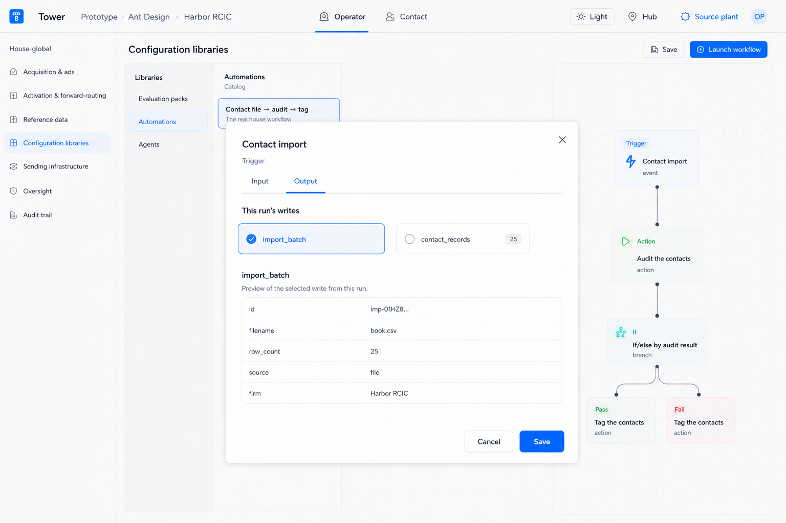

**Rationale (19:34):** Same Output as **A20**. Trigger, not Rule. Contact import writes the **batch** and the **rows**. Click one; bottom is that write.

**On the glass:** Tabs Input · Output. Output selected. No Outcomes. Chips: **import_batch** (selected) · **contact_records** (25). Preview: this batch (id, filename, row_count, source, firm).

**Do not build:** teaching captions. Rule chips (nudge, required data, pass/fail) on this event. Catalog blurb “the real house workflow.” Audit/tag writes as if they were import’s output.

**Not this plate:** New contact (A25). Inside Audit. Get.

---

### A25 — New contact · Output (this run’s writes)

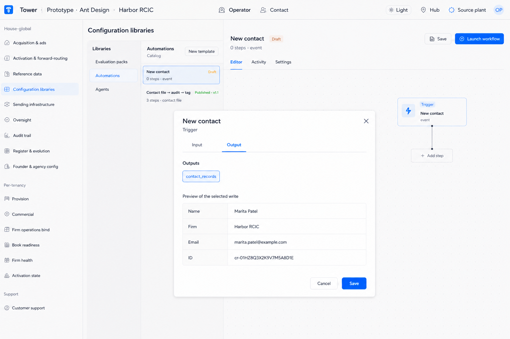

**Rationale (19:34):** Same Output as **A20**. This event wrote **one person**. No `import_batch`.

**On the glass:** Tabs Input · Output. Chip: **contact_records** only. Preview: that contact (name, firm, email, id). Name is example furniture.

**Do not build:** teaching captions. An import_batch chip on this event. Immigration fields.

**Not this plate:** Contact import (A24). Add contact modal (C8).

---

### A26 — Trigger: select the event (middle modal)

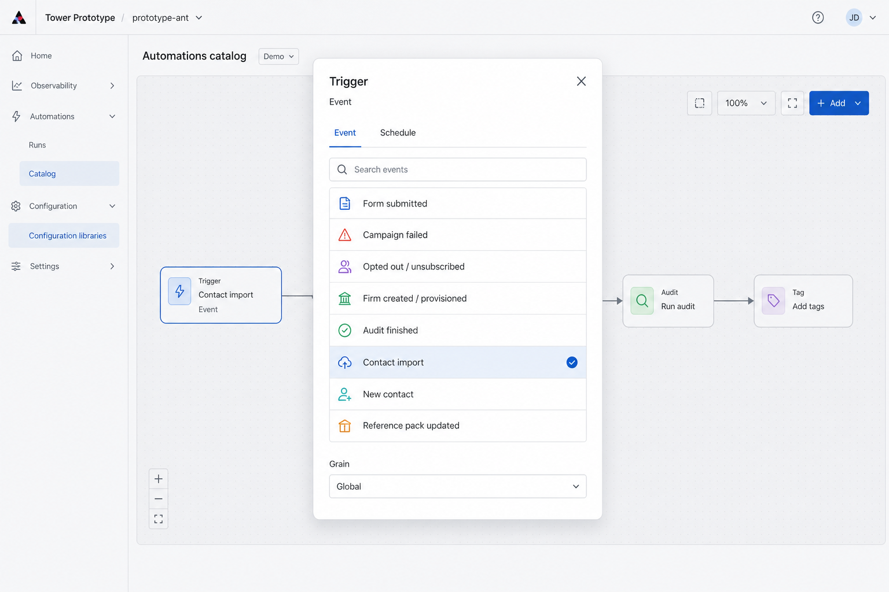

**Rationale (20:05):** Translate selecting a trigger into the Assist middle-modal. Canvas add-trigger already looks good. Click into a placed node is **configure**, not this picker. This plate is add-from-palette and **⋯ → Switch**.

**On the glass:** Event \| Schedule. Search events. Named events only (Form submitted, Campaign failed, Opted out, Firm created / provisioned, Audit finished, **Contact import** selected, **New contact** own row, Reference pack updated). **Icons are spec.** Grain = **dropdown**, value **Global**. Global → no second combobox.

**Do not build:** teaching captions. Grain as radios (A18 prior). Footer Cancel/Save — pick is live like A23. Mixing grain into the event list. Empty Select under Global.

**Stale pixel:** catalog blurb behind the modal if it drifted. Trust the modal.

**Not this plate:** Configure after click (A24 / A25 Output). Node **⋯** (A27). Wire **+** (A28). Local cascade (not this PNG — packet completes).

**Packet:** [`TRIGGER-SELECT-PACKET.md`](./TRIGGER-SELECT-PACKET.md).

---

### A27 — Node options popover

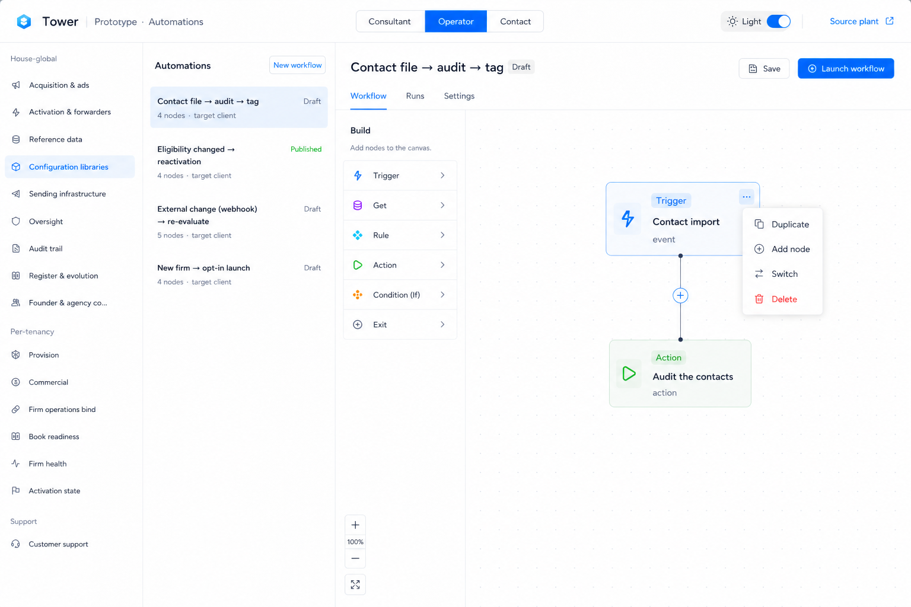

**Rationale (20:05):** Click oscillates today between configure and switch. Click = configure. Switch lives with Duplicate / Add node / Delete — the Hub options idea, on the Assist canvas.

**On the glass:** Trigger **Contact import** selected. **⋯** open: **Duplicate · Add node · Switch · Delete**. Wire **+** still on the connection (that is A28). Palette includes Get.

**Do not build:** Switch as the destination of a body click. Teaching captions.

**Not this plate:** The event list after Switch (A26). Wire add-node menu (A28).

**Packet:** [`NODE-PLACE-PACKET.md`](./NODE-PLACE-PACKET.md).

---

### A28 — Add a node on the wire

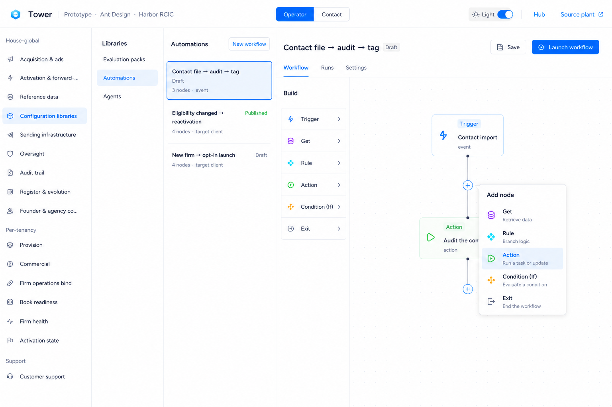

**Rationale (20:05):** Hover the wire → **+**. Same idea as A6, Assist look. Insert between nodes. Palette on the left still has Trigger (starts the graph). The wire menu does not.

**On the glass:** **Add node**: Get · Rule · Action · Condition (If) · Exit. **No Trigger.**

**Do not build:** teaching captions. Trigger on insert-on-wire. Freezing A6 Exit without If.

**Not this plate:** Node **⋯** (A27). Event picker (A26).

**Packet:** [`NODE-PLACE-PACKET.md`](./NODE-PLACE-PACKET.md).

---

## What this is not
| **Ant Rule GUI** | Does not exist. Hub does. | Pictures are the face until built. |
| **Required-data listing in code** | 21:36: not stood up. Catalog unused. | SA: what would have to change — do not mint from the picture. |

---

## What this is not

- Not overwriting 15:43.
- Not a table inventory. Not Story. Not “where it touches Postgres” — that is the SA package.
- Not planting these into `AntAutomationWorkbench`.
- Not treating A13 as a screen to build.
- Not throwing away Hub Rules / If / constants.
- Not a full Automations DAG. Smallest workflow first; insides of those pieces; Output listing; form bind; lattice **idea**.
- Not filling a complete output-class catalog.
- Not restoring a blank form builder as canon (A8 stays as prior).
- Not creating agents inside Automations (A14).

**SA:** read 15:43 (do not overwrite), then [`AUTOMATIONS-FACE.md`](./AUTOMATIONS-FACE.md), then **this file in lineup order**. Dated prompt: [`AUTOMATIONS-SA-PACKAGE.md`](./AUTOMATIONS-SA-PACKAGE.md). Extract the machine from the law + these plates. Do not design a different Automations module from Ant’s poor translation. Hub is the source plant.
