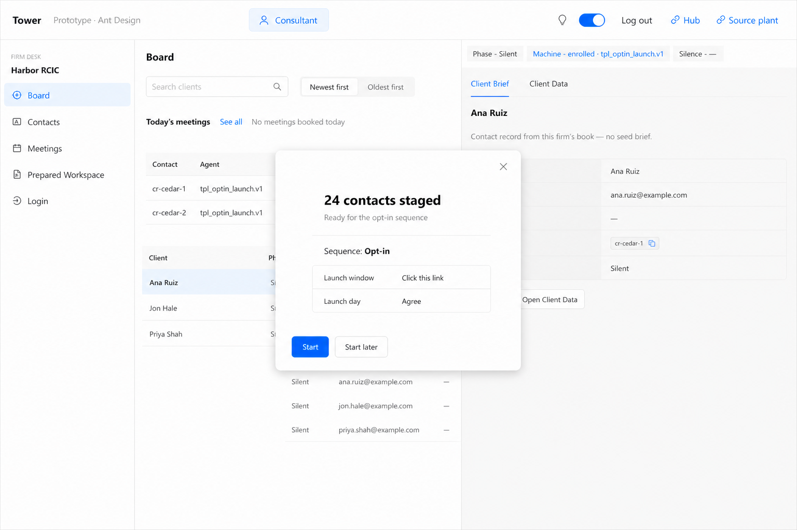
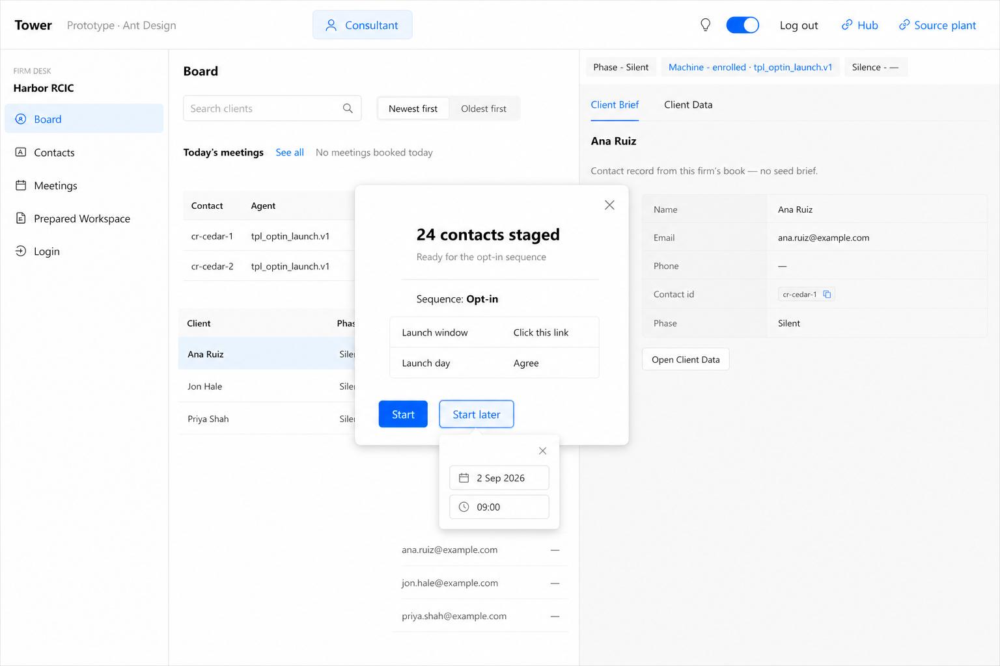
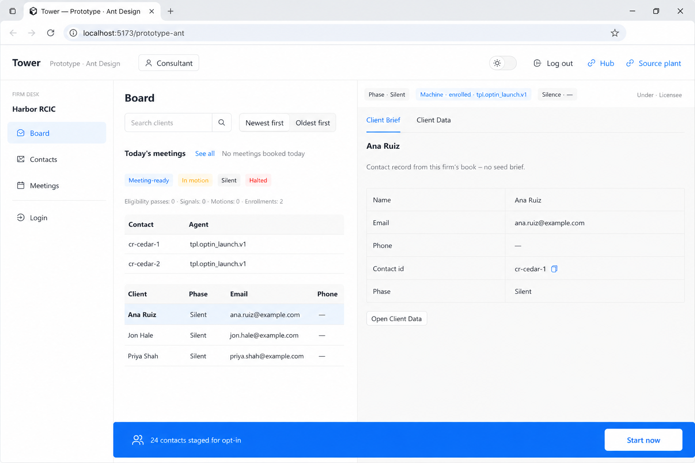

# Consultant workspace — staged Start (plates, not a packet)

**Seat:** Product Manager.  
**Not a packet.** Recut of this look (title + count, no sequence table): [`WAIT-NOTE-PLATES.md`](./WAIT-NOTE-PLATES.md). This file keeps the earlier staged-preview plates as prior.  
**Who:** consultant **person**, **their** workspace. Shell **T4**: Consultant only. No Operator. No Contact picker.  
**When:** after audit, **X contacts are staged** (sequence-ready). This is the confirm / Start face — not Canvas A itself.  
**Flag:** [`PHASE-TWO-LOG.md`](./PHASE-TWO-LOG.md) **15:43 UTC** — do not overwrite.  
**Cousins:** §1 [`LAUNCH-1-NOTHING-TO-OPT-IN.md`](./LAUNCH-1-NOTHING-TO-OPT-IN.md) · reminder [`CONFIRM-READY-DEFERRED.md`](./CONFIRM-READY-DEFERRED.md) · shell [`SHELL-CHROME.md`](./SHELL-CHROME.md) **T4**.  
**Chrome:** screenshot live consultant Board first. Paint the staged mode on that desk. Do not copy House-global. Do not copy Operator / Contact switcher. Harbor / Ana / Cedar / live counts = **example / live leftover**.  
**Does not:** hand this to the engineer; occupy Form; recut A40; recut 015; plant; mint tables.

---

## What the founder asked to see

On the consultant workspace: X contacts have been **staged**. A popover. High-level **sequence** preview. Campaigns and objectives stay obvious as those grains. Bottom: **Start** · **Start later**. Start later **is the schedule** — not “show me later.” The schedule is **not in view** until Start later is clicked. Then a **small popover beneath Start later** (date + time only, own **X**). Not beside the button. Does not replace the two buttons.

**X** on the big card closes it; the mode **remains at the bottom** as a **solid** bar (cannot miss). **Start now** on the **right** of that bar. Click **Start now** = start. Click the **rest** of the bar = reopen the big popover.

---

## Canon (three states)

| # | File | What it is |
|---|------|------------|
| **S1** | [`S1-consultant-staged-popover-open.png`](./consultant-blueprint/S1-consultant-staged-popover-open.png) | Open. Count staged. Sequence preview. **Start** · **Start later**. No schedule until S1b. Big **X** closes to S2. |
| **S1b** | [`S1b-consultant-staged-start-later.png`](./consultant-blueprint/S1b-consultant-staged-start-later.png) | Start later **clicked**. Small popover **beneath** that button: date · time · tiny **X**. Buttons stay. |
| **S2** | [`S2-consultant-staged-minimized.png`](./consultant-blueprint/S2-consultant-staged-minimized.png) | After big **X**. Solid bar at the bottom. **Start now** at the right. Rest of the bar reopens S1. |

**Prior (wrong — kept so the recut is visible):** [`S1-prior-schedule-inline.png`](./consultant-blueprint/S1-prior-schedule-inline.png) put date/time beside Start later. [`S2-prior-pale-bar.png`](./consultant-blueprint/S2-prior-pale-bar.png) was a pale strip with no Start now. Do not build those.

---

### S1 — open (schedule hidden)

**Copy:** Centered popover on the consultant desk. **X** top-right. Count of contacts staged. High-level sequence: name, then rows that are still obviously **campaign** and **objective**. Footer **Start** · **Start later** only. No date. No time.

**Ignore:** **24**. Harbor RCIC. Ana Ruiz / Jon Hale / Priya Shah. Cedar ids. `tpl.optin_launch.v1`. Prepared Workspace · Login. Hub · Source plant. Campaign names **Launch window** / **Launch day** and objectives **Click this link** / **Agree** — example of the opt-in sequence (operator can rename).

Start’s sequence **is** opt-in. Not a picker of three.

---

### S1b — Start later clicked

**Copy:** Same card. Start later is selected. A **small** popover attaches **beneath** Start later. It houses **date** and **time** only. Its own tiny **X** closes the small popover (the big card stays). Does not appear beside the buttons. Does not replace Start · Start later.

**Ignore:** Exact date **2 Sep 2026** / **09:00**. Same scenery as S1.

---

### S2 — minimized (solid bar)

**Copy:** Same desk. Big popover gone. A **solid** color bar at the **bottom** (cannot miss — not a pale wash). Count + staged on the left. **Start now** at the **right**, inside the bar. Click **Start now** = the Start operation. Click **inside the bar but not the button** = reopen S1.

**Ignore:** Same live scenery as S1. Exact bar copy beyond the grain (count + staged + this sequence). Exact blue hex.

**Start** on S1 and **Start now** on S2 are the **same** operation.

---

## Specified and clear (from the ask)

- Consultant person, their workspace (T4).
- After staged: popover with a high-level sequence overview (campaign + objective still obvious).
- **Start** · **Start later**. Start later = **schedule**, not snooze.
- Schedule **hidden** until Start later is clicked. Then a small popover **beneath** Start later: date + time + tiny X. Not beside. Does not replace the two buttons.
- Big **X** minimizes. Mode remains at the bottom as a **solid** bar. **Start now** on the right of that bar. Rest of the bar reopens the card.

## Specified but not clear (do not invent in a packet)

- Whether the **first** appearance is S1 (opens itself) or S2 (bar; click to open).
- Exact copy (“staged” vs “ready” vs “can be sequenced”). **Start** vs **Start now** wording — same operation; do not invent two.
- Whether the bar can be dismissed for good without Start — founder said X **leaves it**. Do not add a second dismiss on S2.
- Confirming a scheduled time (does picking date/time arm it, or is there a confirm in the small popover). Do not invent a third button in S1b.

---

## Do not

- Packet until they agree.
- Freeze Launch window / Launch day / Click this link / Agree as types.
- Put Operator / Contact switcher on the consultant person.
- Restore the inline schedule beside Start later.
- Recut 015. Overwrite 15:43. Plant. Mint tables.
