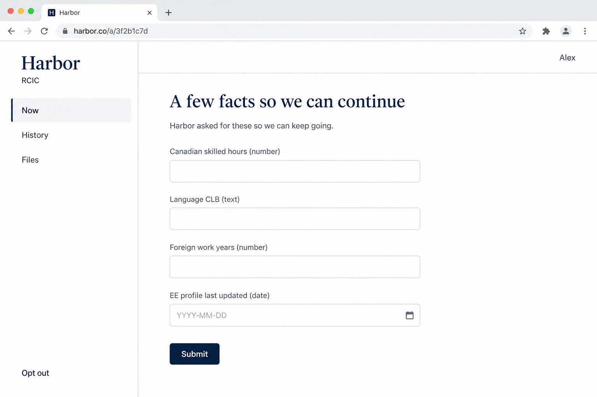
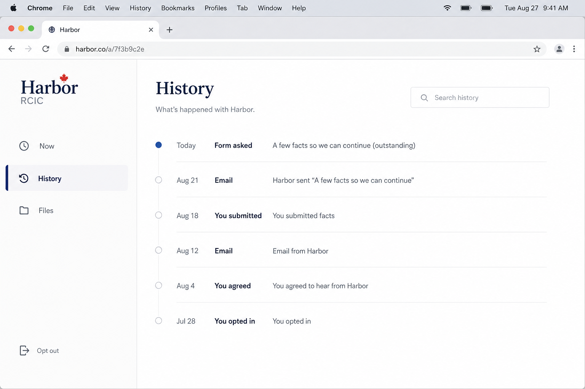

# Contact workspace — UI blueprint

**Seat:** Product Manager.  
**Flag:** [`PHASE-TWO-LOG.md`](./PHASE-TWO-LOG.md) **15:43 UTC**. Law: [`CONTACT-FACE.md`](./CONTACT-FACE.md).  
**Chrome:** firm workspace. **Not** Operator House-global. **Not** the Ant Contact 10-item flipper. Screenshot live Contact only to know what **not** to copy.

---

## Canon lineup

| # | File | What it is |
|---|------|------------|
| **P1** | [`P1-contact-workspace-now.png`](./contact-blueprint/P1-contact-workspace-now.png) | The workspace. Left panel: **Now · History · Files**. Now selected. Data-request form **in** Now. Opt out at the foot. No login. |
| **P1b** | [`P1b-contact-workspace-history.png`](./contact-blueprint/P1b-contact-workspace-history.png) | Same chrome. **History** selected. Light chronology. |

**Not drawn this stamp:** Files interior. Consent / booking as Now states. Do not generate a PNG per module.

Harbor / Alex / `harbor.co/a/…` / the four fields = **example**.

---

### P1 — Now

**Copy:** Three nav entries. Now = current ask (this form). Firm wordmark. Opt out. No login.

**Ignore:** Example names. Browser chrome.

---

### P1b — History

**Copy:** History is a light list of what happened with the firm. Same three entries.

**Ignore:** Exact row copy. Search if it appeared. Maple-leaf / icon drift vs P1.

---

## What this is not

- Not C16 (Gmail). Not A40 (operator). Not planting the Ant Contact sider.
- Not Files drawn — only named in the nav.
