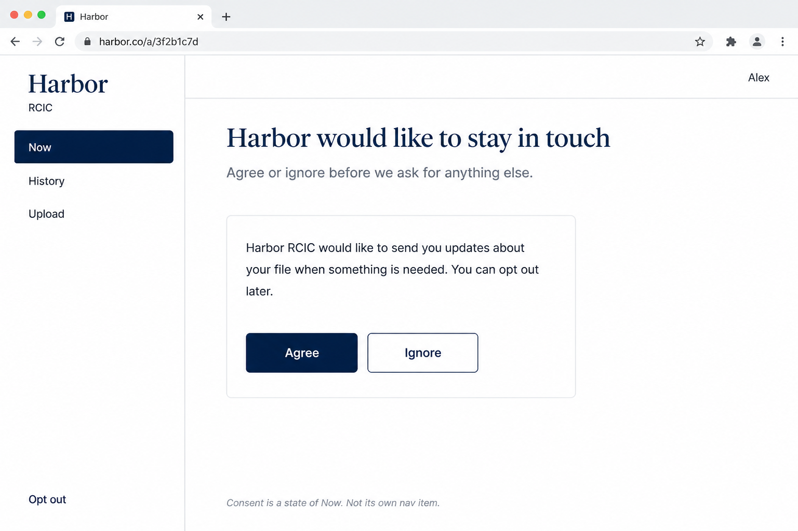
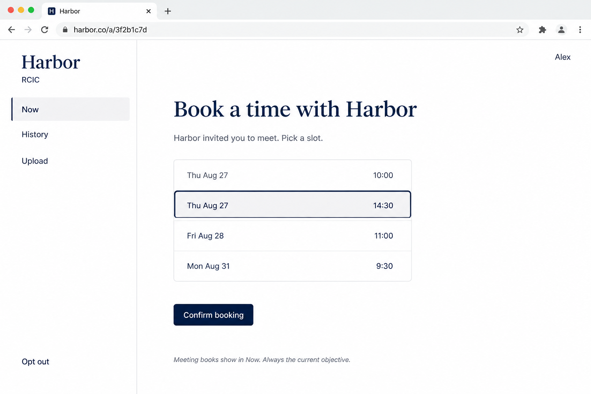
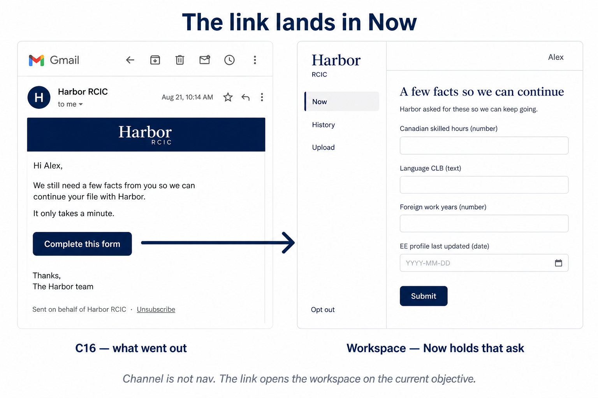
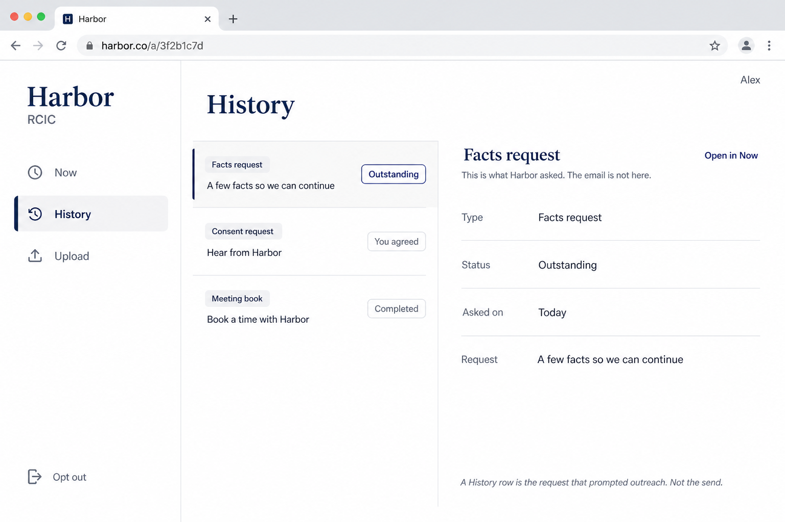
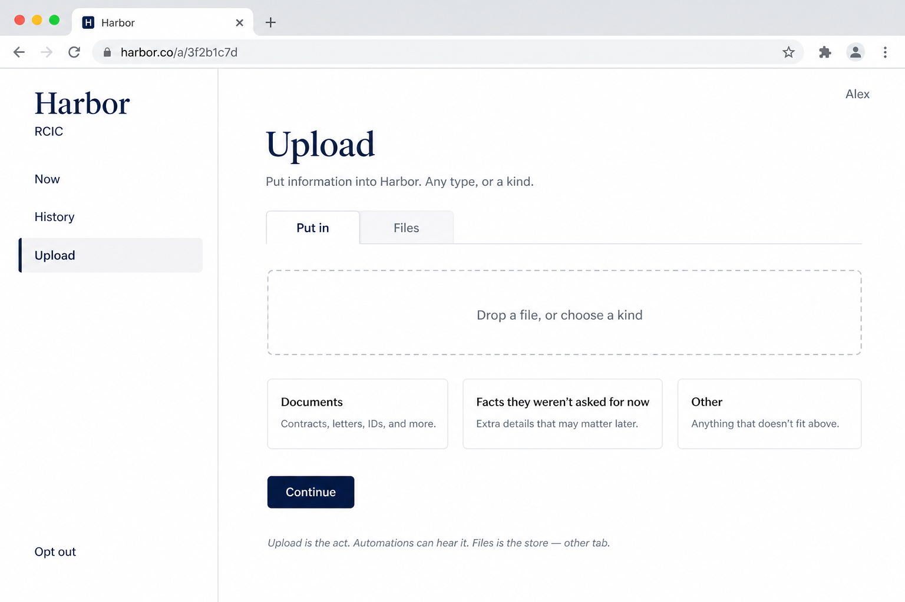
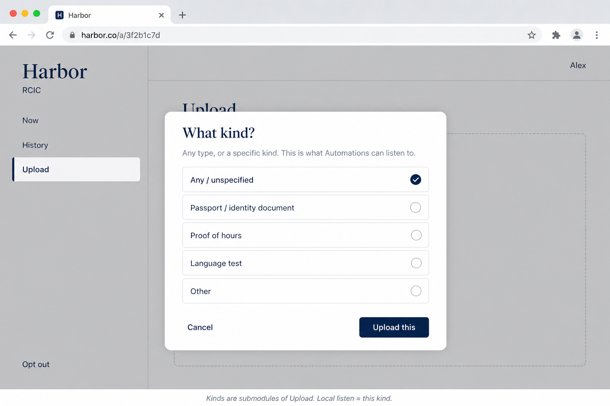
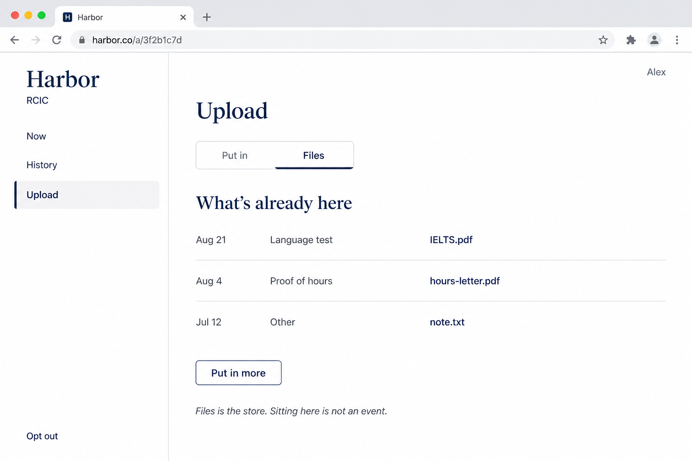
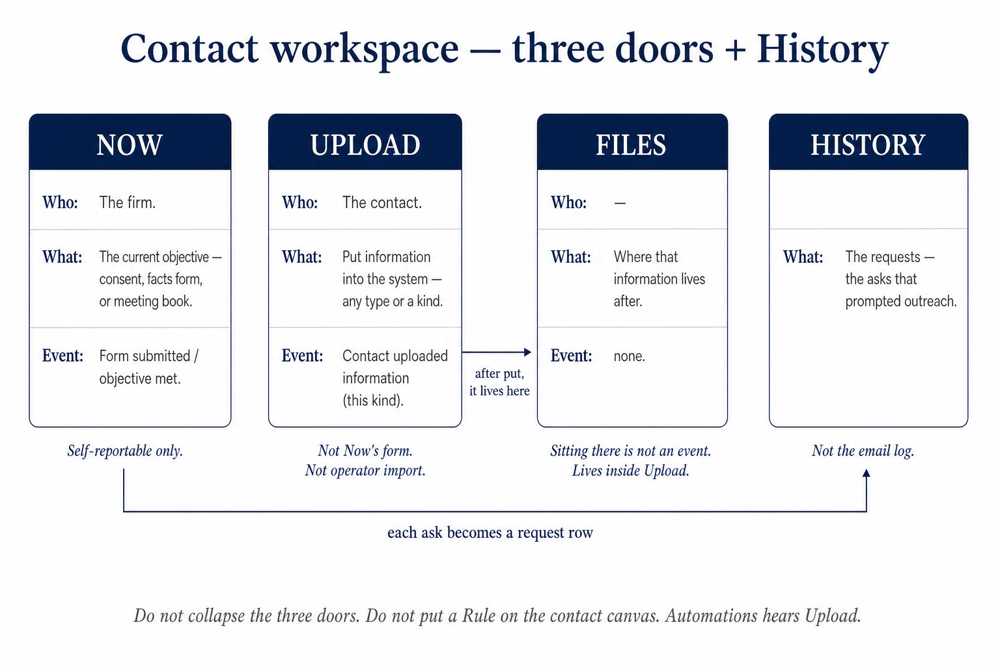
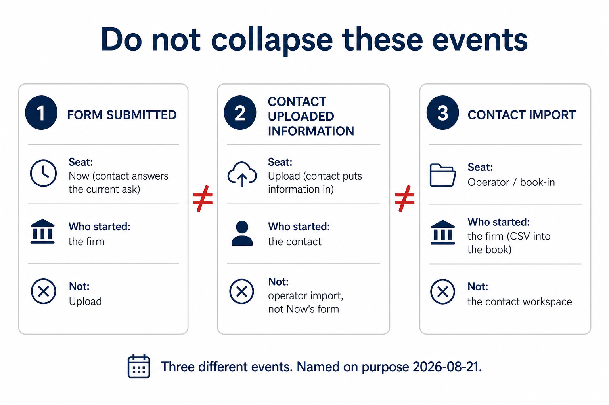

# Contact workspace — UI blueprint

**Seat:** Product Manager.  
**Flag:** [`PHASE-TWO-LOG.md`](./PHASE-TWO-LOG.md) **15:43 UTC**. Law: [`CONTACT-FACE.md`](./CONTACT-FACE.md).  
**Chrome:** firm workspace. **Not** Operator House-global. **Not** the Ant Contact 10-item flipper. Screenshot live Contact only to know what **not** to copy.  
**Design system:** founder likes this workspace and will ask for a recut to the live Ant desk later. **Do not regenerate for match until asked.** These plates spec **what the modules are**, not the final paint.

Harbor / Alex / `harbor.co/a/…` / the four fields / kind names = **example**.

---

## Canon lineup

Read in this order.

| # | File | What it is |
|---|------|------------|
| **P0** | [`P0-contact-ct-portal-built.png`](./contact-blueprint/P0-contact-ct-portal-built.png) | **What CT built.** Copy **only** the 10-item Client portal sider. Interior is generated drift — not Consent spec. |
| **P2** | [`P2-contact-needs-vs-built.png`](./contact-blueprint/P2-contact-needs-vs-built.png) | **Prior** for outcomes → CT 10 vs early P1. Nav on that Harbor card still says History / Files. Upload + three doors → **P9**. |
| **P1-prior** | [`P1-prior-files-nav.png`](./contact-blueprint/P1-prior-files-nav.png) | First Now. Left panel **Now · History · Files**. Kept so the recut is visible. |
| **P1** | [`P1-contact-workspace-now.png`](./contact-blueprint/P1-contact-workspace-now.png) | **Canonical Now.** Left panel **Now · History · Upload**. Data-request form **in** Now. Opt out at the foot. No login. |
| **P3** | [`P3-contact-workspace-now-consent.png`](./contact-blueprint/P3-contact-workspace-now-consent.png) | Now · **Consent** state. Agree / Ignore. Not its own nav item. |
| **P4** | [`P4-contact-workspace-now-book.png`](./contact-blueprint/P4-contact-workspace-now-book.png) | Now · **Meeting book** state. Slot list. Confirm booking. |
| **P10** | [`P10-contact-email-lands-now.png`](./contact-blueprint/P10-contact-email-lands-now.png) | **C16 → Now.** Channel is not nav. The link opens the workspace on the current objective. |
| **P1b-prior** | [`P1b-prior-activity-log.png`](./contact-blueprint/P1b-prior-activity-log.png) | First History. Mixed email + submit log. **Wrong.** Kept so the recut is visible. |
| **P1b** | [`P1b-contact-workspace-history.png`](./contact-blueprint/P1b-contact-workspace-history.png) | **Canonical History.** Requests — the asks that prompted outreach. Not the outreach log. |
| **P5** | [`P5-contact-workspace-history-request.png`](./contact-blueprint/P5-contact-workspace-history-request.png) | One request **opened**. The ask itself. “The email is not here.” |
| **P6** | [`P6-contact-workspace-upload.png`](./contact-blueprint/P6-contact-workspace-upload.png) | **Upload.** Contact puts information in. Tabs: Put in · Files. Kinds as cards (submodules). |
| **P7** | [`P7-contact-workspace-upload-kind.png`](./contact-blueprint/P7-contact-workspace-upload-kind.png) | Kind modal. Any / this kind. Local listen = this kind. |
| **P8** | [`P8-contact-workspace-upload-files.png`](./contact-blueprint/P8-contact-workspace-upload-files.png) | Files **inside** Upload. The store. Sitting there is not an event. |
| **P9** | [`P9-contact-three-doors.png`](./contact-blueprint/P9-contact-three-doors.png) | **Diagram.** Now / Upload / Files doors + History. Do not collapse. |
| **P11** | [`P11-three-events-not-collapsed.png`](./contact-blueprint/P11-three-events-not-collapsed.png) | **Diagram.** Form submitted ≠ Contact uploaded information ≠ Contact import. |

**Operator Automations (same lock, other folder):** [`A41`](./automations-blueprint/A41-trigger-contact-uploaded.png) · [`A42`](./automations-blueprint/A42-trigger-uploaded-global.png) · [`A43`](./automations-blueprint/A43-trigger-uploaded-local-kind.png) · [`A44`](./automations-blueprint/A44-canvas-uploaded-reevaluate.png). Lineup: [`AUTOMATIONS-UI-BLUEPRINT.md`](./AUTOMATIONS-UI-BLUEPRINT.md).

**PM lean drawn:** left panel stays **three** entries. Files is a tab under Upload. If browse-without-put must stand alone, Files becomes a fourth sibling — that ask is still open; these plates show the lean.

---

### P1 — Now (canonical)

**Copy:** Three nav entries: **Now · History · Upload**. Now = current ask (this form). Firm wordmark. Opt out. No login.

**Ignore:** Example names (Harbor, Alex, the four fields). Browser chrome. Selected-state paint (gray bar vs solid navy) drifting plate to plate.

---

### P3 — Now · Consent

**Copy:** Consent is a **state of Now**. Agree / Ignore. Clear instruction of what we need now. Same three nav entries.

**Ignore:** Exact consent paragraph. Teaching caption at the foot (bucket 2).

---

### P4 — Now · Meeting book

**Copy:** Meeting book is a **state of Now**. Slot list. Confirm booking. First thing they see.

**Ignore:** Exact slot times. Teaching caption.

---

### P10 — The link lands in Now

**Copy:** C16 still goes out. Click opens **this workspace on Now**, with that ask open. Channel messages are not left-panel entries.

**Ignore:** Cropped Gmail furniture. Harbor copy.

---

### P1b — History = requests

**Copy:** History is a list of **requests** (facts / consent / meeting book). Outstanding vs done. Not “Harbor sent an email.”

**Ignore:** Exact row copy. Teaching caption. Icons drifting vs P1.

**Prior (wrong):** [`P1b-prior-activity-log.png`](./contact-blueprint/P1b-prior-activity-log.png) mixed Email / You submitted. Do not build that log.

---

### P5 — A request opened

**Copy:** Opening a History row shows **the ask**, not the send. Outstanding can **Open in Now**.

**Ignore:** The metadata block layout. Teaching captions.

---

### P6 — Upload (the act)

**Copy:** Upload is a **module**. Contact **puts information in**. Tabs: **Put in** (the act) · **Files** (the store). Kinds exist as submodules, not extra nav.

**Ignore:** The three card titles as a frozen kind catalog (“Documents” / “Facts they weren’t asked for now” / “Other” are teaching). Drop-zone copy. Teaching caption.

---

### P7 — Kind (this kind)

**Copy:** Upload can be **any** type or a **specific kind**. That kind is what Automations Local hears. Modal / submodule — not a Rule on this canvas.

**Ignore:** The listed kinds (Passport / Proof of hours / Language test / Other) = **example**. Not the catalog.

---

### P8 — Files (the store, inside Upload)

**Copy:** Files is where that information **lives after**. Same module as Upload. Sitting there is **not** an event.

**Ignore:** Filenames. Dates. “Put in more” label.

---

### P9 — Three doors + History

**Copy:** Now / Upload / Files are **three doors**. History is the request trail. Automations hears Upload. Do not put a Rule on the contact canvas. Now’s form stays self-reportable-only.

**Ignore:** Card chrome. Arrow placement.

---

### P11 — Three events, not collapsed

**Copy:** **Form submitted** (Now) ≠ **Contact uploaded information** (Upload) ≠ **Contact import** (operator book-in). Named on purpose.

**Ignore:** Icons. Card numbers.

---

### P0 — CT Client portal as built

**Copy:** The **10-item sider** only. That is what we built.

**Ignore:** The Consent body on this PNG (drift). Walk / Cedar as example.

---

### P2 — needs vs built (prior)

**Copy:** Four outcomes. Channel vs page vs chrome. Now = always the objective.

**Ignore:** Harbor card still saying History / Files without Upload — superseded by P1 + P9.

---

## What this is not

- Not C16 as the workspace (C16 is the email). Not A40 (operator form occupancy).
- Not planting the Ant Contact sider.
- Not a design-system recut of Harbor paint.
- Not minting an upload / files table from the pictures.
- Not a frozen kind catalog from P6 / P7.
- Not Files as a fourth left-nav item on the canonical plates (lean; ask still open).
- Not a Rule / Automations canvas on the contact seat — that is **A41–A44**.
