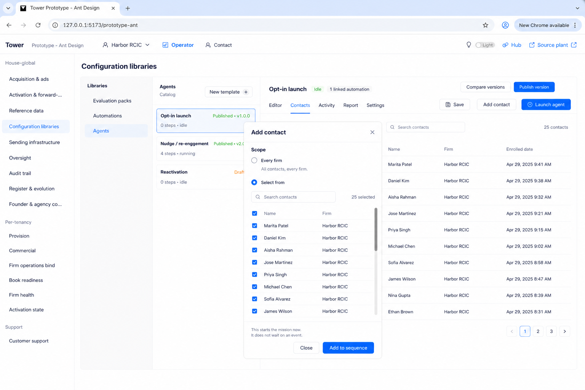

# Implementer UI tests — visual (Add contact specimen)

**Seat:** Product Manager.  
**Flag:** [`PHASE-TWO-LOG.md`](./PHASE-TWO-LOG.md) **15:43 UTC** — do not overwrite.  
**This is a visual test.** Click. Look. Does the glass match the plate? Yes = pass. No = fail.  
We are **not** telling how to build it. Principles stay in [`IMPLEMENTER-FACE-PASS.md`](./IMPLEMENTER-FACE-PASS.md).  
Do not pull code out of the image. Do not plant.

---

## The test

Sit: Operator → Configuration libraries → Agents → a sequence.

| Do | The glass must look like this | Plate |
|----|-------------------------------|-------|
| Click **Add contact** | That modal. Every firm / Select from. | [`C8`](./agents-blueprint/C8-sequence-contacts-enroll.png) |
| Then click **Select from** | Same modal, now with the list. Everyone selected. Names, firms, checkboxes. | [`C8b`](./agents-blueprint/C8b-select-from-list.png) |
| Open the **Contacts** tab | Table: Name · Firm · Enrolled date. People, not empty copy / UUIDs. | C8 behind the modal, same table chrome as [`C13`](./agents-blueprint/C13-sequence-activity.png) |

Sit: Automations → a workflow.

| Do | The glass must look like this | Plate |
|----|-------------------------------|-------|
| Open **Contacts**. Click **Add contact**. | The same look as Agents. | [`A19`](./automations-blueprint/A19-automations-contacts.png) |

If it does not look like the plate, it failed. That is the whole test.

C8:

C8b (Select from — this is the one that was underbuilt):

A19 (Automations — same modal):

