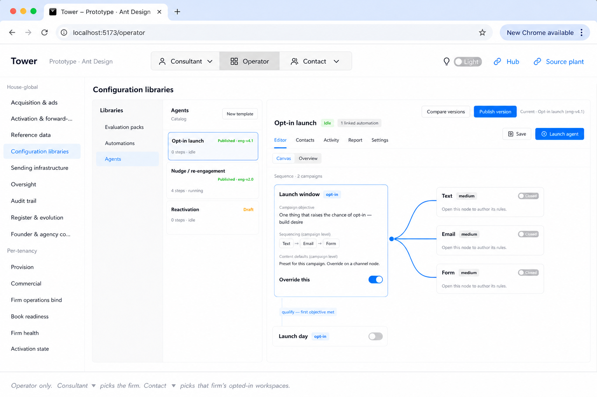
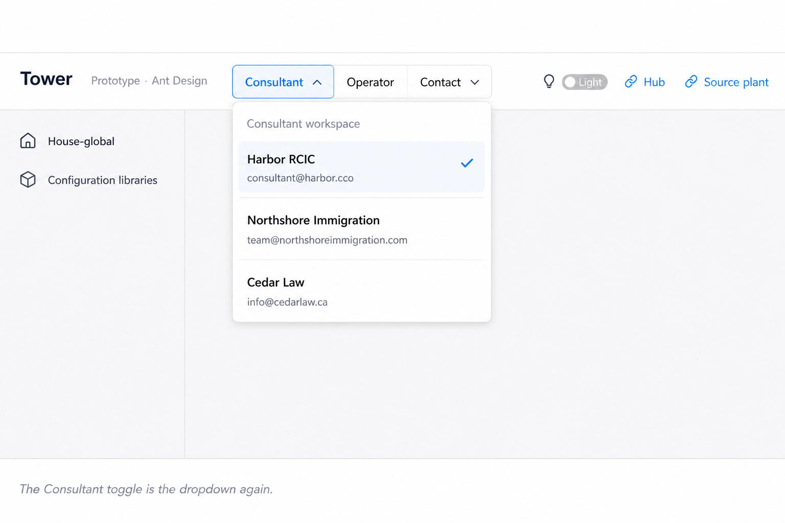
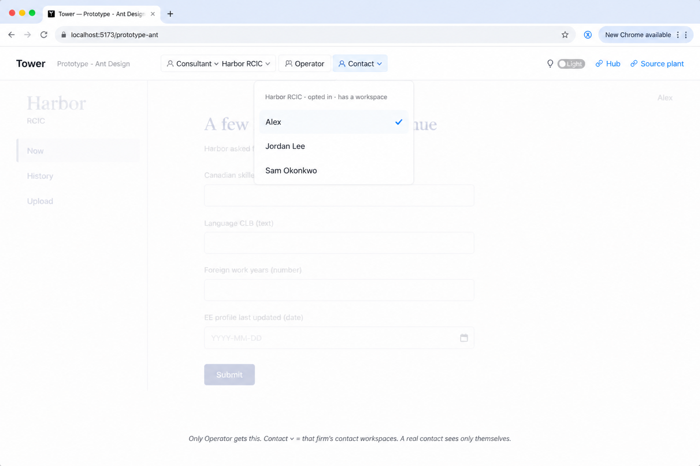
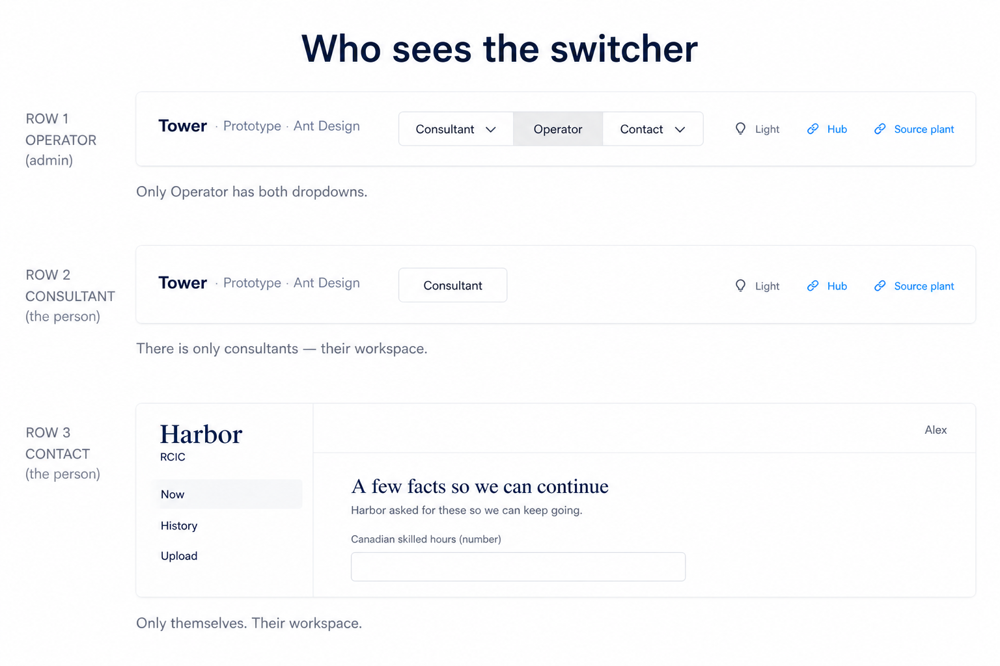

# Shell chrome — Operator view-as

**Seat:** Product Manager.  
**Why:** Founder 2026-08-21: light recut of the top Consultant / Operator / Contact control. Not an extensive redesign.  
**Flag:** [`PHASE-TWO-LOG.md`](./PHASE-TWO-LOG.md) **15:43 UTC** — do not overwrite.  
**Contact seat:** [`CONTACT-FACE.md`](./CONTACT-FACE.md).  
**Packet:** [`SHELL-CHROME-PACKET.md`](./SHELL-CHROME-PACKET.md). Marks **T1–T4**.  
**Does not:** plant; mint tables; recut 015; give Consultant users a Contact picker of the book; give a real contact the Operator switcher.

---

## Founder excerpts (do not paraphrase away)

> I don't it's not extensive at all it's not it's actually very light so if you look at the top of our where we have the Consultants operator and contact Toggles

> When you toggle on consultants it then shows you like the consultants workspace, but it shows you the consultants workspace, which is Selected like this actually a selector to the left of those items previously the consultant Toggle itself was the drop-down and I would like it to be that way again

> when a a consultant workspace is selected. I want a contact thing to also be … I want the … that firm's contacts to also to be that drop down in the contact … all the ones that have opted in that have a contact workspace

> Only I think i'm gonna, i'm gonna opt for that. Only. The operator has this ability. So in consultants, there is only consultants and in contact. Of course, there's only themselves and they're only their workspace

> I wanna see a u I mark. It's gonna be a very easy u I mark

---

## Law (short)

Live today drifted: a **firm picker to the left** of Segmented **Consultant | Operator | Contact**. Prior / wanted: **`Consultant ▾ | Operator | Contact ▾`**. First slot **is** the dropdown.

| Who is signed in | What they see |
|------------------|---------------|
| **Operator** (admin) | **Consultant ▾** (pick a consultant workspace / firm) · **Operator** · **Contact ▾** (that firm’s contacts who **opted in** and **have a workspace**). Both dropdowns. **T1 · T2 · T3** |
| **Consultant** (the person) | **Consultant** only. Their workspace. No Operator. No Contact picker. **T4** |
| **Contact** (the person) | Themselves. Their workspace (Now · History · Upload). No Tower switcher. **T4** / **P1** |

Picking Consultant ▾ shows that firm’s consultant desk. Picking Contact ▾ shows that contact’s workspace (the seat we specified). The Contact list is **not** the whole book — opted in + has a workspace.

Harbor / Alex / other names = **example**.

---

## Marks

| # | File | What it is |
|---|------|------------|
| **T1** | [`T1-shell-operator-toggles-closed.png`](./shell-blueprint/T1-shell-operator-toggles-closed.png) | Closed. One control. Consultant ▾ · Operator (selected) · Contact ▾. No extra picker to the left. |
| **T2** | [`T2-shell-consultant-dropdown.png`](./shell-blueprint/T2-shell-consultant-dropdown.png) | Consultant toggle **is** the dropdown. Pick a firm. |
| **T3** | [`T3-shell-contact-dropdown.png`](./shell-blueprint/T3-shell-contact-dropdown.png) | Contact ▾ = that firm’s opted-in workspaces. Operator viewing the contact seat. |
| **T4** | [`T4-shell-who-sees-switcher.png`](./shell-blueprint/T4-shell-who-sees-switcher.png) | Who sees what. Operator vs consultant person vs contact person. |

### T1 — closed

**Copy:** One segmented group. Consultant and Contact have chevrons. Operator has none. No firm chip to the left.

**Ignore:** Teaching caption. Catalog behind.

### T2 — Consultant ▾

**Copy:** The Consultant slot opens the firm list. Select = that consultant workspace.

**Ignore:** Example firm names / emails. Background sider if sparse.

### T3 — Contact ▾

**Copy:** After a consultant workspace is selected, Contact ▾ lists **opted-in contacts who have a workspace**. Pick one = that seat (Now · History · Upload). Operator chrome stays on top (view-as).

**Ignore:** Example people. Teaching caption.

### T4 — who sees the switcher

**Copy:** Only Operator has both dropdowns. Consultant person: Consultant only. Contact person: only their workspace.

---

## What this is not

- Not giving consultants a dropdown of all contacts.
- Not the contact seeing Operator / other contacts.
- Not the whole book in Contact ▾ — opted in + has a workspace.
- Not a design-system recut of Harbor paint.
- Not minting a view-as table from the picture.
