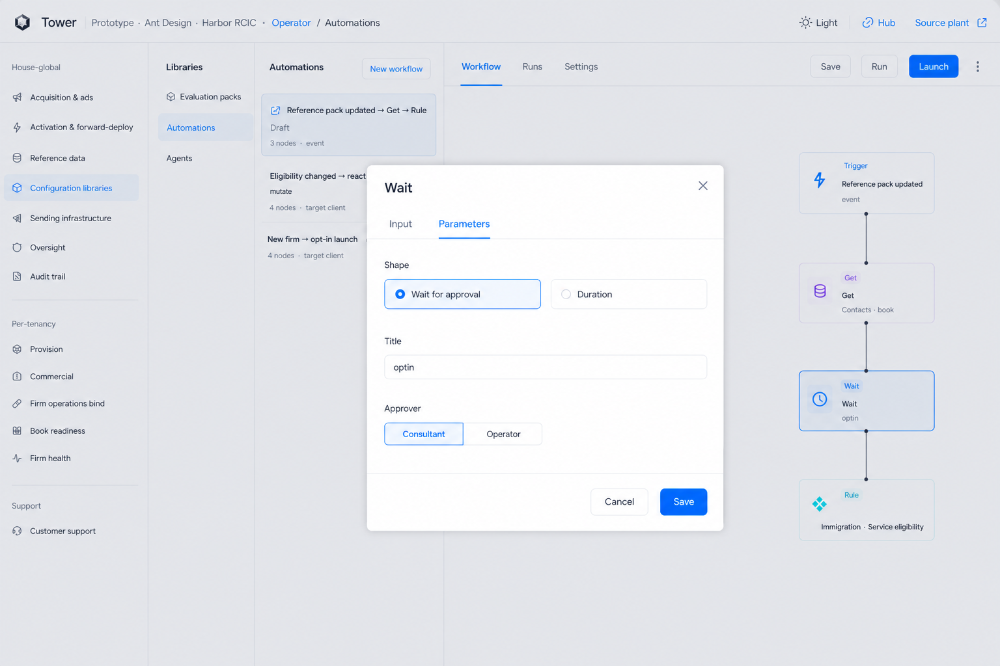

# Wait note — plates

**Seat:** Product Manager.  
**Packet (locked):** [`WAIT-NOTE-APPROVER-PACKET.md`](./WAIT-NOTE-APPROVER-PACKET.md) (pickup). Rest of the note: [`WAIT-NOTE-PACKET.md`](./WAIT-NOTE-PACKET.md) (frozen).  
**Buttons (written spec):** **Approve now** · **Approve later**. PNGs still say Start — do not build Start. No plate regen.  
**SA paper (read, do not recut):** fetch `origin pull/86/head` then `docs/register/SYSTEMS-STAGED-START-ASCRIBE.md` **11:11** — PR [#86](https://github.com/bywale-com/omcoda_tower/pull/86).  
**Flag:** [`PHASE-TWO-LOG.md`](./PHASE-TWO-LOG.md) **15:43 UTC** — do not overwrite.  
**Chrome:** Operator Wait interiors lock to live Automations + A22. Consultant note locks to live Board, **T4** (Consultant only).  
**Does not:** mint tables; recut 015; plant.

Prior sequence-preview look (do not build): [`S1-prior-sequence-preview.png`](./consultant-blueprint/S1-prior-sequence-preview.png). The note is title + count.

---

## What the note is

Approval Wait writes a prompt on the approver’s desk. The prompt is **text they wrote**. The hole is the **number**. Bottom bar and middle card are the same prompt. Duration shape has **no** desk pane.

**Approve later** nests date + time under that button. Solid bar + **Approve now** on the right.

---

## Canon

| # | File | What it is |
|---|------|------------|
| **W1** | [`W1-wait-canvas.png`](./automations-blueprint/W1-wait-canvas.png) | Wait is a kind on the palette and on the chain. |
| **W2** | [`W2-wait-interior-approval.png`](./automations-blueprint/W2-wait-interior-approval.png) | **Prior.** Title only. Do not ship without Approver. |
| **W2b** | [`W2b-wait-approver.png`](./automations-blueprint/W2b-wait-approver.png) | Approval. Title + **Approver:** Consultant · Operator. |
| **W3** | [`W3-wait-interior-duration.png`](./automations-blueprint/W3-wait-interior-duration.png) | Duration shape. A duration. No desk pane. |
| **N1** | [`N1-wait-note-open.png`](./consultant-blueprint/N1-wait-note-open.png) | Middle note. Title + count + **Approve now** · **Approve later** (pixels: Start). **X**. |
| **N1b** | [`N1b-wait-note-start-later.png`](./consultant-blueprint/N1b-wait-note-start-later.png) | Approve later clicked. Small date · time popover beneath that button. |
| **N2** | [`N2-wait-note-bar.png`](./consultant-blueprint/N2-wait-note-bar.png) | Solid bar. Same prompt + count. **Approve now** on the right (pixels: Start now). |

---

### W1 — Wait on the canvas

**Copy:** Wait is its own kind in the Build list. On this chain it sits after If and before the next Action. Approval badge on that node is this shape.

**Ignore:** Example titles (`optin`). Catalog names. Node count on the list card.

---

### W2 — approval interior (prior)

**Prior:** Title only. Pickup **W2b**.

---

### W2b — Approver

**Copy:** Shape **Wait for approval**. **Title** text box. **Approver:** **Consultant** · **Operator**. Two values. Around Title. Packet [`WAIT-NOTE-APPROVER-PACKET.md`](./WAIT-NOTE-APPROVER-PACKET.md).

**Ignore:** `optin`. Harbor. Teaching. Contact as a third value. A people list.

---

### W3 — duration interior

**Copy:** Shape **Duration**. A length (number + unit). No consultant note.

**Ignore:** Helper sentences on the shape cards. Extra Settings tab if it leaked. Exact `2 days`.

---

### N1 — middle note

**Copy:** Consultant person desk. A note: the **title** they wrote, the **number**, **Approve now** · **Approve later**. **X** closes to N2.

**Ignore:** **Start** / **Start later** on the PNG. **24**. Harbor / Ana / Cedar. The word **contacts** as a type. **Approve opt-in** as a frozen string. No campaign table.

---

### N1b — Approve later nest

**Copy:** Small popover **beneath** Approve later: date · time · tiny **X**. Buttons stay.

**Ignore:** Exact date / time. **Start later** string on the PNG.

---

### N2 — solid bar

**Copy:** Solid bar (cannot miss). Same prompt + the number. **Approve now** at the **right**, inside the bar. Rest of the bar reopens N1.

**Ignore:** **Start now** on the PNG. Exact blue hex. Same scenery as N1.

---

## Do not

- Restore the campaign / objective table.
- Ship Start / Start now / Start later.
- Freeze Launch window / optin / Approve opt-in as types.
- Recut 015. Overwrite 15:43. Plant. Mint tables.
