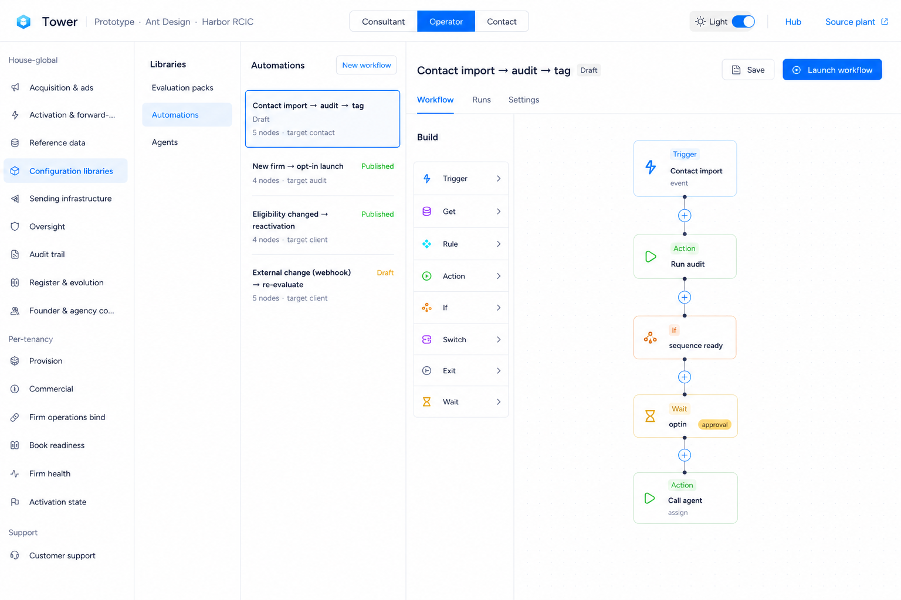
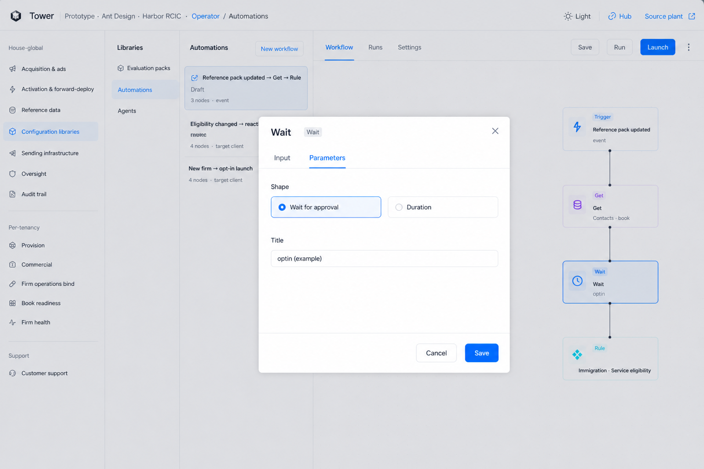
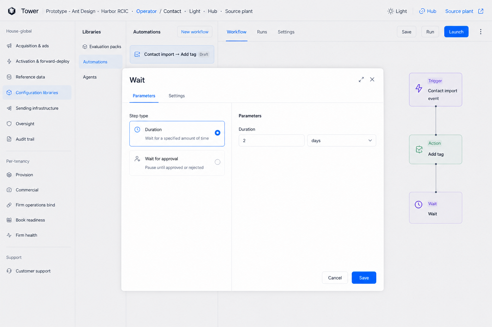
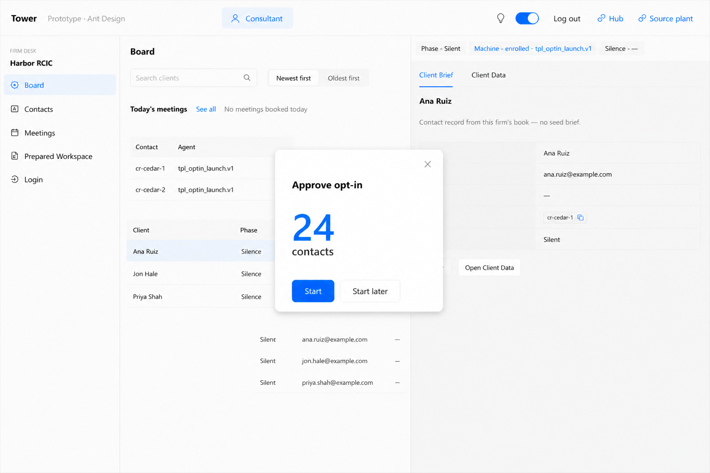
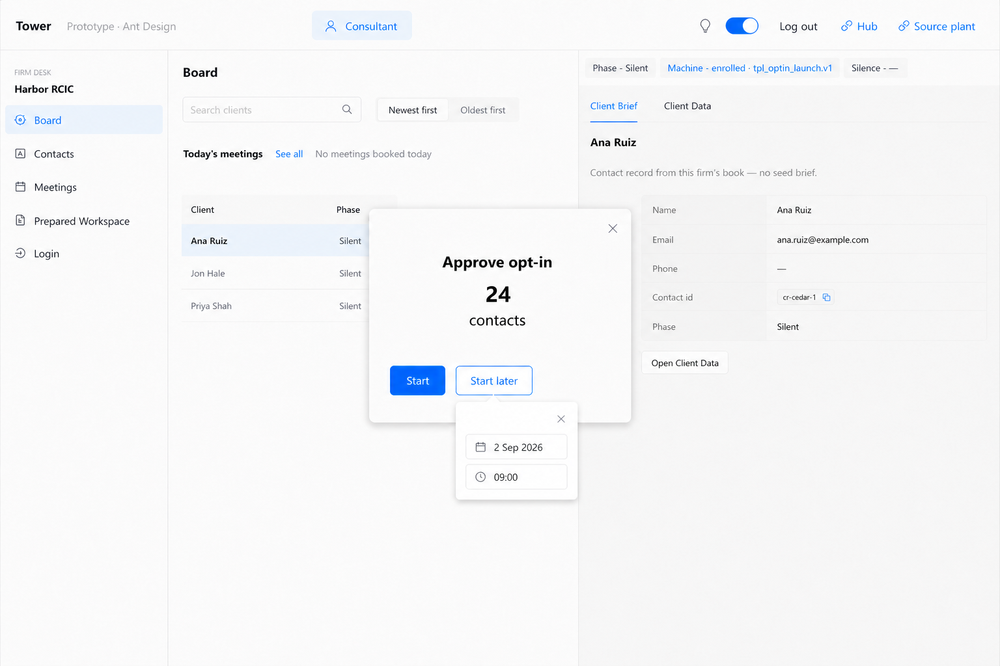
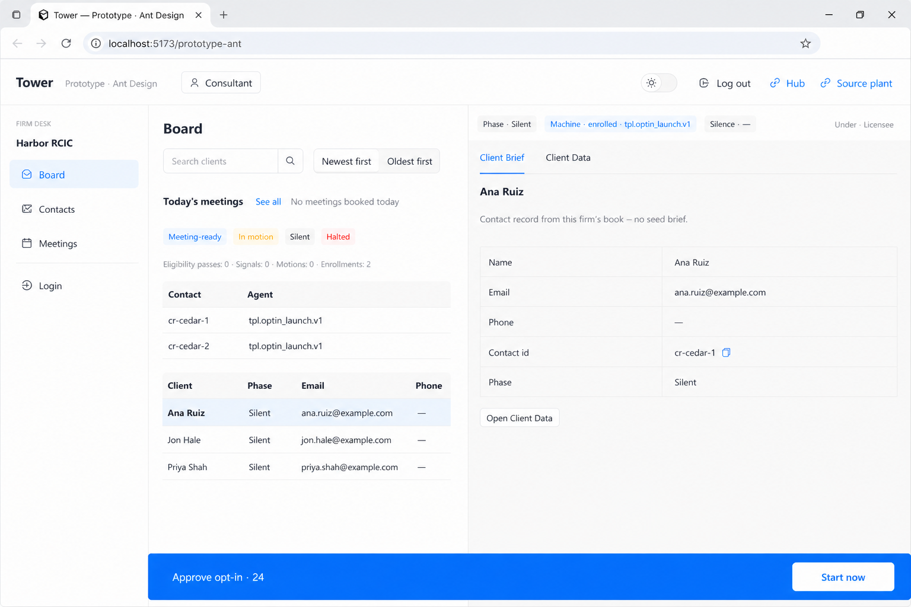

# Wait note — plates, not a packet

**Seat:** Product Manager.  
**Not a packet.** Founder: look at SA’s latest ascribe, then generate the plates that look requires.  
**SA paper (read, do not recut):** [`SYSTEMS-STAGED-START-ASCRIBE.md`](https://github.com/bywale-com/omcoda_tower/blob/cursor/sa-agents-flagship-inventory-a500/docs/register/SYSTEMS-STAGED-START-ASCRIBE.md) on PR [#86](https://github.com/bywale-com/omcoda_tower/pull/86) — **11:11 UTC**: interior is a **title**; the only variable on the desk is the **count**.  
**Flag:** [`PHASE-TWO-LOG.md`](./PHASE-TWO-LOG.md) **15:43 UTC** — do not overwrite.  
**Chrome:** Operator Wait interiors lock to live Automations + A22. Consultant note locks to live Board, **T4** (Consultant only).  
**Does not:** hand this to the engineer; mint tables; recut 015; plant; tell SA the machine.

Prior sequence-preview look (do not build): [`S1-prior-sequence-preview.png`](./consultant-blueprint/S1-prior-sequence-preview.png) and the S1 / S1b campaign table. The note is title + count.

---

## What the note is

Approval Wait writes a prompt on the approver’s desk. The prompt is **text they wrote**. The hole is the **number** of people who have reached **this** Wait in **this** workflow and are not yet approved. Bottom bar and middle card are the same prompt. Duration shape has **no** desk pane.

Start later still nests date + time under that button (earlier recut). Solid bar + Start now on the right (earlier recut).

---

## Canon

| # | File | What it is |
|---|------|------------|
| **W1** | [`W1-wait-canvas.png`](./automations-blueprint/W1-wait-canvas.png) | Wait is a kind on the palette and on the chain. |
| **W2** | [`W2-wait-interior-approval.png`](./automations-blueprint/W2-wait-interior-approval.png) | Approval shape. One **title** text box. |
| **W3** | [`W3-wait-interior-duration.png`](./automations-blueprint/W3-wait-interior-duration.png) | Duration shape. A duration. No desk pane. |
| **N1** | [`N1-wait-note-open.png`](./consultant-blueprint/N1-wait-note-open.png) | Middle note. Title + count + Start · Start later. **X**. |
| **N1b** | [`N1b-wait-note-start-later.png`](./consultant-blueprint/N1b-wait-note-start-later.png) | Start later clicked. Small date · time popover beneath that button. |
| **N2** | [`N2-wait-note-bar.png`](./consultant-blueprint/N2-wait-note-bar.png) | Solid bar. Same prompt + count. **Start now** on the right. |

---

### W1 — Wait on the canvas

**Copy:** Wait is its own kind in the Build list. On this chain it sits after If and before the next Action. Approval badge on that node is this shape.

**Ignore:** Example titles (`optin`). Catalog names. Node count on the list card.

---

### W2 — approval interior

**Copy:** Shape **Wait for approval**. A **title** text box. That is the interior.

**Ignore:** The word `example` if it leaked into the field. Get’s Firm / Contact cascade (not this kind). Sequence / audit chips (11:00 recut). Teaching lines on the shape cards.

---

### W3 — duration interior

**Copy:** Shape **Duration**. A length (number + unit). No consultant note.

**Ignore:** Helper sentences on the shape cards. Extra Settings tab if it leaked. Exact `2 days`.

---

### N1 — middle note

**Copy:** Same desk as the consultant person. A note: the **title** they wrote, the **number**, Start · Start later. **X** closes to N2.

**Ignore:** **24**. Harbor / Ana / Cedar. The word **contacts** as a type — it is authored text. **Approve opt-in** as a frozen string — it is the title example (`optin` on W2). No campaign table.

---

### N1b — Start later nest

**Copy:** Small popover **beneath** Start later: date · time · tiny **X**. Buttons stay.

**Ignore:** Exact date / time.

---

### N2 — solid bar

**Copy:** Solid bar (cannot miss). Same prompt + the number. **Start now** at the right, inside the bar. Rest of the bar reopens N1.

**Ignore:** Exact blue hex. Same scenery as N1.

---

## Specified and clear (this look)

- Approval Wait interior: a title.
- Desk note: that text + the count. Two chrome: middle card · bottom bar.
- Start · Start later. Later = schedule under that button. Bar has Start now on the right.
- Duration: no note.

## Specified but not clear (do not invent in a packet)

- One title field vs title plus a separate desk-copy template (where the number sits).
- First appearance: N1 vs N2.
- Confirm inside the small schedule popover.

## Do not

- Packet until they agree.
- Restore the campaign / objective table on the note.
- Freeze Launch window / optin / Approve opt-in as types.
- Recut 015. Overwrite 15:43. Plant. Mint tables.
