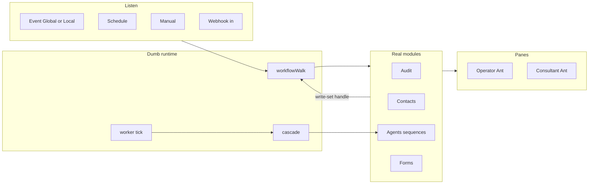
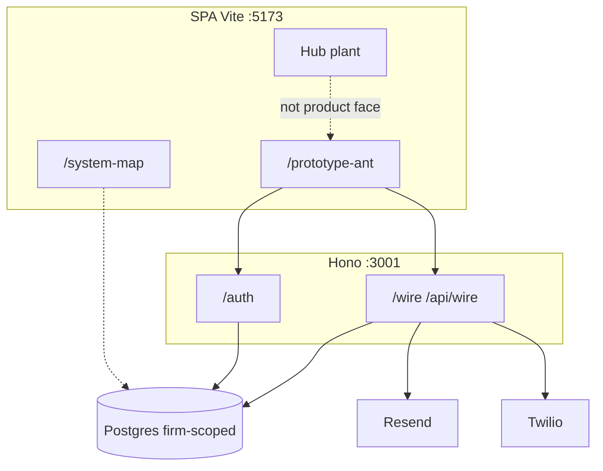
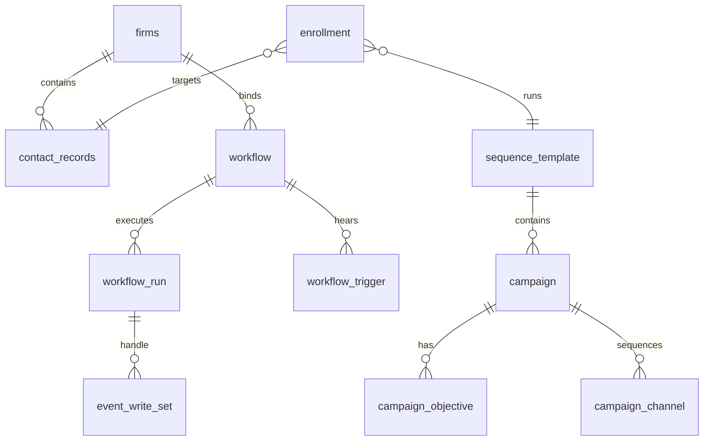

# BMad reconstructed bundle

Coordinator reconstruction from transcript diffs. Install logs, extracts, and full `_bmad/` scaffolding were mostly shell/CLI writes and may be missing.


===== STATUS.json =====

{
  "contestant_id": "bmad",
  "sha": "c5bd617b9b1bb9fbd5d73c99da16a973594c6bd7",
  "framework": "bmad-method",
  "framework_version": "6.12.4",
  "status": "complete",
  "completion_claim": "Installed genuine bmad-method@6.12.4 (module bmm, tool cursor), followed bmad-help catalog routing, and ran the planning skills in headless mode against the Tower repository (plus origin pull refs this SHA names as live spec). Produced a product brief, PRD (FR-1–FR-39), UX DESIGN/EXPERIENCE spines, architecture spine (AD-1–AD-12, lint clean), SPEC-tower kernel with companions, and a headless analog of epics/stories. Uncertainties are explicit; no founder decisions were invented. Ship-phase bmad-build was skipped because product implementation is forbidden. Headless artifacts are status=partial pending founder confirmation of open questions — the assignment to establish a coherent specification from existing material is complete.",
  "blocker": null,
  "artifact_root": "/home/ubuntu/tower-spec-output/"
}


===== EXPERIMENT-RECORD.md =====

# Experiment record — Contestant 5 (BMad Method)

## Initial approach

Treated the assignment as a BMad Method specification of an **existing** product, not as Tower Engineer/PM/SA seating. Confirmed SHA `c5bd617b9b1bb9fbd5d73c99da16a973594c6bd7` at HEAD (`2026-10-19T16:46:33Z`). Created `/home/ubuntu/tower-spec-output/` immediately.

Intended line: stable `bmad-method@6.12.4` module `bmm`. Did **not** switch to v7 preview-alpha.

Top-level `npx bmad-method@6.12.4 --list-tools` failed (`unknown option`). Official `install --help` documents `--list-tools` on the **install** subcommand. Cursor tool ID is `cursor`.

Installed:

```
npx bmad-method@6.12.4 install --yes --action install --modules bmm --tools cursor
```

into `/workspace` as methodology tooling (`_bmad/`, `.agents/skills` 29 skills, `_bmad-output/`). Installed `uv` 0.13.1 because skills halt without `uv run`.

Then executed **bmad-help**: catalog CSV + `resolve_config.py`. Optional items first (brief/recon), next required **PRD**. Architecture and epics required later. Build required by catalog but forbidden by experiment.

## First substantive artifacts

1. `BMAD-HELP-ROUTING.md` — catalog gates and skip list.
2. Extract digests (`planning-artifacts/_extracts/`) — SHA key docs, PR #96 packets, PR #86/#110 SA logs, migrations index. BMad “extract, don’t ingest.”
3. `bmad-product-brief` Create, headless Fast path → `brief-Tower-2026-10-19`.
4. `bmad-prd` Create, headless → `prd-Tower-2026-10-19` (FR-1–FR-39).

Origin pull refs **#86, #96, #108, #110** were fetched because this SHA’s docs name them as live spec. History via `origin` is allowed; third-party commentary was not used as product requirements. `bmad-deep-recon` web market research was skipped (research firewall + experiment rule).

## Later revisions / discoveries

- **README vs register conflict:** root README still says UI prototype / mock clients / no backend. Register + `server/` + `supabase/migrations/001`–`024` describe a wired agency product. Ruled evidence-weighted toward register; tagged `[ASSUMPTION]`, not silently merged.
- **docs/README remap stale vs SQL on this SHA:** docs still say migrations `001`–`018` and Engineer cuts packet 022; tree contains `019_contact_seat.sql` … `024_wait_occupancy.sql`. Spec quotes filenames.
- **Live packets ahead of SHA FACE files:** PR #96 Current at fetch is Wait-note Approver; SHA Phase Two log Current is A40 / SA 021. Intended glass includes named packets; implementation status is a separate inventory.
- **15:43 vs 14:58:** flagship is operator sequencing / overrides / attempts / goal-as-escalation; 14:58 generated list including triggers-in-Agents is superseded.
- **Architecture lint:** `lint_spine.py --workspace …` → `ok: true`, 0 findings.
- **create-epics-and-stories:** step files halt for user Continue. Produced `epics.md` as **headless analog**, not a founder-approved backlog.
- **bmad-review:** `doc_standards` requested structure/prose lenses; this seat cannot spawn subagents. Parent sequential review written to `review-structure-prose.md`.
- **Ship skills** (`bmad-sprint-planning`, `bmad-build`) skipped — implementation forbidden. `bmad-project-context` skipped (would edit `AGENTS.md`).

No intermediate “v2 rewrite” of the brief/PRD after first distill; memlogs record decisions as they landed. Extracts are the intermediate source layer.

## How next steps were chosen

Always `bmad-help` catalog:

| Order | Skill | Why |
|-------|-------|-----|
| 0 | bmad-help | Installer “get started” |
| 1 | product-brief | precedes required PRD; committed concept (skip PRFAQ/forge/brainstorm) |
| 2 | prd | required planning |
| 3 | ux | UI is major; strongly recommended after PRD |
| 4 | architecture | required; brownfield ratify |
| 5 | spec | condense kernel for downstream |
| 6 | create-epics analog | required before ship; interactive blocked |
| 7 | skip build | experiment constraint |

Headless modes on brief/PRD/UX/architecture/spec: do not ask; tag assumptions; open questions stay open.

## Why continue / revisit / stop

Continued until the planning path that BMad requires for a project-sized existing product had artifacts on disk, plus a kernel spec and explicit uncertainty list. Stopped before Build. Did not ask the coordinator/founder for additional requirements.

**Stop condition:** assignment complete as specification-from-existing-material. Not a blocker (toolkit ran). Not budget_exhausted.

## Time / resource notes

- Start: `2026-10-19T16:46:33Z` (`START.md`)
- Stop: see `STOP-TIME.txt`
- Node v22.23.3, npm 10.9.9, Python 3.12.3, uv 0.13.1
- `rsync` absent; used `cp -a` to mirror
- No git push, no PRs, no GitHub issues
- BMad scaffolding left in `/workspace/_bmad`, `/workspace/.agents`, `/workspace/_bmad-output` as methodology tooling (not submitted as product)

## Install evidence

- Package version: **6.12.4**
- Modules: **core 6.12.4**, **bmm 6.12.4**
- Tool ID: **cursor**
- Installer log: `bmad-install.log`, `install-evidence/bmad-install.log`
- Status dump: `install-evidence/bmad-status.txt`
- Manifest: `install-evidence/manifest.yaml`
- Skills: `install-evidence/skills-list.txt` (29)
- Help catalog: `install-evidence/bmad-help.csv`
- Config: `install-evidence/config.toml`, `config.user.toml`
- Native output: `/workspace/_bmad-output` → `bmad-native/_bmad-output/`

## File inventory

See `FILE-INVENTORY.txt` (regenerated at stop). Primary specification:

- `primary/briefs/brief-Tower-2026-10-19/brief.md`
- `primary/prds/prd-Tower-2026-10-19/prd.md`
- `primary/ux-designs/ux-Tower-2026-10-19/DESIGN.md`
- `primary/ux-designs/ux-Tower-2026-10-19/EXPERIENCE.md`
- `primary/architecture/architecture-Tower-2026-10-19/ARCHITECTURE-SPINE.md`
- `primary/specs/spec-tower/SPEC.md`
- `primary/epics.md`
- Concatenated: `BUNDLE.md`
- Uncertainties: `UNRESOLVED-QUESTIONS.md`


===== FRAMEWORK.md =====

# BMad Method — install evidence

- **package:** `bmad-method@6.12.4` (`npx bmad-method@6.12.4 --version` → 6.12.4)
- **modules:** `core` 6.12.4, `bmm` 6.12.4
- **tool ID:** `cursor` (from `bmad install --list-tools`; skills → `.agents/skills`)
- **note:** top-level `--list-tools` is invalid; the flag is on `install`
- **project root install:** `/workspace/_bmad`
- **output folder:** `_bmad-output` (planning-artifacts, specs)
- **user_name:** Contestant 5
- **project_name:** Tower
- **project_knowledge:** docs
- **user_skill_level:** expert (config.user.toml)
- **uv:** 0.13.1 (required for skill Python scripts; installed during this run)
- **node:** v22.23.3
- **skills installed:** 29 under `/workspace/.agents/skills`
- **did not switch** to v7 preview-alpha `npx skills add` path
- **installer log:** `install-evidence/bmad-install.log`
- **native output mirrored to:** `/home/ubuntu/tower-spec-output/bmad-native/_bmad-output`

Install command used:

```bash
npx --yes bmad-method@6.12.4 install --yes --action install --modules bmm --tools cursor \
  --user-name "Contestant 5" --communication-language English \
  --document-output-language English --output-folder _bmad-output \
  --set core.project_name=Tower --set bmm.project_knowledge=docs \
  --set bmm.user_skill_level=expert
```


===== BMAD-HELP-ROUTING.md =====

# BMad Help routing — 2026-10-19T16:50Z

Contestant 5 executed `bmad-help` against the installed catalog (`_bmad/_config/bmad-help.csv`) and merged config.

## Where we are

- Fresh BMad Method 6.12.4 install; module **bmm** 6.12.4; tool **cursor**.
- No prior `_bmad-output/planning-artifacts`.
- Project knowledge path: `docs/` (217 markdown/json files).
- Assignment: complete coherent **specification** of intended Tower product. Implementation forbidden.

## Catalog gates (required=true)

| Phase | Skill | Status at routing |
|-------|-------|-------------------|
| 2-planning | `bmad-prd` (preceded-by `bmad-product-brief`) | not started |
| plan | `bmad-architecture` | not started |
| plan | `bmad-create-epics-and-stories` (preceded-by architecture) | not started |
| plan | `bmad-sprint-planning` | not started |
| ship | `bmad-build` | **will not run** — experiment forbids product implementation |

## Optional items considered first (per help ordering)

- `[RS] Deep Recon` (`bmad-deep-recon`) — useful for market/domain, but research firewall treats project files as inadmissible evidence unless the plan **grants named documents**. Third-party web commentary is forbidden as Tower product requirements. Decision: **do not use web recon as product truth**. Instead grant named Tower documents as the research corpus via extract files (product-brief Discovery / PRD extract-don't-ingest).
- `[BP] Brainstorm` — skip. Concept already committed in-repo.
- `[FI] Forge Idea` — skip. Committed product, not an untested idea.
- `[WB] PRFAQ` — skip. Catalog: brief is the gentler alternative when already committed to the concept.
- `[CB] Create Brief` (`bmad-product-brief`) — **run first**, headless, from repository evidence.
- `[SPC] Spec` (`bmad-spec`) — run after PRD/UX/architecture to condense the kernel.
- `[CU] Create UX` — strongly recommended; UI is a major part of the product. Run after PRD.
- `[PC] Project Context` — skip writing into `AGENTS.md` (application source change forbidden).

## Next required

1. `bmad-product-brief` Create, headless Fast path, sources = repo docs + code as evidence.
2. `bmad-prd` Create, headless.
3. `bmad-ux` Create, headless.
4. `bmad-architecture` Create (brownfield: ratify existing conventions), headless.
5. `bmad-spec` Create from the planning artifacts.
6. `bmad-create-epics-and-stories` — specification of remaining work vs stood-up machine; not an implementation license.
7. `bmad-sprint-planning` — generate tracking only if it does not imply starting Build. Experiment: produce readiness assessment; do not invoke `bmad-build`.

## Execution constraints treated as BMad persistent facts

- Isolated contestant; no other contestants' work.
- SHA `c5bd617b9b1bb9fbd5d73c99da16a973594c6bd7`.
- No founder elicitation. Gaps → `open_questions[]` / `[NOTE FOR PM]`, not invented decisions.
- Git history / origin pull refs may be inspected when this SHA's docs point to them as live spec.
- Native BMad output under `/workspace/_bmad-output`; mirrored to `/home/ubuntu/tower-spec-output/`.

## Headless justification

No TTY / no founder. Skills with Headless Mode: do not ask; infer; tag assumptions; halt blocked only when topic cannot be inferred. Topic = Tower intended product from the supplied repository.


===== UNRESOLVED-QUESTIONS.md =====

# Unresolved questions

Contestant 5 (BMad) did not invent founder decisions. These remain open in the repository material.

1. Full Automations operations catalog (beyond PRIMITIVES shape list).
2. Full Automations exit-point catalog.
3. Form-as-own-graph-node vs embedded in start-agent node (lean: embedded).
4. Remaining rule output classes besides required data.
5. Story §7 promotion of goal-as-completion wording vs SA packet 022 mechanism.
6. Consent regime for the first agent→consultant Approach text.
7. Whether email earns Meta entry; Meta targeting / CAC.
8. Multi-consultant roles inside a firm.
9. Root README “UI prototype / no backend” vs register+SQL wired product — no explicit withdrawal.
10. Which PR #96 packets are liked vs still pickup relative to this SHA’s FACE files (living #96 Current at fetch: Wait-note Approver).
11. WCAG / accessibility floor unspecified.
12. Production SLA / RTO / on-call unspecified.
13. SME privacy/CASL vs Seed product-law merge.
14. Wait walker kind vs `024_wait_occupancy.sql` alignment on this SHA.
15. Packet number vs migration number after 012 (docs/README remap stale vs SQL `019`–`024`).


===== _workspace/_bmad-output/planning-artifacts/briefs/brief-Tower-2026-10-19/brief.md =====

---
title: Product Brief — Tower
status: final
created: 2026-10-19
updated: 2026-10-19
sources:
  - SHA c5bd617b9b1bb9fbd5d73c99da16a973594c6bd7
  - docs/register/SEED.md
  - docs/register/WORLD.md
  - docs/register/PHASE-TWO.md
  - docs/register/PHASE-TWO-LOG.md (flagship 2026-08-15 15:43 UTC)
  - docs/register/personas.md
  - docs/register/PRIMITIVES.md
  - docs/register/AGENTS-FACE.md
  - docs/register/AUTOMATIONS-FACE.md
  - docs/register/DATA-IN-TABLES.md
  - docs/register/SYSTEMS-STORY.md
headless: true
skill: bmad-product-brief
---

# Product Brief: Tower

## Executive Summary

Tower is Om Coda’s always-on immigration-consultancy workspace. It is **not** a reactive CRM. It is **proactive eligibility wrapped in engagement**: given a firm’s private contact book, the system keeps engaging dormant and active people, refreshes immigration-relevant facts through firm→client touchpoints, re-evaluates **service eligibility** as IRCC-shaped reference and client facts move, and surfaces campaign-worthy people so consultants book meetings without rechecking every file by hand.

Om Coda runs Tower as an **agency product across many firms**, not as a self-serve tool each firm configures alone. House operators author evaluation rules, automation graphs, and sequence/campaign templates in **configuration libraries**; a **per-tenancy admin** binds those packs under a firm’s identity. The consultant inhabits the book and the meetings. The engagement contact is a subject of outreach — consent, forms, booking — not a branded Tower seat.

The product face is **CT Ant** (`/prototype-ant`). Hub is an advanced plant / reference, not the app. Register is prototype-time house methodology tooling and is **not shipped to firms**.

## The Problem

Immigration consultancies lose work sitting in dormant books. Eligibility (pathways, draws, documents, scores) moves while consultants are in meetings. Rechecking every file by hand does not scale. Public-before-contact detection of *end-client* eligibility is the wrong product class: real eligibility needs the firm’s own book.

Consultants need the book reachable, consent respected, and outreach that is methodology — opt-in, data-request re-engagement, reactivation toward a meeting — not a mail-merge. The agency needs those operations inspectable and changeable **without a code deploy**.

## The Solution

Tower runs a continuous loop over a private firm book:

**Book in → house-authored agent (rules / sequence / content) ↔ automations (when / motion / structured info) → enroll / attempt → send → Activity / Board → meeting booked.**

- **Automations** is the operations brain: on an event (or schedule / manual / webhook), perform a definite operation, then fork on binary results. Actions are **in-app** (audit, tag, form, provision) or **Agents** (assign an existing sequence or instantiate from a template). After a node, the next step has **every write that run made**.
- **Agents** is where the **operator** authors outreach sequencing: order deployed, per firm or default plus overrides, attempt/retry/escalation, and a **goal / goal criteria** that is itself an escalation point — to another agent, to another workflow, or it ends. Once met, met.
- **Consultant desk** inhabits the book, Activity chronology, eligibility read-out, and meetings. **Contact** touchpoints are firm-branded (consent, forms, booking). **Operator** house-global + per-tenancy admin provisions, binds, oversees.

Growth door (ALG): one-tap Meta Approach captures name + website + one channel inside a click budget; forward-deploy stages a no-login prepared workspace; an agent *presents* until the firm authorizes the book and accepts escrow. Assisted provision remains a real second door into the **same** application.

## What Makes This Different

- **Eligibility wrapped in engagement**, not a CRM inbox.
- **Agency authorship**: house writes packs; firms bind; consultants inhabit. Firms do not author libraries.
- **Open-box operations**: rules, constants, sequences, and workflows are data + a dumb runtime — not sealed model weights and not “write any table.”
- **Goal as endpoint**, not a dashboard metric. Objective met is an event; escalation is a subscription, not a destination column. [ASSUMPTION: SA packet 022 on this SHA / PR #110 is the intended housing; Story §7 promotion of that wording is still named, not silently done.]
- **Honesty contract**: records on a desk come from tables. Empty book → empty UI. No Sarah/Cedar scenery.

Do not fabricate a technical moat beyond execution of this shape. Hub quality is the visual plant for Automations/Rules; Ant is the translation that must match the plates.

## Who This Serves

- **Primary acquired seat — Consultant (firm desk):** inhabits the private book; refuses illegal outreach; takes meetings the loop books. Success = booked meetings on eligible people without file-by-file recheck.
- **Operator / Om Coda house (not an acquired persona):** authors libraries, provisions and binds firms, keeps reference current, oversees fleet health, answers support. House-global console + per-tenancy admin.
- **Engagement contact (not a persona):** consent, self-report, silence, booking as firm-branded touchpoints.

Non-users in V1: LinkedIn Approach (deferred); cold-email Approach; self-serve long onboarding as the primary door; public-detection products; a branded contact “Tower workspace.”

## Success Criteria

User: a running firm’s book is sequence-ready; eligible people surface; meetings book without the consultant rechecking every file; opt-out and halt are honored.

Business: ALG cheaply tests the growth bet; contingent-cost / escrow is the activation money posture (not built as fulfillment — deferred by plan). Open-box packs swap industry criteria without a deploy.

Honesty: desks show query results; stand-in ports (Meta, escrow, enrich crawl) are named as stand-in, not “the system.”

**No numeric conversion/CAC targets are in Seed.** [NOTE FOR PM: Seed leaves Meta targeting / CAC and first-text consent regime as silences.]

## Scope

**In (intended product, Phase One + Phase Two module-by-module):** twelve Story systems (acquisition through meeting); consultant / operator / contact surfaces as in personas + How trees; Agents + Automations as authored on the Ant face (plates + PM packets); tables + worker + `workflowWalk.ts`; live send when secrets exist (Resend / Twilio); data-in-tables.

**Explicitly out / deferred by named plan:** Meta go-live as live ads ops; Escrow fulfillment (prototype / stand-in); Register & evolution as a shipped firm module; Hub as the product face; minting tables from captions; recutting walker **015**; overwriting flagship **15:43**.

Phase Two is not a second Seed/World rewrite. Work is “I should be able to…” mapped to missing component, missing system, both, or already-exists.

## Vision

If it works: Om Coda runs many immigration firms on one agency machine. House evolves packs as IRCC moves. Consultants live in a desk that is already working when they sit down. The same graph-shaped operations layer is what later verticals swap packs into — Tower V1 is immigration, not a generic engagement OS pretending to be finished.

Grounded limit: V1 Approach is Meta; the desk does not shrink to make ALG cheaper; Evolution stays house methodology, not a client lifecycle.


===== _workspace/_bmad-output/planning-artifacts/briefs/brief-Tower-2026-10-19/addendum.md =====

# Product Brief addendum — Tower

Depth that does not fit the 1–2 page brief. Downstream PRD / UX / architecture / spec should read this with the brief.

## Authority layers (do not conflate)

| Layer | What it is | Conflict rule |
|-------|------------|---------------|
| Seed + World | Validated 2026-07-27 ecosystem + bets | Under-claim; World does not fill Seed holes |
| Systems Story (12 systems) | Machine must / must-not / chain / silence | Requirements extract; they do not invent |
| Personas / How / Outcomes | Workspace seats and function trees | Consultant is the only acquired persona |
| Phase Two log **15:43** | Agents flagship — founder wording | Do not overwrite with generated lists |
| Agents / Automations FACE + UI blueprints | App-facing law + plates | Captions on plates are not nodes |
| PRIMITIVES | Event and action catalogs “shape so far” | Not “any row changed”; webhook is inbound only |
| Data-in-tables | Desk shows query results | Missing store = SA, not SPA fake rows |
| Postgres migrations on this SHA | Stood-up machine | `001`–`024_*` present; docs/README remap on SHA is stale vs SQL |
| Live PM packets | PR #96 (`git fetch origin pull/96/head`) | SHA tree does not contain most packets |
| Live SA packets | PR #86 (010–028) and PR #110 Current | SHA `docs/README.md` Current pointer is behind SQL |

## Source conflict: README.md vs register

Root `README.md` still describes a **UI prototype** (board → client, mock Sarah Jenkins / Marcus Webb, “no authentication, API, or persistence”). Register + `package.json` scripts + `server/` + `supabase/migrations/` describe a **wired product** with auth, wire, worker, and Postgres.

**Ruling for this specification (evidence-weighted, tagged):** treat register + Seed/World/Story/FACE as intended product; treat root README as a **stale earlier prototype description**. [ASSUMPTION] No founder stamp on this SHA says “README is withdrawn.”

## Dual-entry and causal ring (Phase Two 14:49 — context, not the 15:43 flag)

Automations decide whether / when / which motion → Agents define how engagement behaves → worker/cascade applies firm-bound template+rules → desks record → `meeting_booked` is the win.

Agents has two doors: from Automations (event), and from Agents itself (start the mission now — Contacts / Add contact). Do not put Automations triggers on the Agents canvas.

## Deferred by named product choice (not unfinished rewire unless Story already required it)

- Meta ads go-live
- Escrow fulfillment
- Enrich crawl / Postmaster / warmup / list-unsubscribe ingress (wiring stand-ins)
- Register as shipped firm surface
- LinkedIn Approach
- Cold email as V1 Approach

## Silences Seed/World name (do not fill)

- When/whether email earns Meta entry; Meta targeting / CAC
- Consent regime for the first agent→consultant text
- ALG Approach / forward-deploy / escrow door remain bets not fully built in prototype honesty
- Full Automations operations catalog and exit-point catalog (FACE “Open”)
- Form-as-own-node vs embedded in start-agent node (lean: embedded; not locked)
- Story §7 promotion of goal-as-completion wording vs packet 022 mechanism

## Product face vs plant

| Surface | Job |
|---------|-----|
| `/prototype-ant` | Product face (Operator → Configuration libraries → Agents / Automations; Consultant desk; Contact seat) |
| Hub | Advanced plant for Automations/Rules quality — not the app |
| `/register` | Theory workspace — not shipped to firms |
| `/system-map` | Interactive machine map — SA tool, not consultant product |

## Shell chrome (later packets on PR #96)

Consultant ▾ · Operator · Contact ▾. Workspace-until-opt-out and Wait-note/Approver are living packets on #96; SHA FACE files predate some of them. Specification of *intended* product includes those packets as named from the living log; implementation status on this SHA is a separate inventory (migrations through `024_wait_occupancy.sql` suggest Wait occupancy SQL has landed even if FACE docs on SHA have not).


===== _workspace/_bmad-output/planning-artifacts/prds/prd-Tower-2026-10-19/prd.md =====

---
title: PRD — Tower
status: final
created: 2026-10-19
updated: 2026-10-19
stakes: launch / agency product (Phase Two inhabit; not greenfield)
working_mode: fast-path headless
headless: true
skill: bmad-prd
sources:
  - ../briefs/brief-Tower-2026-10-19/brief.md
  - ../briefs/brief-Tower-2026-10-19/addendum.md
---

# PRD: Tower

*Working title confirmed from Seed / package.json / register: **Tower**. Company: **Om Coda**.*

## 0. Document Purpose

This PRD is the BMad Method planning contract for the **intended Tower product**, distilled from the repository at SHA `c5bd617b9b1bb9fbd5d73c99da16a973594c6bd7` plus origin pull refs this SHA’s docs name as live spec (PR #96 PM packets, PR #86 / #110 SA packets). It is for downstream UX, architecture, spec, and epic skills — not for inventing founder decisions.

Vocabulary is Glossary-anchored. Features group functional requirements with stable FR-n IDs. Inferences without a founder's written decision are tagged `[ASSUMPTION]`. Named silences stay in §8. UX plates and machine packets are not duplicated here; they remain companions.

## 1. Vision

Tower is the always-on immigration-consultancy workspace Om Coda runs as an agency. A stranger consultant is acquired through a one-tap Meta Approach (name + website + one channel inside a click budget) or through assisted provision into the **same** application. Activation forward-deploys a no-login prepared workspace under the firm identity until database authorization and escrow acceptance land. Then the Application loop runs: keep the private book reachable, engage through opt-in → re-engagement nudges → reactivation, refresh facts through touchpoints, re-evaluate service eligibility as facts and IRCC-shaped rules move, and campaign eligible people toward a **meeting booked** — without the consultant rechecking every file by hand, and without public-before-contact detection of end-client eligibility.

The operator authors outreach **sequencing** (order deployed), **per firm or as a default** plus **overrides**, **escalation between attempts**, and a **goal / goal criteria** that is itself an escalation point: to other agents, to other workflows, or it ends. Once met, met. Everything in the middle is modular. Automations is the operations brain on events; Agents sends people to goals. Presentation agents ask, explain, and route — they do not scrape, persist, fire sequences, evaluate, issue OTP, or move money.

## 2. Target User

### 2.1 Jobs To Be Done

- **Consultant (functional):** Give Tower the book; get booked meetings on people who are actually eligible now, without file-by-file recheck.
- **Consultant (emotional):** Trust that outreach is legal, consented, and on-brand — not spam the firm will be blamed for.
- **Operator (functional):** Author packs once; bind them per tenancy; see silent sequence failure across firms; provision and recover a tenancy without a deploy.
- **Engagement contact (functional):** Understand what is being asked (consent, a form, a meeting), opt out, and not be chased after silence.
- **Founder / agency (contextual):** Keep eligibility and engagement as open-box operations that survive IRCC change and industry-pack swap.

### 2.2 Non-Users (v1)

- End-clients acquired via Approach (contacts are never Approach-acquired).
- The Om Coda house as an Approach stranger.
- Firms that must author their own evaluation/automation/sequence libraries. [WORLD: authorship is house-global; tenancy binds.]
- LinkedIn Approach users (deferred).
- A “public detection” buyer who thinks a legal business name is enough to score immigrant eligibility.

### 2.3 Key User Journeys

- **UJ-1. Priya (RCIC) inhabits a running firm desk.** Priya authorized the book last week. She opens `/prototype-ant` as Consultant, sees Board detections keyed by `contact_records.id` (not Sarah). She opens a contact’s Client Data → Activity and reads the engagement record: what armed, what sent, what is silenced. A meeting appears on Meetings with a live brief. **Climax:** she walks into the meeting already knowing why this person is campaign-worthy. **Edge:** empty book → empty Board, never a painted Cedar roster.

- **UJ-2. Amira (Om Coda operator) authors then binds.** Amira opens Operator → Configuration libraries. She authors (or revises) an Automations graph: firm provisioned → audit contacts → If on that write-set → assign Agents from a template. She authors an Agents sequence as a blank canvas of campaigns (each campaign one objective; channels revealed by Override this). She binds those packs to Priya’s firm. **Climax:** the firm identity is running house methodology, not a blank CRM. **Edge:** if no templates exist, there are no templates (Agents FACE law 10).

- **UJ-3. Jordan (contact) opts in, then is left alone when they say so.** Jordan receives firm-branded SMS/email, completes consent, later submits a data-request form. They unsubscribe. Automations hears opt-out (global or local), ascribes the tag, halt/silence suppresses new enroll+send. **Climax:** silence is a first-class state, not a hope. **Edge:** never opted in is also silenced (World).

- **UJ-4. ALG stranger on Meta (growth path; Meta live deferred).** A scrolling consultant understands the one-tap output from the ad, taps, gives name + website + phone or email, continues the scroll. Forward-deploy stages a prepared workspace. A presentation agent walks them to book authorize + escrow. **Climax:** campaign can **run**. **Edge:** continue-scroll without tap is instrumented (understood vs not). **[ASSUMPTION: Meta go-live remains deferred; journey is still intended.]**

- **UJ-5. Operator recovers a failing tenancy.** Cross-firm Oversight shows sequence health. Drill to Firm health. Support queue has per-tenancy context (bind, commercial, recent house actions). Founder controls can halt. **Climax:** the firm keeps running without the consultant inventing ops.

## 3. Glossary

- **Tower** — Om Coda’s always-on immigration-consultancy workspace (this product).
- **Om Coda** — the agency that runs Tower across firms.
- **Firm** — tenancy boundary (users, contacts, book, brand). Not a persona.
- **Consultant** — the only acquired workspace-owning persona; inhabits the firm desk.
- **Operator / house** — Om Coda configuration-and-oversight layer (house-global console + per-tenancy admin). Not an acquired persona.
- **Engagement contact / Contact** — subject of engagement; not a branded Tower seat.
- **Book** — the firm’s private contact records.
- **Audit** — reachability gate only: can we reach this contact, and can we start a sequence? Verdicts reachable / partial / unreachable. Not pathway scoring.
- **Sequence** — blank container that can hold multiple campaigns (goals). Templates (opt-in / re-engagement / reactivation) are sequence templates, not objective names.
- **Campaign** — one objective inside a sequence.
- **Objective** — binary completion for a campaign (click / form / meeting as named kinds). All objectives are events.
- **Goal** — completion of an objective. Goal criteria on an Agent is an escalation point (other agent · other workflow · or end).
- **Channel** — medium (text / email / form). Channel rules = escalation on that medium. Not an objective.
- **Attempt** — a cycle/container of the same campaign sequencing; attempt rules are not at the channel.
- **Agent (module)** — operator authorship of sequencing, attempts, overrides, and goal-as-escalation; also the place to start a mission now.
- **Agent (presentation)** — conversational surface that asks, explains, routes. Must not fulfill scrape/templates/sequences/evaluate/OTP/money.
- **Automations** — event → definite operation → binary forks → in-app or Agents actions. Blank canvas that can chain. Does not create agents (assign existing or from template).
- **Handle / write-set** — after a node, every write that run made; the next node picks.
- **Global / Local** — all of an event kind vs this specific instance (this form, this campaign). Not “Settings.”
- **Signal vs motion** — detections record as signals; whether anything is sent is motion. Engine 2: one client, one motion; reactivation first; else one nudge consolidating self-reportable needs.
- **Armed / Active / Silenced** — template ready vs executing vs excluded (opt-out or never opted in).
- **Product face** — `/prototype-ant` (CT Ant).
- **Hub** — advanced plant for Automations/Rules; not the app.
- **Register** — prototype-time house methodology tooling; not shipped to firms.
- **Service eligibility** — what the firm can sell this person now (any pathway assertion, not one favoured pathway).
- **Reference tables** — versioned IRCC-shaped data the house maintains without a code deploy.
- **Escrow** — contingent terms between **firm and Om Coda**. Tower does not hold immigrant settlement funds.
- **ALG** — agent-led growth (cheap seed inputs → forward-deploy → earn hard inputs).
- **OLG** — assisted / operator-led entry into the same application.
- **Data in tables** — module records come from Postgres; never hard-coded SPA rows.
- **Click the node = configure** — opening a node configures it; `⋯` Switch means change this Trigger/Action’s **kind**, not the Switch node.

## 4. Features

### 4.1 Facet spine — Acquisition, Activation, Application, Evolution

**Description:** Seed facet order is an immutable wall. Acquisition delivers seed inputs only. Activation earns hard inputs and stages readiness. Application is the running desk loop. Evolution is Register-driven product change, not a client lifecycle. Realizes UJ-4, UJ-1.

#### FR-1: Capture ALG seed inputs inside the click budget

Approach can capture firm/consultant name, website, and one channel (phone **or** email) from a Meta (FB/IG) Approach in V1. One click is the design constraint. Output is legible in the ad (never persuade). After capture, the stranger continues the scroll.

**Consequences:**
- Seed input set is exactly those three; database authorization and escrow are **not** in the click budget.
- Continue-scroll without tap is instrumented as understood vs not.

**Out of Scope:** LinkedIn Approach; cold email Approach; pulling hard inputs into the ad.

#### FR-2: Forward-deploy a prepared workspace

On seed inputs land, the system scrapes **public firm facts** and instantiates **Om Coda’s** launch → re-engagement → reactivation methodology templates — not the firm’s client list — into a no-login prepared workspace that proves **readiness**, not value.

**Consequences:**
- Campaign is not derived from the private book before authorization.
- Firm identity is branding/auth detail, not a claim that Tower already holds their clients.

#### FR-3: Earn hard inputs then run

Activation ends when database authorization **and** escrow acceptance land and the campaign can run. Presentation agent may ask and route; Automations/Wiring persist and flip running.

**Consequences:**
- ALG and OLG land in one application, one session matrix.
- Application desk is not redesigned to make ALG cheaper.

#### FR-4: Evolution stays house-side

Running-firm friction may become documented gaps and regenerate the product through Register. The shipped firm product contains **no Register**.

### 4.2 Tenancy, access, and shell

**Description:** Firm is the tenancy. Consultant is the desk seat. Operator is house-global + per-tenancy. Contact uses access links / firm-branded touchpoints. Shell chrome (PR #96) is Consultant ▾ · Operator · Contact ▾. Realizes UJ-1, UJ-5.

#### FR-5: Passwordless known-user session

Known users enter via OTP / access-link redeem as specified in auth tables and `MAGIC-ACCESS-LINK.md`. Cedar-class “no auth user” remains an ops/honesty problem, not a second product.

#### FR-6: View-as / seat switch does not mint extra personas

Consultant, Operator, and Contact seats match personas.md. Firm is not a fourth persona. Register is not a firm module.

#### FR-7: Workspace until opt-out (intended; packet on PR #96)

Contact workspace persists until they opt out, per `WORKSPACE-UNTIL-OPT-OUT-PACKET.md` on PR #96. [ASSUMPTION: SHA FACE files may predate this packet; intended product includes it because the living Phase Two log on #96 names it.]

### 4.3 Book, reachability, consent

**Description:** Authorize book (CRM OAuth or equivalent) and/or import. Audit is the reachability gate. Consent, halt, and silence suppress send. Realizes UJ-1, UJ-3.

#### FR-8: Authorize and import the book

Consultant/operator can authorize the book (single handover) and import contacts (CSV / named import path). Contacts list is `contact_records` (and related), never a baked roster.

#### FR-9: Audit is reachability only

Audit answers: can we reach this contact, and can we start a sequence? Verdicts: reachable / partial / unreachable. Sequence-ready when passed. Not a sales ceremony, not pathway scoring, not a minimum-count gate.

#### FR-10: Consent, halt, silence, opt-out

Outbound send is gated on consent / halt / silence. Opt-out / unsubscribe is an event (global; local unnamed in primitives). Halt/Kill suppresses new enroll+send.

### 4.4 Eligibility, facts, reference, motion

**Description:** Keep facts fresh; re-evaluate service eligibility against versioned reference; record signals; decide motion under Engine 2. Realizes UJ-1.

#### FR-11: Fact classes

Self-reportable facts may enter forms and pre-meeting capture. Document-dependent facts **never** enter a form; they become tracked work items. Employer-directed asks route to the firm, not the contact.

#### FR-12: Reference currency

House maintains versioned immigration reference tables (categories, trades, cutoffs, provincial identifiers) as data, without a code deploy.

#### FR-13: Service eligibility re-evaluation

As facts and reference move, re-evaluate what the firm can sell now. Pathway pass = any pathway assertion, not one favoured pathway. Open-box: inspectable and changeable without deploy.

#### FR-14: Signal vs motion (Engine 2)

Every detection — including missing fact — is a signal. Outreach is one motion: reactivation first if anything is reactivation-worthy; else one nudge consolidating outstanding self-reportable needs into a **single** form. When reactivation fires, other signals ride the pre-meeting brief — never parallel outreach. One client, one motion.

### 4.5 Agents — operator authorship of engagement

**Description:** Flagship 15:43 + Agents FACE law. Sequence is a blank canvas of campaigns. Realizes UJ-2.

#### FR-15: Operator defines outreach sequencing

Operator defines the sequence and the **order it is deployed**, per firm or as a default, plus overrides. Nested like CSS: global Agents Settings → sequence Settings → campaign override → channel.

#### FR-16: Attempt and channel rules are distinct

Attempt = cycle of the same sequencing; distance after failed last node of an attempt is a rule. Channel rules = escalation on the medium (not opened, not clicked, …). Attempt rules are not at the channel. Per-campaign attempt rules live on the campaign; per-sequence in Sequence Settings; global in Agents Settings.

#### FR-17: Two objectives → two campaigns

If two things must be met, each requires its own campaign. Meeting a campaign’s objective may string the next. There is no “first objective” object and no qualify node between campaigns. A tick of “objective met” may be chrome, not a node.

#### FR-18: Objective is first on a campaign

Untemplated objective is a binary event (yes/no), then named. Templated objective populates the campaign. Objective kinds named in machine/packets include click, form, meeting. Do not put “opt-in” in the objective picker.

#### FR-19: Channels revealed by Override this; content by Override content

Override this on a campaign reveals wired channel nodes. Override content is a toggle **inside** the channel node and expands the composer for that medium. Attempt-specific copy is a variation on that node, not a sibling wire.

#### FR-20: Dual enroll doors

Agents Contacts displays enrolled contacts; Add contact in the sequence header starts the mission **now** (scope: Every firm default, or Select from). Automations enroll is the other door (on an event). Not Publish.

#### FR-21: Goal / goal criteria is an escalation point

Once the goal is met, it is met. Escalation: other agents, other workflows, or end. [ASSUMPTION: housing is Local event `objective_met` + subscription (packet 022), not a goal table. Story §7 promotion of wording remains open.]

#### FR-22: Engagement chart is a tree of outreach

Activity/engagement chart does **not** connect left to the trigger that created the agent. Lineage is queryable separately (Automations law 29).

### 4.6 Automations — operations brain

**Description:** FACE laws 1–33 + PRIMITIVES. Product face Ant; Hub is plant. Realizes UJ-2, UJ-3.

#### FR-23: Definite middle, DAG forks

On this event (schedule or trigger or manual or webhook-in) → perform this operation → on this kind of result do X / on that kind do Y. Smallest legal workflow: trigger · rule · action. Canvas may chain.

#### FR-24: Named listen catalog (shape so far)

In-app events: form submitted (global / this form); campaign failed (global / this campaign); opted out / unsubscribed (global); firm created/provisioned (global); audit finished (global; local probably none); contact file imported (global; local later if needed); objective met (kind / this instance). Not “any row changed.” Webhook is inbound, not an action.

#### FR-25: Two action kinds

(a) In the application: ascribe a tag; run an audit; who this applies to; make a form; provision a firm (later idea — Automations **hears** firm created). (b) Agents: assign existing sequence or create from a template. Do **not** author a new agent in Automations. Not “write whatever table.” If/Switch is a fork, not an action.

#### FR-26: Handle after a node

When a node completes, the next step has every write that run made (015 `previousWrites` / 017 `chainWrites`). Next node picks. Two doors: handle on this canvas vs a different automation listening to the completion event. Do not collapse.

#### FR-27: Rule is conditions + constants, togglable families

Rules are creatable, industry-modular, GUI default (field · operator · constant) with named-code escape. Two grains of condition: inside the rule vs If/Switch after previous result. Required-data listing is an output class; forms for data-request **are** those self-reportable rows (A40 / packet 021).

#### FR-28: Forms live in Automations

Agents does not create forms. Data-request objective creates the form in Automations. Form-as-own-node vs embedded in start-agent node is **not locked** (lean embedded). Opt-in/consent forms and loop-closer forms are different artifacts; do not collapse.

#### FR-29: Click the node = configure; Switch kind ≠ Switch node

Selecting a node opens configuration. `⋯` Switch changes Trigger/Action **kind** (A26). That is not the Switch node (If/Switch packet).

#### FR-30: Test, Run, Wait (intended packets)

Test: provide data on the trigger (TEST-PACKET). Run: execute now vs arm the event (RUN-PACKET). Wait: graph kind `wait` with approval (Consultant or Operator) or duration (WAIT-NOTE packets; SA 028). [ASSUMPTION: SHA SQL includes `024_wait_occupancy.sql`; FACE on SHA may not yet describe Wait.]

### 4.7 Actuation and meetings

**Description:** Worker/cascade applies bind; desks show the record; meeting booked is the loop win. Realizes UJ-1.

#### FR-31: Channel send with content

Text/email/form send writes `engagement_records` / `outbound_messages` (content fields exist from migration 009) and messaging events when webhooks live. One channel owns the flow at a time; motion forward-only when criteria are met; live inbound can override an in-flight attempt.

#### FR-32: Meeting booked is the success event of the Application loop

Story core outcome: detect eligible candidates and initiate the right motion whose success event is meeting booked. Live brief hydrates from facts. Loop-closer capture is pending the meeting (How trees).

### 4.8 Operator libraries, bind, oversight, commercial

**Description:** personas.md surfaces. Realizes UJ-2, UJ-5.

#### FR-33: Configuration libraries are house-authored

Evaluation/rules, automation workflows, sequence & campaign templates authored house-globally; never on the firm desk as authorship.

#### FR-34: Per-tenancy bind

Bind which house-authored packs run under this firm identity (Publish → Bind). Firms do not author packs.

#### FR-35: Oversight, audit trail, founder controls, support

Cross-firm sequence health with tenancy drill-down; operator audit of house changes; founder/agency controls (including halt); support queue + per-tenancy context.

#### FR-36: Commercial / escrow posture (capability target)

House holds contingent terms per firm. V1 presented door is escrow, not prepaid credits as a peer activation door. **Fulfillment is deferred by plan** (MODULES-ALIVE / cohesion): stand-in, not “the system,” unless Story already required live money movement.

### 4.9 Honesty, data-in-tables, product face

**Description:** PLACEHOLDER-REAL-MAP + DATA-IN-TABLES. Realizes UJ-1 edge.

#### FR-37: Empty real, not demo scenery

If a surface exists and the fact is machine-owned: no rows ⇒ empty UI; rows ⇒ personalized to the session firm. No Sarah/Marcus/Cedar/Harbor painted as live. No hard-coded SPA catalogs for module records.

#### FR-38: Product face is Ant; Hub is plant; do not plant Hub as the app

`/prototype-ant` is the product. Hub may remain as reference. Captions on plates are teaching, not spec (IMAGE-CAPTION-AUDIT / PLATE-READ on #96).

#### FR-39: Write-set is the shape for subsequent mapping

Do not hard-code a field catalog in the client for “what the last node produced.” Pick from the run’s writes.

## 5. Non-Goals (Explicit)

- Not a reactive CRM (“what do I do when someone emails?”).
- Not public-before-contact detection of end-client eligibility.
- Not holding immigrant settlement funds.
- Not shipping Register to firms.
- Not making Hub the product face.
- Not agent-as-fulfillment (scrape, templates, send, evaluate, OTP, money).
- Not “write any table” from Automations.
- Not webhook-as-an-action.
- Not putting Automations triggers on the Agents canvas.
- Not treating opt-in / re-engagement / reactivation as **objective** names (they are sequence templates / campaign names).
- Not minting tables from pictures or captions.
- Not recutting walker 015 or overwriting flagship 15:43.
- Not LinkedIn or cold-email as V1 Approach.
- Not self-serve long onboarding as the primary growth door.
- Not collapsing If/Switch with `⋯` Switch-kind.
- Not a thick fake world of seed people in React.

## 6. MVP Scope

### 6.1 In Scope

Phase One “most of the app” plus Phase Two module-by-module inhabit of Agents/Automations/Contact/shell as specified on the Ant face, bound to stood-up tables and the dumb runtime (cascade, worker, workflowWalk). Live send (Resend CEM, Twilio SMS) when secrets + DB exist. Honesty contract. Dual enroll doors. Primitives event/action catalogs as the **shape so far**.

### 6.2 Out of Scope for MVP (named deferrals)

- Meta ads **go-live** (capability remains; port is stand-in).
- Escrow **fulfillment** (posture specified; money movement stand-in).
- Register & evolution **house tooling in the shipped firm product**.
- Full operations/exit-point catalogs not yet named by founder.
- Queryable lineage as a dedicated module (minimum: queryable; do not mint a table from the sentence).
- Provision-as-Automations-action (later idea; hearing firm-created is in).

## 7. Success Metrics

Seed does **not** contain numeric CAC, conversion, or SLA targets. Metrics below are **demonstrable** from Story + honesty, not invented KPIs.

**Primary**
- **SM-1**: A running firm with a real book can be shown: sequence-ready contacts, an armed or active engagement, and a path to `meeting_booked` without painted demo people. Validates FR-8, FR-31, FR-32, FR-37.
- **SM-2**: Operator can author a smallest Automations (trigger · rule · action) and an Agents sequence with at least two campaigns, bind them, and enroll from both doors. Validates FR-15–FR-20, FR-23–FR-26.
- **SM-3**: Opt-out/halt stops new enroll+send. Validates FR-10.

**Secondary**
- **SM-4**: Empty book renders empty desks (Board/Contacts/Activity), not Sarah. Validates FR-37.
- **SM-5**: Eligibility re-eval produces inspectable rule outcomes (open-box), not a sealed score. Validates FR-13, FR-27.

**Counter-metrics (do not optimize)**
- **SM-C1**: Screen fullness (row counts painted in UI). Counterbalances SM-1.
- **SM-C2**: Hub chrome parity as a substitute for Ant plates. Counterbalances SM-2.
- **SM-C3**: Number of tables minted from pictures. Counterbalances modularity.

## 8. Open Questions

These are **repository-named** gaps. Do not fill them in this PRD.

1. Full list of Automations **operations** beyond the primitives shape list (FACE Open #1).
2. Full list of **exit points** besides start/select agent (FACE Open #2).
3. Form creation: own graph node vs embedded in start-agent node (lean embedded; not locked).
4. Remaining rule **output classes** besides required data (FACE Open #9).
5. Story §7 **promotion** of goal-as-completion wording vs packet 022 already cutting Local event housing.
6. Consent regime for the **first agent→consultant text** (Story §1 silence).
7. When/whether **email earns Meta entry**; Meta targeting / CAC (Seed silences).
8. Multi-consultant roles inside a firm (personas: remain open in World).
9. Word “event” vs “objective” residual vocabulary (law 28 settled they’re the same grain; C2b still uses both words in places).
10. Root README “prototype only / no backend” vs wired `server/` + migrations — no explicit founder withdrawal of README.
11. Which PM packets on PR #96 that post-date this SHA’s FACE files are **already liked** vs still pickup (living log on #96 Current = Wait-note Approver at fetch time; SHA log Current = A40 / SA 021).
12. Accessibility floor and i18n for Ant — not specified as WCAG target in register. [NOTE FOR PM]
13. Production SLA / RTO / on-call — not in Seed. [NOTE FOR PM]
14. Canadian privacy / CASL operational detail exists in SME docs as implementation consideration; founder product-law vs SME advice not merged into Seed.

## 9. Assumptions Index

- `[ASSUMPTION]` Intended product is Seed/World/Story/FACE/primitives, not stale root README prototype framing.
- `[ASSUMPTION]` Product face `/prototype-ant` remains law even where Hub looks more complete.
- `[ASSUMPTION]` Packet 022 housing (objective met = Local event + subscription) is the intended mechanism for 15:43 escalation; no goal table.
- `[ASSUMPTION]` PR #96 packets named from living logs are intended face law even when absent from SHA tree.
- `[ASSUMPTION]` SHA migrations `019`–`024` are stood-up machine for contact seat, workspace opt-out, objective local axis, pursuit exhausted, operator panes, wait occupancy — even when SHA `docs/README.md` still says pickup 022.
- `[ASSUMPTION]` Meta/Escrow remain deferred fulfillment, not silently in-scope for go-live.
- `[ASSUMPTION]` Fast-path headless: no founder review this run; status of this PRD for downstream is **partial** wherever §8 applies.

## 10. Constraints and Guardrails

- **Privacy / messaging:** CASL-class consent and halt are product-law (consent_records, halt_records, silence). Exact legal opinion is SME, not Seed.
- **Safety:** presentation agent must not fulfill. Illegal outreach refused (consultant governance How).
- **Cost:** contingent-cost bet at activation; do not replace escrow with credits as a peer door at that moment.
- **Modularity:** anything that should vary is a table; frozen-in-prose that should vary is a bug unless it is a hard-gate / must-not.

## 11. Platform

Web application (Vite + React 18). Product routes: `/prototype-ant` (and `/c/` deep paths per vite config). Optional Hono backend on `:3001` for `/auth` and `/wire`. Mobile/native not specified as a V1 ship target. [ASSUMPTION: desktop/laptop web is the inhabit environment of Phase Two.]

## 12. Integration and Dependencies

**Live when secrets + DB are good (docs/README on SHA):** Resend CEM, Twilio SMS, Resend webhooks → messaging_events, OTP mailer, sending_domains, Postgres halt/consent/CRM grant/audit/primary store, worker tick, access links.

**Stand-in / deferred:** Meta ads, escrow fulfillment, enrich crawl, Postmaster, warmup counters, list-unsubscribe ingress.

CRM OAuth grant is the authorize-book port (named live as crmOAuth in MODULES-ALIVE).

## 13. Data Governance (shape only)

Tenancy-scoped Postgres (firm_id on machine tables). Session firm is explicit (`VITE_DEV_FIRM_ID` has no demo-tenant default). No founder-specified retention schedule found. [NOTE FOR PM]

## 14. Why Now

Phase Two thesis: Phase One already put most of the app on a table-first spine; remaining work is inhabit — “I should be able to…” — especially Agents/Automations as most of the app. This PRD exists to hold the intended product coherent while implementation continues module-by-module.


===== _workspace/_bmad-output/planning-artifacts/prds/prd-Tower-2026-10-19/addendum.md =====

# PRD addendum — Tower

Mechanism, packet maps, and rejected alternatives. Not FR narrative.

## A. Twelve Story systems (must extract, not reinvent)

1. Acquisition (seed-capture)
2. Provision / forward-deploy
3. Commercial / hard-input
4. Tenancy & access
5. Reachability / audit
6. Consent / suppression
7. Engagement / sequencing — 7a campaign calendar · 7b attempt / channel-ownership
8. Fact-refresh / data-collection
9. Reference-currency
10. Eligibility re-evaluation
11. Signal / motion orchestration
12. Meeting / loop-closer

UI is only **control** (injects a change into an existing state) or **pane** (displays an existing state). Faceless triggers are native to the machine.

## B. SA packet map (as of origin PRs fetched 2026-10-19)

Do not treat packet number as migration number after 012.

| Packet | Intent (short) | Notes |
|--------|----------------|-------|
| 013–015 | import, house graph, **handle** | 015 = `previousWrites`; do not recut |
| 016 | event_write_set + event_test_data | landed as `017_event_test_contract.sql` in SHA docs remap; verify per SQL |
| 017 | available vs N; chainWrites; Get; mappedSlots | no new table |
| 018 | A34 audit mark | UI join; no SQL |
| 019 | If/Switch | walker + plates; no SQL |
| 020 | Operator panes | SHA has `023_operator_panes.sql` |
| 021 | Form occupancy / collectible fields | `018_collectible_fields.sql` in SHA docs remap; SHA also has later files |
| 022 | Objective met is Local event | SHA has `021_objective_local_axis.sql` |
| 023 | Failure = stop spending, keep listening | SHA has `022_pursuit_exhausted.sql` |
| 024–027 | (see PR #86 files) | inspect packet titles on #86 |
| 028 | Wait kind + occupancy | SHA has `024_wait_occupancy.sql`; FACE pickup on #96 |

**Conflict:** SHA `docs/README.md` says Engineer cuts 022 now and migrations `001`–`018`. SHA tree **also contains** `019`–`024` SQL. Specification of *stood-up* vs *docs Current* must quote SQL filenames, not the frozen README remap.

## C. PM packets on PR #96 (intended glass)

GET, Rule Outcomes/Output, Input look, Node interior/place, Test, Run, In-app Action, Add tag, If/Switch, Form class, Trigger select, Mapped box, Contact workspace/upload/uploaded-info, Shell chrome, Workspace until opt-out, Wait note + Approver, Launch terrain, Plate-read, Audit field (hardcoded, not an Action).

Plate-read five buckets live on #96 until merged.

## D. Rejected alternatives (founder-backed)

- 14:58 generated 7-item Agents list including **triggers as Agents interior** — superseded by 15:43.
- Treating Hub as the app.
- Creating agents inside Automations.
- Qualify node between campaigns.
- Channel objectives.
- Audit as two special outputs rather than the module’s write-set.
- Pipe vs this-then-that as the product question (the product is the handle).
- Demo scenery to look finished.

## E. Concern scan (drove adapt-in sections)

Compliance/messaging (CASL/consent), tenancy data, contingent commercial, integration density (CRM, Resend, Twilio, Meta), operational honesty (empty real), open-box modularity, multi-seat chrome. No WCAG/SLA numbers found — recorded as open questions, not invented NFRs.


===== _workspace/_bmad-output/planning-artifacts/ux-designs/ux-Tower-2026-10-19/DESIGN.md =====

---
name: Tower
status: final
created: 2026-10-19
updated: 2026-10-19
sources:
  - src/app/components/tokens.ts
  - rules.md
  - docs/register/PLATE-CHROME-RULE.md
  - docs/register/AGENTS-UI-BLUEPRINT.md
  - docs/register/AUTOMATIONS-UI-BLUEPRINT.md
  - default_shadcn_theme.css
  - landingpage.md (marketing lockup tokens — not Ant desk)
headless: true
skill: bmad-ux
---

# Tower — Design Spine

## Brand & Style

Two visual worlds exist in the repo and **must not be mixed**:

1. **Product desk (CT Ant / `/prototype-ant`)** — inhabit environment. Neutral white/black surfaces, Inter-class UI (Ant Design 6 + existing token theme `light` / `dark` in `tokens.ts`). Chrome is the live Operator/Consultant/Contact shell. Plates lock that chrome (PLATE-CHROME-RULE): House-global / Per-tenancy / Support sider; libraries + catalog columns; top bar as the live app. Do not invent Home / Inbox / Sequences / BUILD / OPERATE nav.
2. **Marketing / lockup** — Garet + JetBrains Mono, paper `#FAFAF7`, ink `#0A0A0A` (`landingpage.md`). Used for public nav replication, **not** as a license to restyle the Ant desk.

Hub has its own plant aesthetic. Hub is not the app; do not copy Hub chrome onto Ant plates.

Voice of the desk: operational, exact, empty-or-personalized. No celebration empty-states, no Sarah scenery, no “Let’s get engaging!”.

## Colors

Token object `Tokens` (`src/app/components/tokens.ts`). Components must not hardcode visual values (`rules.md`). Semantic exceptions live on the token object.

| Token | Light | Dark | Role |
|-------|-------|------|------|
| `bgPrimary` / `bgSecondary` / `bgTertiary` | `#ffffff` | `#000000` | Surfaces |
| `textPrimary` | `#1e1e1e` | `#d4d4d4` | Body |
| `textMuted` | `#6e6e6e` | `#8a8a8a` | Secondary |
| `textDim` | `#aaaaaa` | `#666666` | Tertiary |
| `textSidebar` | `#525252` | `#b0b0b0` | Nav labels |
| `border` | `#e0e0e0` | `rgba(255,255,255,0.22)` | Rules |
| `accent` | `#4A7BF7` | `#4A7BF7` | Tower read / selection |
| `accentBg` | `rgba(74,123,247,0.08)` | `rgba(74,123,247,0.18)` | Selection wash |
| `amber` | `#8B6CF6` | `#8B6CF6` | Attention (token name amber; value is violet) |
| `success` / `green` | `#16a34a` / `#4A7BF7` | `#16a34a` / `#4A7BF7` | Confirmed vs accent-aliased green |
| `red` | `#dc2626` | `#ef4444` | Destructive |
| `hoverBg` | `rgba(0,0,0,0.04)` | `rgba(255,255,255,0.06)` | Hover |
| `activeRowBg` | `rgba(74,123,247,0.07)` | `rgba(74,123,247,0.18)` | Active row |

Do not introduce a third palette for Agents/Automations interiors. New ideas paint **inside** the existing workspace.

**[ASSUMPTION]** Light mode is the plate-lock mode (PLATE-CHROME-RULE: “Light mode”). Dark exists as a peer token set; inhabit screenshots are Light.

## Typography

Desk: inherit root font; never set `fontFamily` in components (`rules.md`). Font size/weight may be literal (`12`, `13`, `500`, `600`).

Marketing lockup (not desk): Garet 400/500–800, JetBrains Mono for mobile toggle only (`landingpage.md`).

## Layout & Spacing

Operator configuration: persistent left chrome (house-global / per-tenancy / support) → libraries column → catalog column → editor workspace. Consultant: board/list → client workspace tabs (Details vs Activity). Do not clunky-reveal modules; persistent left nav, modules revealed upfront (THREE-SURFACE-MODEL PM law).

Breakpoints for marketing header (≤920px hamburger) are **not** specified as the Ant desk breakpoint. [NOTE FOR UX: Ant desk responsive behavior is not a locked packet.]

## Elevation & Depth

Shadows conditional on `isDark` (`rules.md`): light `rgba(0,0,0,0.08–0.14)`; dark `rgba(0,0,0,0.3–0.4)`. Borders always `t.border` or `t.borderLight`.

## Shapes

Ant Design controls in the translate face; Radix primitives remain in older plant components. `[ASSUMPTION]` New Ant-face work follows Ant control radii, not a new radius scale. No founder radius token named for Ant.

## Components

Behavioral specs live in EXPERIENCE.md. Visual: Ant Design 6 (`antd` ^6.5.3) on the product face; token theme passed as `t: Tokens`. Canvas graphs use `@xyflow/react` inside the editor workspace, not as app chrome.

Plate interiors (Agents campaign/channel nodes, Automations trigger/rule/action/If/Get/Wait) are specified by UI blueprints and PM packets — **screenshots of live chrome + paint only in the workspace**. Teaching captions on images are not chrome.

## Do's and Don'ts

**Do**
- Lock live Ant chrome before generating a plate.
- Empty real: vacant query → vacant pane.
- Click the node to configure it.

**Don't**
- Copy Hub nav onto Ant.
- Paint demo people so a module looks full.
- Invent a different left nav (Home/Inbox/Sequences/BUILD/OPERATE).
- Treat `⋯` Switch (change kind) as the Switch node.
- Use Garet/paper marketing tokens inside the desk.


===== _workspace/_bmad-output/planning-artifacts/ux-designs/ux-Tower-2026-10-19/EXPERIENCE.md =====

---
name: Tower
status: final
created: 2026-10-19
updated: 2026-10-19
sources:
  - ../../prds/prd-Tower-2026-10-19/prd.md
  - docs/register/personas.md
  - docs/register/AGENTS-FACE.md
  - docs/register/AUTOMATIONS-FACE.md
  - docs/register/PRIMITIVES.md
  - docs/register/PLACEHOLDER-REAL-MAP.md
  - docs/register/PLATE-CHROME-RULE.md
  - docs/register/how/00-INDEX.md
headless: true
skill: bmad-ux
---

# Tower — Experience Spine

DESIGN.md is the visual identity reference. This spine owns behavior. Spines win on conflict with any mock, wireframe, or Hub screenshot.

## Foundation

**Form-factor:** desktop web application (Phase Two inhabit). Mobile/native not specified as V1 desk. `[ASSUMPTION]`

**UI system:** Ant Design 6 on `/prototype-ant` (product face). Older Hub/plant may use other kits; do not translate Hub chrome.

**Seats (named protagonists, not “the user”):**
- **Priya** — Consultant, firm desk.
- **Amira** — Operator, house-global + per-tenancy admin.
- **Jordan** — Engagement contact, firm-branded touchpoints / Contact seat.

## Information Architecture

| Surface | Seat | Purpose |
|---------|------|---------|
| Consultant Board | Priya | Detections / phase indicators keyed by `contact_records.id` |
| Client Details | Priya | Profile, eligibility/CRS-style panes as query results |
| Client Data: Information / History / Activity | Priya | Activity = engagement chronology (tree of outreach, not lineage to trigger) |
| Meetings / live brief | Priya | Booked meetings; facts as agenda |
| Contacts (consultant) | Priya | Book inhabit; authorize/import |
| Operator → Configuration libraries → Agents | Amira | Sequence canvas, Settings, Contacts/enroll |
| Operator → Configuration libraries → Automations | Amira | Blank DAG canvas, Runs, Settings (global/local is event grain, not a fake Settings-as-Agents-copy) |
| Evaluation packs / Reference / Bind | Amira | House authorship + per-tenancy bind |
| Provision, Book readiness, Firm health, Commercial, Activation state | Amira (per-tenancy) | Tenancy ops |
| Acquisition, Oversight, Audit trail, Founder controls, Support | Amira (house-global) | Agency ops |
| Register | House only | Not in shipped firm product |
| Contact workspace (Now / History) | Jordan | Seat until opt-out (PR #96 packets) |
| Access link / forms / booking | Jordan | Firm-branded, not Om Coda-branded stay |

Hub modules that exist in the repo are **plant**, not IA destinations for the product.

→ Companion plates: `docs/register/AGENTS-UI-BLUEPRINT.md`, `AUTOMATIONS-UI-BLUEPRINT.md`, PR #96 packets. Spine wins on conflict with Hub.

## Voice and Tone

| Do | Don't |
|----|-------|
| “No contacts in this book.” | “Sarah Jenkins is in opt-in.” when the query is empty |
| “Override this” / “Override content” as labeled on the node | “Open the nested graph wizard” |
| “Every write that run made” as the handle | “Audit output field 1 and 2” |
| Module names: Agents, Automations, Contacts | “Sequences,” “Workflows” as nav inventions |
| Empty, honest, specific | Hub-teaching captions as UI copy |

## Component Patterns (behavioral)

- **Node (Agents campaign/channel):** click = configure. Campaign: objective first. Override this reveals channels as wires. Override content expands composer inside the channel. Attempt rules at the grain that owns them (campaign visible; sequence/global in Settings modals).
- **Node (Automations):** click = configure. Kinds include trigger, rule, action, If/Switch, Get, Wait (intended). Adding a node then selecting kind is A27/A28/A26. `⋯` Switch changes **this** Trigger/Action kind — not the Switch node.
- **If / Switch:** paths are wires (IF-SWITCH-PACKET on #96).
- **Mapped box:** value in the box from write-set chips (A31–A32), not a client field catalog.
- **Enroll / Add contact:** header control; scope Every firm (default) or Select from (list opens all selected). Same look on Agents C8 and Automations A19.
- **Run vs Test:** Test provides data on the trigger; Run executes now vs arms the event.
- **Wait:** approval (title + Approver Consultant \| Operator + count + Approve now/later) or duration. Resume **this** run.
- **Lists/tables:** query-backed; empty real.

## State Patterns

| State | UI |
|-------|-----|
| Empty real | Honest empty; no demo rows |
| Copy stub | Named “will live here” only when there is no query yet — not a fake list |
| Armed | Template ready, nothing sending |
| Active | Sequence executing; Activity shows in-flight |
| Silenced | Opted out or never opted in; no new automatic outreach |
| Halt / Kill | Suppress new enroll+send (firm/house control) |
| Waiting (Wait node) | Run parked; occupancy count is this node in this workflow |
| Stand-in port | Must not read as live Meta/escrow fulfillment |

## Interaction Primitives

- Persistent left nav; no reveal-on-click module hunting.
- Click node → inspector/config. Do not require a separate “edit mode” unless a packet says so.
- Drag/wire on canvases for campaign channels and Automations DAG.
- Keyboard: not specified beyond ordinary form/canvas. `[NOTE FOR UX]`
- Confirm destructive halt/kill. Exact modal copy not locked in Seed.

## Accessibility Floor

No WCAG target found in register. Minimum implied by honesty and consent: text that states empty vs populated; opt-out must be possible from contact touchpoints; color is not the only status (armed/active/silenced should be readable as words/chips). **[NOTE FOR UX: no contrast audit packet.]**

Contrast for tokens: Light text `#1e1e1e` on `#ffffff` is fine; Dark `#d4d4d4` on `#000000` is fine. `textDim` `#aaaaaa` on white is a risk for body copy — do not use dim for primary status.

## Key Flows

**UJ-1. Priya inhabits the desk.** Entry: Consultant seat, session firm bound. Path: Board → contact (UUID) → Details/Activity → Meetings. Climax: live brief before the meeting. Resolution: book still query-backed.

**UJ-2. Amira authors and binds.** Entry: Operator → Configuration libraries. Path: Automations blank canvas (event → audit → If on write-set → Agents assign) ; Agents blank sequence (campaign objective → Override this → channels → Override content) ; Publish/Bind to firm. Climax: tenancy runs house packs. Resolution: consultant desk shows the record, not the authoring graph.

**UJ-3. Jordan consents then silences.** Entry: firm-branded SMS/email. Path: consent → form (data-request occupancy = required listing) → later unsubscribe. Climax: tag + halt. Resolution: Consultant Activity shows silenced; no new send.

**UJ-4. ALG stranger.** Entry: Meta feed (live deferred). Path: one tap → seed inputs → continue scroll → prepared workspace (no login) → authorize + escrow. Climax: running. Do not show a thank-you dashboard.

**UJ-5. Amira recovers a tenancy.** Entry: Oversight. Path: fleet health → firm slice → support context. Climax: halt or re-bind. Resolution: audit trail records the house action.

## Inspiration & Anti-patterns

**Inspiration (product-class, from personas.md — not visual clones):** Braze-style HQ-authored journeys tenants run; HubSpot/Salesforce Flow for open-box rules; agency CS with account-context side panel.

**Anti-patterns:** Hub-as-app; demo scenery; caption-as-node; qualify node between campaigns; Settings-copying between Agents and Automations (global/local is the Automations divide); planting Register on the firm desk.

## Responsive & Platform

Desktop web first. Marketing site has a 920px header breakpoint; that is not the desk contract. Contact forms must work on a phone because contacts receive them — **[ASSUMPTION]** form/access-link surfaces are mobile-capable even if the operator desk is not. No packet locks that.


===== _workspace/_bmad-output/planning-artifacts/architecture/architecture-Tower-2026-10-19/ARCHITECTURE-SPINE.md =====

---
name: Tower
type: architecture-spine
purpose: build-substrate
altitude: initiative
paradigm: 'tables + dumb runtime (open-box); event listen → module write-set handle; agency pack bind'
scope: 'Intended Tower product at initiative altitude — invariants independently built desks, graphs, and workers must share'
status: final
created: '2026-10-19'
updated: '2026-10-19'
binds: [FR-1 through FR-39]
sources:
  - ../../prds/prd-Tower-2026-10-19/prd.md
  - docs/register/SYSTEMS-STORY.md
  - docs/register/system-map/BUILD-system-map-v2-table-inventory.md
  - docs/register/DATA-IN-TABLES.md
  - docs/register/PRIMITIVES.md
  - supabase/migrations/
  - server/wire-service/
  - package.json
  - AGENTS.md
headless: true
skill: bmad-architecture
---

# Architecture Spine — Tower

## Design Paradigm

**Tables + a dumb runtime.** Anything that should be modifiable is a table (kinds: **state | rule | sequence**). UI is only a **control** (injects a change into an existing state) or a **pane** (displays an existing state). Independently built modules share Postgres rows and a small set of runtimes (`cascade.ts`, `worker.ts`, `workflowWalk.ts`) — they do not each invent a side ledger.

**Event listen → module execution → write-set handle.** Automations does not pipe shadow copies. An action sends work to the real module; the next node picks from **every write that run made** (`previousWrites` / `chainWrites`). Completion writes are events; other graphs subscribe (Global/Local). Do not mint an events table that copies the write.

**Agency pack bind.** House authors libraries; tenancy binds; consultant inhabits. Dual enroll: Automations (on event) and Agents (mission now).



## Invariants & Rules

### AD-1 — Table-first modularity [ADOPTED]

- **Binds:** all operator-authored behavior
- **Prevents:** frozen-in-prose that should vary; SPA-invented stores; tables minted from pictures
- **Rule:** If it must change without a deploy, it is a table (or a field/JSONB key on an existing table). Missing store is an SA ascribe, not a client catalog. Captions are not nodes.

### AD-2 — Presentation ≠ fulfillment [ADOPTED]

- **Binds:** conversational “agent” surfaces, Approach walk
- **Prevents:** chat/voice that scrapes, instantiates templates, persists captures, fires sequences, evaluates rules, issues OTP, or moves money
- **Rule:** Those jobs belong to Automations / Wiring / auth. Presentation asks, explains, routes.

### AD-3 — Product face vs plant [ADOPTED]

- **Binds:** all UI implementation
- **Prevents:** Hub-as-app; Register-as-firm-module; planting Hub chrome
- **Rule:** Ship and smoke `/prototype-ant`. Hub is reference plant. Register is prototype-time house tooling only.

### AD-4 — Data in tables / empty real [ADOPTED]

- **Binds:** every module pane
- **Prevents:** demo scenery; hard-coded React rows; painted empty-states that pretend people exist
- **Rule:** Desk shows the query. Seed Postgres (`supabase/seeds/`) with a reasonable count when a table is minted. Key consultant records by `contact_records.id`.

### AD-5 — Walk is one machine [ADOPTED]

- **Binds:** Automations execution
- **Prevents:** a second walker; recutting 015
- **Rule:** `server/wire-service/workflowWalk.ts` is the live walk. Handle = last-node `previousWrites`. Unknown node types must not silently invent semantics (Wait is additive kind, not `action.type`).

### AD-6 — Write-set is the shape [ADOPTED]

- **Binds:** If/Switch, mapped boxes, subsequent actions
- **Prevents:** hard-coded field catalogs in the client for “last output”
- **Rule:** Next step picks from writes that run made. Completions are events (the write **is** the event). Do not mint an events table that copies the write.

### AD-7 — Dual entry, two doors [ADOPTED]

- **Binds:** Agents enroll vs Automations assign
- **Prevents:** collapsing “start mission now” with “on event”; putting Automations triggers on the Agents canvas
- **Rule:** `call_agent` and Agent-native enroll both exist. Automations does not author new agents (assign existing or from template).

### AD-8 — One client, one motion [ADOPTED]

- **Binds:** actuation / Engine 2
- **Prevents:** parallel nudge + reactivation outreach
- **Rule:** Reactivation first if worthy; else one nudge consolidating self-reportable needs. Other signals ride the meeting brief.

### AD-9 — Send gates [ADOPTED]

- **Binds:** `dispatchSend.ts` and all outbound
- **Prevents:** send despite halt/consent/silence; treating stand-in ports as live fulfillment
- **Rule:** Live send only through dispatch gates. Meta/escrow/enrich remain stand-in until Story+plan say otherwise. `SEND_MODE` default live does not override missing secrets.

### AD-10 — Tenancy isolation [ADOPTED]

- **Binds:** all Postgres machine rows and sessions
- **Prevents:** demo-tenant default; cross-firm leakage in consultant panes
- **Rule:** `firm_id` scopes data. No implicit demo firm in `VITE_DEV_FIRM_ID`. House-global surfaces are the only cross-firm views.

### AD-11 — Objective met is Local event housing [ADOPTED from SA 022; Story wording still named]

- **Binds:** 15:43 goal-as-escalation
- **Prevents:** a `goal` table; destination column for “other agent / other workflow / end”
- **Rule:** Completion write is the event; instance axis on that row; escalation is subscription to `objective_met`. Do not recut 015 to smuggle this.

### AD-12 — Click node = configure; Switch-kind ≠ Switch node [ADOPTED]

- **Binds:** Ant canvases
- **Prevents:** mixing A26 kind-switch with If/Switch
- **Rule:** Implementer follows packets; do not reuse the word Switch for both.

## Consistency Conventions

| Concern | Convention |
|---------|------------|
| Naming | Glossary terms from PRD (sequence ⊃ campaigns; channel ≠ objective; Global/Local ≠ Settings) |
| IDs | UUID primary keys; contacts are `contact_records.id` not seed slugs |
| Dates | timestamptz in SQL; ISO in JSON payloads |
| Errors | Wire/auth HTTP via Hono; do not invent a second envelope in the SPA |
| State mutation | Tables + walker/worker/cascade; UI writes through wire |
| Auth | OTP + sessions + access_links; `VITE_AUTH_DISABLED` is a local gate skip, not product law |
| Config | `VITE_WIRE_REAL` default true; stand-ins when false or deferred ports |
| Events | Named catalog in PRIMITIVES; not any-row-changed |
| Packs | House-authored; `firm_sequence_binding` / bind surfaces apply per tenancy |
| Tests | No unit-test runner in repo law; verify scripts + manual `/prototype-ant` smoke |

## Stack

Brownfield seed — versions from `package.json` at SHA `c5bd617`. Code owns drift after this.

| Name | Version |
|------|---------|
| React | 18.3.1 |
| react-router | 7.17.0 |
| Vite | 6.4.3 |
| TypeScript (dev) | ^7.0.2 (repo: TS is not a `tsc` gate; AGENTS.md: no tsc) |
| Tailwind CSS | 4.1.12 |
| Ant Design | ^6.5.3 |
| @xyflow/react | ^12.11.0 |
| Hono + @hono/node-server | ^4.7.10 / ^1.14.4 |
| pg | ^8.14.1 |
| Resend | ^4.5.1 |
| Twilio | ^5.13.1 |
| Postgres | Supabase (session-pooler 5432; `$` in password URL-encoded) |

Named tech verified against the lockfile-equivalent (`package.json` pins) this run; no web “current starter” swap — brownfield.

## Structural Seed

```text
/workspace
  src/app/                 # SPA — desks, system-map, wire client
    prototype-ant*         # product face entry (vite prototype-ant-mpa)
    wire/                  # ports, registry, reals vs standins, machineTypes
  server/auth-service/     # OTP, sessions, access redeem
  server/wire-service/     # routes, cascade, worker, workflowWalk, dispatchSend
  supabase/migrations/     # stood-up truth (001–024 on this SHA)
  supabase/seeds/          # reasonable row counts; never SPA fakes
  docs/register/           # product/machine law (FACE, Story, packets)
```



Core entities (names + relationships only):



Column detail lives in SQL. Do not maintain an attribute mirror here.

## Capability → Architecture Map

| Capability / Area | Lives in | Governed by |
|-------------------|----------|-------------|
| ALG capture / Approach | stand-in Meta port; acquisition docs | AD-2, AD-9, FR-1 |
| Forward-deploy | `prepared_workspaces` / primary store | AD-2, FR-2 |
| Auth / access | `server/auth-service`, `001`, `008` | AD-10, FR-5 |
| Book / import / audit | contact tables, import, reachability | AD-4, FR-8–9 |
| Consent / send | halt/consent, `dispatchSend` | AD-9, FR-10, FR-31 |
| Agents authorship | `sequence_template` + campaign housing `010+` | AD-1, AD-7, FR-15–22 |
| Automations walk | `workflowWalk.ts`, trigger `006`, test contract `017` | AD-5, AD-6, FR-23–30 |
| Objective met | `021_objective_local_axis.sql` (SHA) | AD-11 |
| Wait occupancy | `024_wait_occupancy.sql` (SHA) | AD-5 additive kind |
| Eligibility / reference | rule_* , reference tables, evaluation packs | AD-1, FR-11–14 |
| Meetings | `007_meeting_booked.sql` | FR-32 |
| Operator panes / bind | `023_operator_panes.sql`, bind surfaces | AD-3, FR-33–35 |
| Honesty | seeds + query panes | AD-4, FR-37 |

## Deferred

- Meta ads provider topology and CAC instrumentation (stand-in; Story still requires the capability).
- Escrow money-movement provider (stand-in; contingent-cost is posture).
- Enrich crawl / Postmaster / warmup / list-unsubscribe ingress.
- Queryable lineage **module** (minimum queryable; no table from the sentence).
- WCAG/SLA/on-call envelope (not in Seed) — operational altitude not owned here.
- Form-as-own-node vs embedded (product lean embedded; not an architecture fork until locked).
- Story §7 wording promotion (mechanism AD-11; prose promotion is SA/founder).
- Greenfield starter swap (brownfield: do not re-platform).

## Open questions (architecture)

- Docs/README remap vs SQL filenames after 018 — builders must quote migrations, not the frozen remap.
- Whether Wait graph type in the walker matches `024` occupancy SQL on this SHA (packet 028 on #86 vs code).
- Multi-consultant roles inside a firm (World open).


===== _workspace/_bmad-output/specs/spec-tower/SPEC.md =====

---
id: SPEC-tower
companions:
  - brownfield.md
  - glossary.md
  - open-questions.md
  - ../../planning-artifacts/briefs/brief-Tower-2026-10-19/brief.md
  - ../../planning-artifacts/briefs/brief-Tower-2026-10-19/addendum.md
  - ../../planning-artifacts/prds/prd-Tower-2026-10-19/prd.md
  - ../../planning-artifacts/prds/prd-Tower-2026-10-19/addendum.md
  - ../../planning-artifacts/ux-designs/ux-Tower-2026-10-19/DESIGN.md
  - ../../planning-artifacts/ux-designs/ux-Tower-2026-10-19/EXPERIENCE.md
  - ../../planning-artifacts/architecture/architecture-Tower-2026-10-19/ARCHITECTURE-SPINE.md
sources:
  - SHA c5bd617b9b1bb9fbd5d73c99da16a973594c6bd7
created: 2026-10-19
updated: 2026-10-19
headless: true
skill: bmad-spec
---

# Tower

## Why

**Vision to realize, plus a pain to solve.** Immigration consultancies cannot recheck every file as IRCC-shaped facts move. Om Coda wants an agency-run workspace that engages the private book, keeps facts fresh, re-evaluates service eligibility, and campaigns toward a booked meeting — with house-authored open-box operations, not a sealed CRM and not public-before-contact detection. The repository already holds Seed, World, Story, faces, plates, packets, and a stood-up machine; this spec is the kernel so independently built units do not drift from that intended product.

## Capabilities

- **CAP-1**
  - **intent:** A consultant can inhabit a firm desk over a real book and see engagement, eligibility, and meetings as query results so they book work without rechecking every file.
  - **success:** Board/Contacts/Activity/Meetings are keyed by live `contact_records` (and related writes); empty book renders empty; a path to `meeting_booked` is visible when rows exist.

- **CAP-2**
  - **intent:** An operator can author Automations (event → operation → forks → in-app or Agents actions) and Agents sequences (campaigns, channel order, attempt/channel rules, overrides, goal-as-escalation) without a code deploy.
  - **success:** Smallest legal automation (trigger · rule · action) and a two-campaign sequence can be saved, bound to a firm, and enrolled from both doors (on event; mission now).

- **CAP-3**
  - **intent:** After any Automations node, the next node can pick from every write that run made.
  - **success:** If/Switch/mapped-box/subsequent action resolve against `previousWrites`/`chainWrites` for that run, not a client field catalog or “latest audit for this firm.”

- **CAP-4**
  - **intent:** The system can listen to the named event catalog (form submitted, campaign failed, opt-out, firm created, audit finished, contact imported, objective met) at Global or Local grain, plus schedule/manual/webhook-in.
  - **success:** A graph can be armed on “this form” vs all forms of that kind; webhook is inbound only; “any row changed” is rejected.

- **CAP-5**
  - **intent:** Outreach can run one channel-owned attempt at a time, escalate by channel then attempt rules, honor consent/halt/silence, and treat objective met as the endpoint (other agent, other workflow, or end).
  - **success:** Dispatch gates block silenced/halted sends; Engine 2 yields one motion; objective completion is a Local event others may subscribe to.

- **CAP-6**
  - **intent:** House can keep versioned IRCC-shaped reference and open-box eligibility rules, re-evaluate as facts move, and request only self-reportable missing facts via Automations-owned forms.
  - **success:** Rule outcomes are inspectable; document-dependent facts never become form questions; data-request form occupancy is this run’s required-data listing.

- **CAP-7**
  - **intent:** Om Coda can acquire via ALG seed inputs and/or assisted provision, forward-deploy a prepared workspace, and land both paths in one application — without presentation agents fulfilling.
  - **success:** Seed input set is name + website + one channel; hard inputs stay out of the click budget; scrape/template/send/evaluate/OTP/money are not done by the chat surface.

- **CAP-8**
  - **intent:** Operator per-tenancy admin can provision, bind house packs, audit book readiness, observe firm health, and support a tenancy; house-global can oversee, audit, and halt.
  - **success:** Bind changes what runs under a firm identity; consultant desk does not author libraries; Register is absent from the firm product.

## Constraints

- Flagship 15:43 wording is read-only; do not generate a substitute Agents list (especially not triggers-inside-Agents).
- Do not recut `workflowWalk.ts` 015 handle.
- Product face is `/prototype-ant`; Hub is plant; Register is not shipped to firms.
- Records on modules come from tables; never hard-code SPA demo people.
- Do not mint tables from pictures or teaching captions.
- Presentation ≠ fulfillment.
- Automations does not create agents (assign existing or from template).
- Webhook is not an action; If/Switch is not an action; `⋯` Switch-kind is not the Switch node.
- Engine 2: one client, one motion.
- Escrow is firm↔Om Coda contingent terms, not immigrant settlement funds.
- Facet walls: do not pull hard inputs into acquisition; do not shrink Application to cheapen ALG.
- Brownfield stack (React 18 + Vite 6 + Hono + Postgres + Ant 6) is adopted; do not re-platform to satisfy this spec.

## Non-goals

- Reactive CRM as the product.
- Public-before-contact end-client eligibility detection.
- Meta ads go-live, escrow money movement, enrich crawl, Postmaster, warmup, list-unsubscribe ingress as live fulfillment (named stand-ins).
- LinkedIn or cold-email Approach in V1.
- Self-serve long onboarding as the primary door.
- Shipping Register to firms or planting Hub as the app.
- A goal table or destination column for escalation (subscription to the completion event instead).
- Inventing founder answers for FACE “Open” catalogs (full operations list, full exit points, remaining output classes).
- Implementing this spec in the present experiment (application code is read-only here).

## Success signal

A reviewer can sit in `/prototype-ant` on a session firm, see empty-or-personalized desks, author and bind a real Automations+Agents pair, enroll from both doors, and trace a contact from book → motion → send gates → Activity → meeting without painted scenery and without Hub being required as the app. Gaps in §Open Questions remain labeled, not silently filled.

## Assumptions

- Intended product is Seed/World/Story/FACE/primitives + named live packets, not stale root README “mock-only prototype.”
- SHA SQL `019`–`024` is stood-up machine even where SHA `docs/README.md` Current still says cut 022.
- PR #96 / #86 / #110 docs fetched from origin are admissible intended-glass/machine packets this SHA points at.
- Packet 022 housing for 15:43 is AD-11 (Local event + subscription).
- Headless BMad: no founder confirmation this run.

## Open Questions

See companion `open-questions.md` (PRD §8 preserved). Load-bearing before treating this kernel as implementation-complete: form-as-node vs embedded; Story §7 wording promotion; README vs register authority; WCAG/SLA unstated; Meta/escrow remain deferred by plan.


===== _workspace/_bmad-output/specs/spec-tower/glossary.md =====

# Glossary (spec companion)

Verbatim with PRD §3. Downstream must not introduce synonyms.

- **Tower** — Om Coda’s always-on immigration-consultancy workspace.
- **Firm** — tenancy boundary; not a persona.
- **Consultant** — only acquired workspace-owning persona.
- **Operator / house** — configuration-and-oversight layer (house-global + per-tenancy).
- **Engagement contact** — subject of engagement; not a branded Tower seat.
- **Sequence** — blank container of campaigns. Opt-in / re-engagement / reactivation are sequence templates, not objective names.
- **Campaign** — one objective inside a sequence.
- **Objective / Goal** — binary completion; goal is completion of an objective; goal criteria is an escalation point.
- **Channel** — medium (text / email / form); channel rules = escalation on that medium.
- **Attempt** — cycle of the same campaign sequencing.
- **Handle / write-set** — every write that run made.
- **Global / Local** — all of a kind vs this instance.
- **Product face** — `/prototype-ant`.
- **Hub** — plant, not the app.
- **Register** — prototype-time house tooling; not shipped to firms.
- **Audit** — reachability gate only.
- **Engine 2** — one client, one motion; reactivation first; else one consolidating nudge.
- **ALG / OLG** — agent-led growth vs assisted entry; same application.
- **Data in tables** — desks show query results.


===== _workspace/_bmad-output/specs/spec-tower/brownfield.md =====

# Brownfield notes (spec companion)

Ratified from SHA `c5bd617b9b1bb9fbd5d73c99da16a973594c6bd7`. Architecture spine AD-1–AD-12 bind; this file is the code-shaped seed.

## Runtimes

| Unit | Path | Job |
|------|------|-----|
| Automations walk | `server/wire-service/workflowWalk.ts` | Live walk; 015 handle; do not recut |
| Shared enroll/send | `server/wire-service/cascade.ts` | Enroll / escalate / send; attempt criteria + channel order |
| Time path | `server/wire-service/worker.ts` | Tick |
| HTTP machine | `server/wire-service/machine.ts`, `routes.ts` | `/wire/*`, webhook hook |
| Send gates | `server/wire-service/dispatchSend.ts` | Consent / halt / silence / SEND_MODE |
| Auth | `server/auth-service/` | OTP, sessions, access redeem |

## Stood-up SQL on this SHA

`supabase/migrations/001` … `024_wait_occupancy.sql` (see extracts/migrations-index.md). Quote filenames, not stale docs/README remap (`001`–`018` only).

## Client law

- Product face: vite `prototype-ant-mpa` → `/prototype-ant`, `/c/`.
- Wire client: `src/app/wire/` ports, registry, reals vs standins.
- Types mirror: `src/app/wire/machineTypes.ts`.
- Tokens: `src/app/components/tokens.ts` + `rules.md`.
- Flags: `VITE_AUTH_DISABLED` default true locally; `VITE_WIRE_REAL` default true; no demo `VITE_DEV_FIRM_ID`.

## Verify (repo scripts; no ESLint/Vitest/tsc gate)

`npm run build`; `db:migrate` / `db:seed`; `verify:*` scripts in package.json; manual smoke on `/prototype-ant`.

## Do not

- Treat `src/app/data/` mock journeys as product truth where wire+tables exist.
- Treat root README “prototype only” as current machine law.
- Implement inside this specification experiment.


===== _workspace/_bmad-output/specs/spec-tower/open-questions.md =====

# Open questions (spec companion)

Copied from PRD §8 so the kernel stays lean. A human founder/PM/SA must answer; this experiment will not invent.

1. Full Automations **operations** catalog beyond primitives.
2. Full **exit points** besides start/select agent.
3. Form creation: own graph node vs embedded in start-agent node (lean embedded).
4. Remaining rule **output classes** besides required data.
5. Story §7 **promotion** of goal wording vs packet 022 mechanism already cut.
6. Consent regime for the first agent→consultant text.
7. Whether email earns Meta entry; Meta targeting / CAC.
8. Multi-consultant roles inside a firm.
9. Residual “event” vs “objective” vocabulary in older plates.
10. Root README prototype framing vs register — no explicit withdrawal.
11. Which PR #96 packets are liked vs still pickup relative to this SHA’s FACE files.
12. Accessibility floor (WCAG) unspecified.
13. Production SLA / RTO / on-call unspecified.
14. SME Canadian privacy/CASL vs Seed product-law merge.

Additional architecture questions: walker Wait kind vs `024_wait_occupancy.sql` alignment; packet≠migration numbering after 012.


===== _workspace/_bmad-output/planning-artifacts/epics.md =====

---
status: draft
stepsCompleted: [step-01-extract, step-02-epics-headless-analog, step-03-stories-headless-analog]
inputDocuments:
  - planning-artifacts/prds/prd-Tower-2026-10-19/prd.md
  - planning-artifacts/prds/prd-Tower-2026-10-19/addendum.md
  - planning-artifacts/ux-designs/ux-Tower-2026-10-19/DESIGN.md
  - planning-artifacts/ux-designs/ux-Tower-2026-10-19/EXPERIENCE.md
  - planning-artifacts/architecture/architecture-Tower-2026-10-19/ARCHITECTURE-SPINE.md
  - specs/spec-tower/SPEC.md
note: >
  bmad-create-epics-and-stories is interactive (halt for Continue / approval).
  No founder is available. Steps 2–3 are a headless analog so the specification
  names remaining work without implying bmad-build. Not a user-approved sprint backlog.
---

# Tower - Epic Breakdown

## Overview

Decomposition of the intended Tower product (PRD FR-1–FR-39, UX spines, architecture AD-1–AD-12) into value-shaped epics. Several capabilities are **already stood up** on SHA `c5bd617` (migrations through `024`, walker, Ant face). Stories therefore distinguish **ratify/honesty** vs **still-specified-not-clear** vs **named deferral**. This document is specification of remaining coherence, not a license to implement in this experiment.

## Requirements Inventory

### Functional Requirements

FR-1 ALG seed capture · FR-2 forward-deploy · FR-3 hard inputs then run · FR-4 Evolution house-side · FR-5 passwordless session · FR-6 seats/shell · FR-7 workspace until opt-out · FR-8 authorize/import book · FR-9 audit reachability · FR-10 consent/halt/silence · FR-11 fact classes · FR-12 reference currency · FR-13 eligibility re-eval · FR-14 Engine 2 motion · FR-15 sequencing authorship · FR-16 attempt vs channel rules · FR-17 two objectives two campaigns · FR-18 objective first · FR-19 override this/content · FR-20 dual enroll · FR-21 goal as escalation · FR-22 engagement chart ≠ lineage · FR-23 Automations DAG · FR-24 event catalog · FR-25 two action kinds · FR-26 handle/write-set · FR-27 rules GUI · FR-28 forms in Automations · FR-29 click node / Switch-kind · FR-30 Test Run Wait · FR-31 channel send · FR-32 meeting booked · FR-33 house libraries · FR-34 tenancy bind · FR-35 oversight/support · FR-36 commercial/escrow posture · FR-37 empty real · FR-38 Ant face · FR-39 write-set mapping in client.

### NonFunctional Requirements

- Tenancy isolation (AD-10)
- Send gates (AD-9)
- Open-box without deploy (AD-1)
- No WCAG/SLA numbers in Seed (open)
- Privacy/CASL-shaped consent (shape; legal opinion is SME)

### Additional Requirements

Architecture AD-1–AD-12. Do not recut 015. Do not overwrite 15:43. Packet≠migration after 012.

### UX Design Requirements

Lock Ant chrome; Light mode plates; empty real; click-node configure; Garet/marketing tokens stay off the desk; Contact forms assumed mobile-capable.

### FR Coverage Map

| Epic | FRs |
|------|-----|
| E1 Honesty & face | 37, 38, 6 |
| E2 Book, consent, send gates | 8, 9, 10, 31 |
| E3 Agents authorship | 15–22, 29 (Agents) |
| E4 Automations brain | 23–30, 39, 3 (handle) |
| E5 Eligibility & facts | 11–14, 28 |
| E6 Meetings & chronology | 22, 32 |
| E7 Operator bind & oversight | 33–35, 5 |
| E8 Acquisition & activation | 1–4, 7, 36 |
| E9 Named deferrals (track only) | Meta/escrow/Register live |

## Epic List

1. **E1 — Honest Ant desk** — Empty-or-personalized product face; Hub is plant.
2. **E2 — Reachable consented book** — Authorize/import/audit/send gates.
3. **E3 — Operator authors Agents** — Flagship 15:43 on the canvas.
4. **E4 — Automations as operations brain** — Events, handle, in-app + assign.
5. **E5 — Eligibility wrapped in engagement** — Reference, rules, required-data forms, Engine 2.
6. **E6 — Record and meeting** — Activity tree + meeting booked.
7. **E7 — Agency bind and recover** — Libraries, bind, health, support, halt.
8. **E8 — Get a firm running** — ALG/OLG, forward-deploy, hard inputs, workspace-until-opt-out.
9. **E9 — Named stand-ins** — Do not pretend Meta/escrow/Register are live.

Each epic is standalone as a *product slice* (a running firm with an honest desk is valuable even before ALG ads go live). E9 is tracking, not a fake build.

## Epic 1: Honest Ant desk

Consultant and operator can trust the glass: query results, locked chrome, correct seats.

### Story 1.1: Empty real on consultant panes

As a consultant, I want empty tables to look empty, so that I never confuse plant people for my book.

**Acceptance Criteria:**

**Given** a session firm with no `contact_records`
**When** I open Board, Contacts, Activity
**Then** panes are honestly empty
**And** no Sarah/Marcus/Cedar rows render

### Story 1.2: Product face is Ant

As an implementer, I want `/prototype-ant` to be the smoked face, so that Hub is not shipped as the app.

**Given** the product
**When** a plate or module is built
**Then** chrome matches PLATE-CHROME-RULE
**And** Hub is not required to complete the journey

### Story 1.3: Seats in shell

As Priya/Amira/Jordan, I want Consultant · Operator · Contact seats, so that World’s acquired-seat rule holds.

**Given** shell chrome packets on PR #96
**When** I switch seats
**Then** I do not get a Firm persona or a Register firm module

## Epic 2: Reachable consented book

### Story 2.1: Authorize and import

As a consultant, I want to authorize the book or import contacts, so that Agents have real enrollments.

### Story 2.2: Audit is reachability

As an operator, I want audit verdicts reachable/partial/unreachable, so that sequence-ready is not a sales score.

### Story 2.3: Halt and silence suppress send

As a contact who unsubscribed, I want no new automatic send, so that silence is real.

## Epic 3: Operator authors Agents

### Story 3.1: Blank sequence of campaigns

As Amira, I want a sequence that holds multiple campaigns each with an objective, so that two goals are two campaigns.

### Story 3.2: Override this / Override content

As Amira, I want Override this to reveal channels and Override content to expand the composer inside the channel, so that sequencing stays at campaign grain.

### Story 3.3: Nested rules like CSS

As Amira, I want global / sequence / campaign / channel fallback, with attempt rules at the correct grain, so that everything is an override.

### Story 3.4: Enroll now from Contacts

As Amira, I want Add contact in the sequence header (Every firm | Select from), so that Agents can start a mission without an event.

### Story 3.5: Goal met ends or escalates

As Amira, I want objective met to be the endpoint (other agent, other workflow, or end), so that 15:43 holds without a qualify node.

## Epic 4: Automations as operations brain

### Story 4.1: Smallest workflow

As Amira, I want trigger · rule · action on a blank canvas that can chain, so that firm-created → audit → If → assign Agents is possible.

### Story 4.2: Handle after the node

As Amira, I want the next node to pick from every write that run made, so that If/mapped-box do not guess.

### Story 4.3: Named events Global/Local

As Amira, I want the primitives listen catalog, so that “this form” and “all forms” are both legal.

### Story 4.4: In-app actions vs Agents assign

As Amira, I want tag/audit/form/who-this-applies-to and assign-existing-or-from-template, so that Automations does not author agents and does not write arbitrary tables.

### Story 4.5: Test, Run, Wait

As Amira, I want Test data on the trigger, Run now vs arm, and Wait (approval Consultant|Operator or duration), so that packets TEST/RUN/WAIT hold.

**Open:** walker Wait kind vs SQL `024` alignment is an SA/engineer cut, not invented here.

## Epic 5: Eligibility wrapped in engagement

### Story 5.1: Open-box rules + reference

As Amira, I want togglable rule families against versioned reference, so that eligibility changes without a deploy.

### Story 5.2: Required-data listing occupies the form

As Amira, I want the data-request form to *be* this run’s self-reportable missing facts, so that A40 holds.

### Story 5.3: One motion

As the machine, I want reactivation-first else one consolidating nudge, so that Jordan is not hit in parallel.

## Epic 6: Record and meeting

### Story 6.1: Activity is a tree of outreach

As Priya, I want engagement chronology without a left-side trigger lineage, so that the chart stays pristine.

### Story 6.2: Meeting booked + live brief

As Priya, I want the loop win to be a meeting with facts as agenda, so that Story system 12 holds.

## Epic 7: Agency bind and recover

### Story 7.1: House authors, tenancy binds

As Amira, I want libraries house-global and bind per firm, so that firms do not author packs.

### Story 7.2: Health, audit trail, halt, support

As Amira, I want fleet health and a support context pane, so that a failing tenancy is recoverable.

## Epic 8: Get a firm running

### Story 8.1: Two doors, one app

As a stranger consultant, I want ALG seed inputs **or** assisted provision to land in the same desk.

### Story 8.2: Prepared workspace then hard inputs

As that consultant, I want a no-login readiness workspace, then authorize + escrow acceptance, before the campaign runs.

### Story 8.3: Contact workspace until opt-out

As Jordan, I want the contact seat to persist until opt-out (PR #96 packet).

**Fulfillment of Meta and escrow money movement is E9, not this epic’s live port.**

## Epic 9: Named stand-ins (track only)

### Story 9.1: Call stand-ins by name

As a reviewer, I want Meta, escrow fulfillment, enrich crawl, Register-in-firm-product labeled deferred, so that nobody calls them the system.

## Workflow limitation

`bmad-create-epics-and-stories` step files forbid proceeding without user `C`. This file is a **headless analog**. It is not Sofia-approved `tickets.toml`. `bmad-sprint-planning` / `bmad-build` were **not** run (experiment forbids product implementation).


===== _workspace/_bmad-output/planning-artifacts/SKIP-BUILD.md =====

# Ship phase — not executed

Catalog required `bmad-build` after sprint-planning. This experiment forbids product implementation and application-code changes.

| Skill | Action |
|-------|--------|
| `bmad-sprint-planning` | Not run — would generate implementation-agent tracking |
| `bmad-build` / `bmad-build-auto` | Explicitly skipped |
| `bmad-code-review` / walkthrough / QA e2e / retrospective | N/A (no implementation) |
| `bmad-project-context` | Skipped — would edit `AGENTS.md` (application source) |
| `bmad-create-epics-and-stories` | Headless analog only (`epics.md`); interactive Continue unavailable |

Next if implementation were allowed: `bmad-help` would recommend sprint-planning then Build per story, still without recutting 015 or planting Hub.
