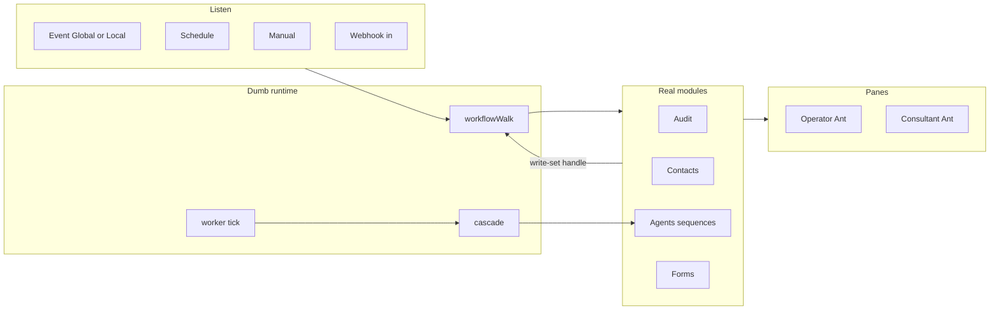
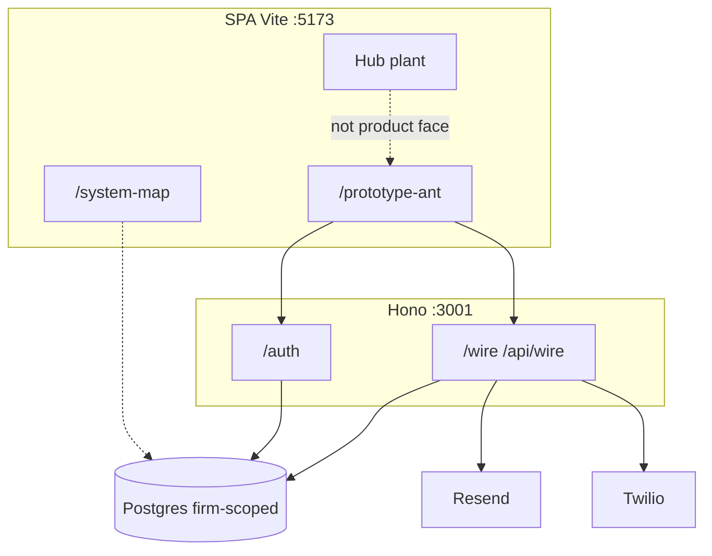
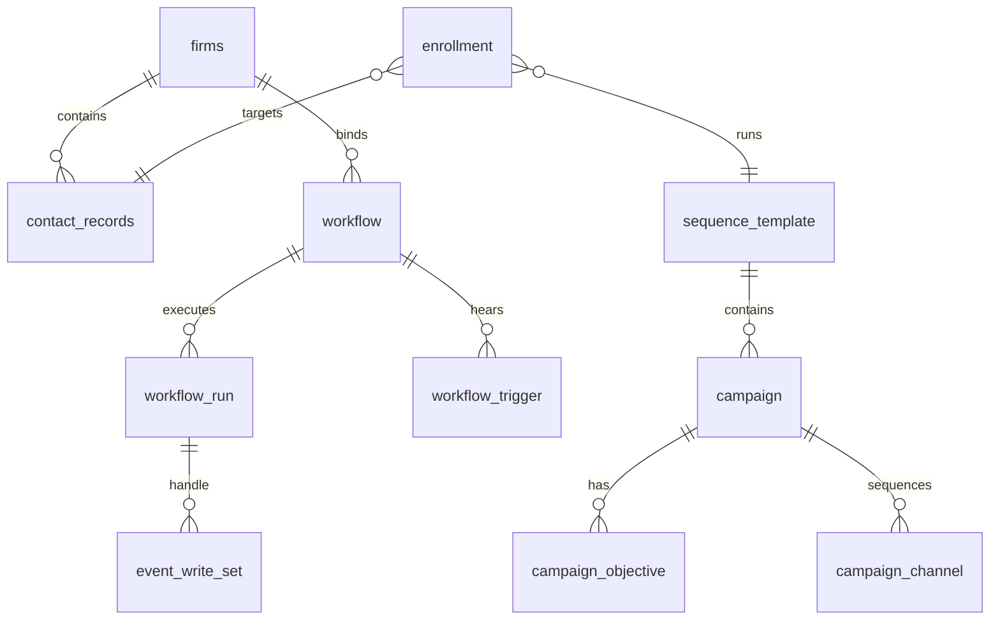

# Architecture Spine — Tower

## Design Paradigm

**Tables + a dumb runtime.** Anything that should be modifiable is a table (kinds: **state | rule | sequence**). UI is only a **control** (injects a change into an existing state) or a **pane** (displays an existing state). Independently built modules share Postgres rows and a small set of runtimes (`cascade.ts`, `worker.ts`, `workflowWalk.ts`) — they do not each invent a side ledger.

**Event listen → module execution → write-set handle.** Automations does not pipe shadow copies. An action sends work to the real module; the next node picks from **every write that run made** (`previousWrites` / `chainWrites`). Completion writes are events; other graphs subscribe (Global/Local). Do not mint an events table that copies the write.

**Agency pack bind.** House authors libraries; tenancy binds; consultant inhabits. Dual enroll: Automations (on event) and Agents (mission now).



## Invariants & Rules

### AD-1 — Table-first modularity [ADOPTED]

- **Binds:** all operator-authored behavior
- **Prevents:** frozen-in-prose that should vary; SPA-invented stores; tables minted from pictures
- **Rule:** If it must change without a deploy, it is a table (or a field/JSONB key on an existing table). Missing store is an SA ascribe, not a client catalog. Captions are not nodes.

### AD-2 — Presentation ≠ fulfillment [ADOPTED]

- **Binds:** conversational “agent” surfaces, Approach walk
- **Prevents:** chat/voice that scrapes, instantiates templates, persists captures, fires sequences, evaluates rules, issues OTP, or moves money
- **Rule:** Those jobs belong to Automations / Wiring / auth. Presentation asks, explains, routes.

### AD-3 — Product face vs plant [ADOPTED]

- **Binds:** all UI implementation
- **Prevents:** Hub-as-app; Register-as-firm-module; planting Hub chrome
- **Rule:** Ship and smoke `/prototype-ant`. Hub is reference plant. Register is prototype-time house tooling only.

### AD-4 — Data in tables / empty real [ADOPTED]

- **Binds:** every module pane
- **Prevents:** demo scenery; hard-coded React rows; painted empty-states that pretend people exist
- **Rule:** Desk shows the query. Seed Postgres (`supabase/seeds/`) with a reasonable count when a table is minted. Key consultant records by `contact_records.id`.

### AD-5 — Walk is one machine [ADOPTED]

- **Binds:** Automations execution
- **Prevents:** a second walker; recutting 015
- **Rule:** `server/wire-service/workflowWalk.ts` is the live walk. Handle = last-node `previousWrites`. Unknown node types must not silently invent semantics (Wait is additive kind, not `action.type`).

### AD-6 — Write-set is the shape [ADOPTED]

- **Binds:** If/Switch, mapped boxes, subsequent actions
- **Prevents:** hard-coded field catalogs in the client for “last output”
- **Rule:** Next step picks from writes that run made. Completions are events (the write **is** the event). Do not mint an events table that copies the write.

### AD-7 — Dual entry, two doors [ADOPTED]

- **Binds:** Agents enroll vs Automations assign
- **Prevents:** collapsing “start mission now” with “on event”; putting Automations triggers on the Agents canvas
- **Rule:** `call_agent` and Agent-native enroll both exist. Automations does not author new agents (assign existing or from template).

### AD-8 — One client, one motion [ADOPTED]

- **Binds:** actuation / Engine 2
- **Prevents:** parallel nudge + reactivation outreach
- **Rule:** Reactivation first if worthy; else one nudge consolidating self-reportable needs. Other signals ride the meeting brief.

### AD-9 — Send gates [ADOPTED]

- **Binds:** `dispatchSend.ts` and all outbound
- **Prevents:** send despite halt/consent/silence; treating stand-in ports as live fulfillment
- **Rule:** Live send only through dispatch gates. Meta/escrow/enrich remain stand-in until Story+plan say otherwise. `SEND_MODE` default live does not override missing secrets.

### AD-10 — Tenancy isolation [ADOPTED]

- **Binds:** all Postgres machine rows and sessions
- **Prevents:** demo-tenant default; cross-firm leakage in consultant panes
- **Rule:** `firm_id` scopes data. No implicit demo firm in `VITE_DEV_FIRM_ID`. House-global surfaces are the only cross-firm views.

### AD-11 — Objective met is Local event housing [ADOPTED from SA 022; Story wording still named]

- **Binds:** 15:43 goal-as-escalation
- **Prevents:** a `goal` table; destination column for “other agent / other workflow / end”
- **Rule:** Completion write is the event; instance axis on that row; escalation is subscription to `objective_met`. Do not recut 015 to smuggle this.

### AD-12 — Click node = configure; Switch-kind ≠ Switch node [ADOPTED]

- **Binds:** Ant canvases
- **Prevents:** mixing A26 kind-switch with If/Switch
- **Rule:** Implementer follows packets; do not reuse the word Switch for both.

## Consistency Conventions

| Concern | Convention |
|---------|------------|
| Naming | Glossary terms from PRD (sequence ⊃ campaigns; channel ≠ objective; Global/Local ≠ Settings) |
| IDs | UUID primary keys; contacts are `contact_records.id` not seed slugs |
| Dates | timestamptz in SQL; ISO in JSON payloads |
| Errors | Wire/auth HTTP via Hono; do not invent a second envelope in the SPA |
| State mutation | Tables + walker/worker/cascade; UI writes through wire |
| Auth | OTP + sessions + access_links; `VITE_AUTH_DISABLED` is a local gate skip, not product law |
| Config | `VITE_WIRE_REAL` default true; stand-ins when false or deferred ports |
| Events | Named catalog in PRIMITIVES; not any-row-changed |
| Packs | House-authored; `firm_sequence_binding` / bind surfaces apply per tenancy |
| Tests | No unit-test runner in repo law; verify scripts + manual `/prototype-ant` smoke |

## Stack

Brownfield seed — versions from `package.json` at SHA `c5bd617`. Code owns drift after this.

| Name | Version |
|------|---------|
| React | 18.3.1 |
| react-router | 7.17.0 |
| Vite | 6.4.3 |
| TypeScript (dev) | ^7.0.2 (repo: TS is not a `tsc` gate; AGENTS.md: no tsc) |
| Tailwind CSS | 4.1.12 |
| Ant Design | ^6.5.3 |
| @xyflow/react | ^12.11.0 |
| Hono + @hono/node-server | ^4.7.10 / ^1.14.4 |
| pg | ^8.14.1 |
| Resend | ^4.5.1 |
| Twilio | ^5.13.1 |
| Postgres | Supabase (session-pooler 5432; `$` in password URL-encoded) |

Named tech verified against the lockfile-equivalent (`package.json` pins) this run; no web “current starter” swap — brownfield.

## Structural Seed

```text
/workspace
  src/app/                 # SPA — desks, system-map, wire client
    prototype-ant*         # product face entry (vite prototype-ant-mpa)
    wire/                  # ports, registry, reals vs standins, machineTypes
  server/auth-service/     # OTP, sessions, access redeem
  server/wire-service/     # routes, cascade, worker, workflowWalk, dispatchSend
  supabase/migrations/     # stood-up truth (001–024 on this SHA)
  supabase/seeds/          # reasonable row counts; never SPA fakes
  docs/register/           # product/machine law (FACE, Story, packets)
```



Core entities (names + relationships only):



Column detail lives in SQL. Do not maintain an attribute mirror here.

## Capability → Architecture Map

| Capability / Area | Lives in | Governed by |
|-------------------|----------|-------------|
| ALG capture / Approach | stand-in Meta port; acquisition docs | AD-2, AD-9, FR-1 |
| Forward-deploy | `prepared_workspaces` / primary store | AD-2, FR-2 |
| Auth / access | `server/auth-service`, `001`, `008` | AD-10, FR-5 |
| Book / import / audit | contact tables, import, reachability | AD-4, FR-8–9 |
| Consent / send | halt/consent, `dispatchSend` | AD-9, FR-10, FR-31 |
| Agents authorship | `sequence_template` + campaign housing `010+` | AD-1, AD-7, FR-15–22 |
| Automations walk | `workflowWalk.ts`, trigger `006`, test contract `017` | AD-5, AD-6, FR-23–30 |
| Objective met | `021_objective_local_axis.sql` (SHA) | AD-11 |
| Wait occupancy | `024_wait_occupancy.sql` (SHA) | AD-5 additive kind |
| Eligibility / reference | rule_* , reference tables, evaluation packs | AD-1, FR-11–14 |
| Meetings | `007_meeting_booked.sql` | FR-32 |
| Operator panes / bind | `023_operator_panes.sql`, bind surfaces | AD-3, FR-33–35 |
| Honesty | seeds + query panes | AD-4, FR-37 |

## Deferred

- Meta ads provider topology and CAC instrumentation (stand-in; Story still requires the capability).
- Escrow money-movement provider (stand-in; contingent-cost is posture).
- Enrich crawl / Postmaster / warmup / list-unsubscribe ingress.
- Queryable lineage **module** (minimum queryable; no table from the sentence).
- WCAG/SLA/on-call envelope (not in Seed) — operational altitude not owned here.
- Form-as-own-node vs embedded (product lean embedded; not an architecture fork until locked).
- Story §7 wording promotion (mechanism AD-11; prose promotion is SA/founder).
- Greenfield starter swap (brownfield: do not re-platform).

## Open questions (architecture)

- Docs/README remap vs SQL filenames after 018 — builders must quote migrations, not the frozen remap.
- Whether Wait graph type in the walker matches `024` occupancy SQL on this SHA (packet 028 on #86 vs code).
- Multi-consultant roles inside a firm (World open).
